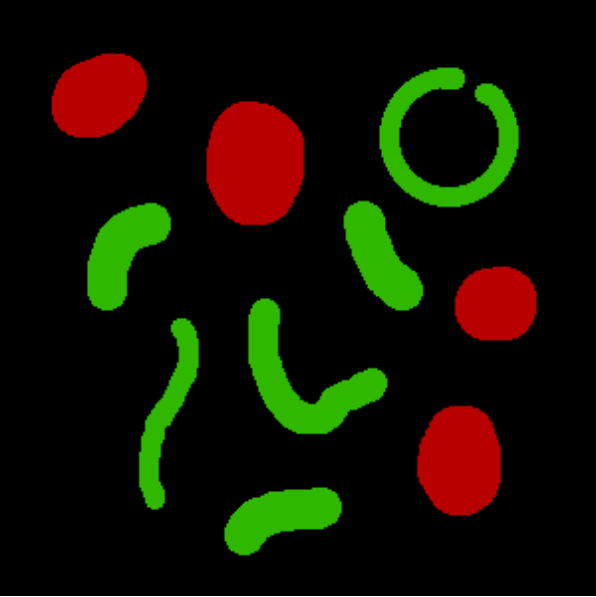
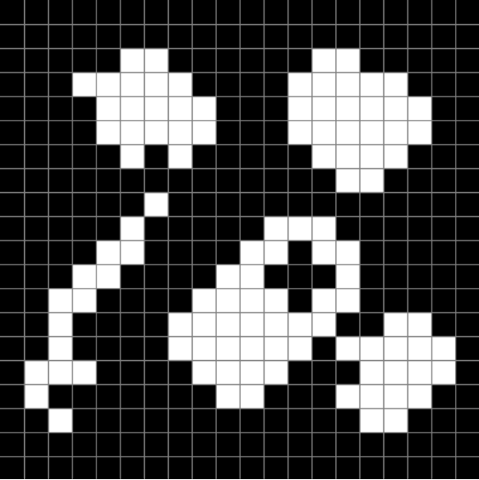
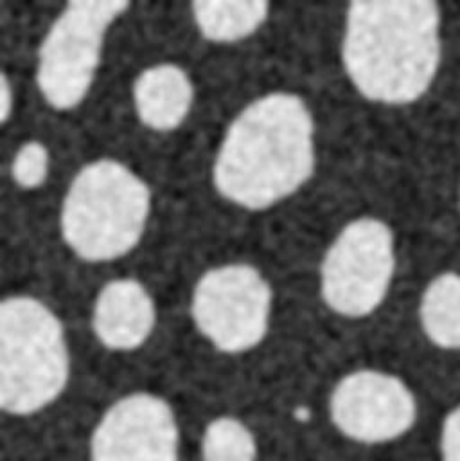
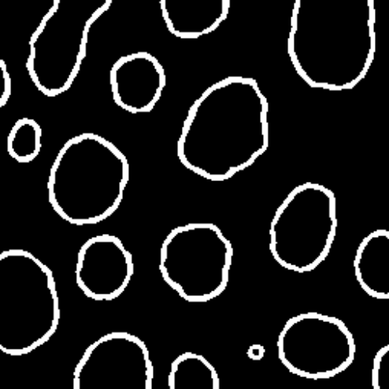
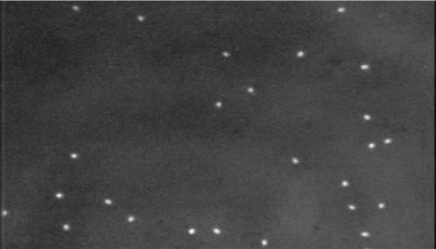

# COMP9517 Computer Vision - Example Exam Questions + Answers

> Source: `COMP9517_Example_Exam_Questions_Answers(1).pdf`  
> Format: editable Markdown. Images required by visual questions are extracted into the `images/` folder and linked below.

## Exam instructions

1. Time allowed: 2 hours, plus 15 minutes.
2. This exam consists of 50 multiple-choice questions, each worth 1 mark.
3. Total marks available: 50 marks, worth 50% of the total marks for the course.
4. Students have been reminded of the UNSW rules regarding Academic Integrity and Plagiarism, and the fit to sit policy, before starting the exam.
5. Your work will be saved periodically throughout the exam and will be submitted when the test ends provided you are connected to the internet. If you are not connected to the internet at the conclusion of the exam, please ask a supervisor to save your submission.
6. You must complete all your work within the exam time. No late submissions will be accepted.
7. Students will be provided with the following during their exam: 1 piece of scrap paper.

---

## Questions

### Question 1 - Colour spaces

**Question:** Which one of the following statements about colour spaces is incorrect?

A. The R, G, and B channels of the RGB colour space are often correlated.  
B. The H and the S channel of the HSV colour space are confounded.  
C. The Y channel of the YCbCr colour space represents the brightness.  
D. The a* channel of the L*a*b* colour space is the green-blue component.

**Answer:** D

---

### Question 2 - Intensity transformations

**Question:** Which one of the following statements about intensity transformations is incorrect?

A. Contrast stretching linearly maps intensities between two values to the full output range.  
B. Log transformation maps a narrow range of high intensities to a wider range of output values.  
C. Power transformation can map intensities similar to log and inverse log transformations.  
D. Piecewise linear transformations can achieve contrast stretching and intensity slicing.

**Answer:** B

---

### Question 3 - 2D convolution kernel

**Question:** What is the effect of the following 2D convolution kernel on an image?

```text
0   1   0
1  -4   1
0   1   0
```

A. It approximates the sum of first-order derivatives in x and y.  
B. It approximates the sum of second-order derivatives in x and y.  
C. It approximates the product of first-order derivatives in x and y.  
D. It approximates the product of second-order derivatives in x and y.

**Answer:** B

---

### Question 4 - Image filtering

**Question:** Which one of the following statements on image filtering is incorrect?

A. Median filtering reduces noise in images.  
B. Low-pass filtering results in blurry images.  
C. High-pass filtering smooths fine details in images.  
D. Notch filtering removes specific image frequencies.

**Answer:** C

---

### Question 5 - Feature descriptors

**Question:** Which one of the following statements about feature descriptors is incorrect?

A. Haralick features are derived from gray-level co-occurrence matrices.  
B. SIFT achieves rotation invariance by computing gradient histograms at multiple scales.  
C. LBP describes local image texture and can be multiresolution and rotation-invariant.  
D. Colour moments have lower representation capability than the colour histogram.

**Answer:** B

---

### Question 6 - Shape measures for classification

**Question:** Given the image below showing the result of a segmentation of various objects and the desired classification of these objects. The two different colours, red and green, indicate the two different classes which the objects are to be assigned to.

A straightforward way to perform classification is by computing the value of a quantitative shape measure for each object and then thresholding those values. Suppose we compute the circularity and the eccentricity. Which of these two measures can be used to produce the shown classification?



A. Only circularity  
B. Only eccentricity  
C. Both circularity and eccentricity  
D. Neither circularity nor eccentricity

**Answer:** A

---

### Question 7 - Random forest classifiers

**Question:** Which one of the following statements is correct for random forest classifiers?

A. Increasing the correlation between the individual trees decreases the random forest classification error rate.  
B. Reducing the number of selected features at each node increases the correlation between the individual trees.  
C. Reducing the number of selected features at each node increases the strength of the individual trees.  
D. Increasing the strength of the individual trees decreases the random forest classification error rate.

**Answer:** D

---

### Question 8 - Pattern recognition

**Question:** Which one of the following statements is correct for pattern recognition?

A. Pattern recognition requires training data that contain ground truth labels.  
B. The dimension of feature vectors should be smaller than the number of training samples in order to avoid the overfitting problem.  
C. The simple kNN classifier needs homogeneous feature types and scales so that the classification performance can be better.  
D. SVM is a powerful classifier that can separate classes even when the feature space exhibits significant overlaps between classes.

**Answer:** C

---

### Question 9 - Connected components labelling

**Question:** Given the following binary image after segmentation.

To automatically identify the objects, in white, in this image we can use the connected components labelling algorithm. How many separate objects will this algorithm find here if it uses 4-connectivity?



A. 4  
B. 5  
C. 6  
D. 7

**Answer:** D

---

### Question 10 - Reconstruction from boundary pixels

**Question:** Given a binary input image I to which we apply the following algorithm:

1. Create a copy C of input image I.
2. Copy the boundary pixels of C into new image B.
3. Compute the reconstruction R of C from B.
4. Compute output O by subtracting R from I.

What does the output image O contain?

A. The same objects as the input image whatever the input.  
B. The same objects as the input image but with holes filled.  
C. The same objects as the input image except the boundary objects.  
D. The same objects as the input image but with touching objects separated.

**Answer:** C

---

### Question 11 - Convolutional layers in CNNs

**Question:** Which one of the following lines describes the purpose of convolutional layers in CNNs?

A. Reducing the size of the feature maps.  
B. Calculating the dot product of the input and kernels.  
C. Applying a nonlinear activation function.  
D. Making the network learn faster.

**Answer:** B

---

### Question 12 - Transfer learning

**Question:** Which one of the following lines describes the purpose of transfer learning?

A. Training a model from scratch for each new task.  
B. Using a pretrained model and fine-tuning it for a new task.  
C. Converting image data to text data to facilitate learning.  
D. Combining multiple models into a single model for better performance.

**Answer:** B

---

### Question 13 - CNNs vs traditional ANNs

**Question:** Which one of the following lines best describes the key benefit of CNNs over traditional ANNs for image classification?

A. CNNs are computationally less expensive.  
B. CNNs automatically learn hierarchical features.  
C. CNNs require fewer network layers.  
D. CNNs can learn nonlinear mappings.

**Answer:** B

---

### Question 14 - Image segmentation networks

**Question:** Which one of the following networks is most suited for image segmentation tasks?

A. Multilayer perceptron, MLP  
B. Fully convolutional network, FCN  
C. Region proposal network, RPN  
D. Recurrent neural network, RNN

**Answer:** B

---

### Question 15 - Motion analysis

**Question:** Which one of the following statements about motion analysis is incorrect?

A. Detection of moving objects by subtraction of successive images in a video works best if the background is constant.  
B. Sparse motion estimation in a video can be done by template matching and minimising the mutual information measure.  
C. Dense motion estimation using optical flow assumes that each small neighbourhood remains constant over time.  
D. Optical flow provides an equation for each pixel but requires further constraints to solve the equation uniquely.

**Answer:** B

---

### Question 16 - Object tracking

**Question:** Which one of the following statements about object tracking is incorrect?

A. The particle filtering method assumes that the dynamics model and the measurement model can be parameterized.  
B. The hidden Markov model assumes that the measurements depend only on the current state of the objects.  
C. The prediction step of Bayesian inference assumes that the current state of the objects depends only on the previous state.  
D. The Kalman filtering method assumes that the dynamics and measurement noise are additive Gaussian.

**Answer:** A

---

### Question 17 - Boundary expansion and Fourier transform

**Question:** In many image processing operations, the image must be expanded a little bit to solve the boundary problem. Which one of the following types of expansion is implicitly used by the Fourier transform?

A. Padding  
B. Clamping  
C. Wrapping  
D. Mirroring

**Answer:** C

---

### Question 18 - Morphological edge extraction

**Question:** Suppose we have the following grayscale input image I, shown on the left, and we would like to have a binary output image O, shown on the right, containing the edges of the objects in the input.





Also suppose that the only image processing operations available for this are intensity thresholding, dilation and erosion, binary and grayscale, and image subtraction. Which one of the following algorithms will **not** produce the desired output?

A. Thresholding, result = T, then erosion, result = E, then subtraction, result = E - T.  
B. Erosion, result = E, then subtraction, result = I - E, then thresholding, result = T.  
C. Thresholding, result = T, then dilation, result = D, then subtraction, result = D - T.  
D. Dilation, result = D, then subtraction, result = D - I, then thresholding, result = T.

**Answer:** A

---

### Question 19 - Automatic thresholding

**Question:** Given the image below containing about two dozen algae, the bright spots, which we would like to segment using an automatic thresholding method. Which one of the following automatic thresholding methods will give the best segmentation result here?



A. Mean thresholding  
B. IsoData thresholding  
C. Otsu thresholding  
D. Triangle thresholding

**Answer:** D

---

### Question 20 - Data augmentation for CNN image classification

**Question:** Which one of the following statements about data augmentation for image classification using CNNs is correct?

A. Augmentation increases the number of parameters in the model.  
B. Augmentation reduces the size of the dataset to speed up training.  
C. Augmentation generates new training data by transforming the existing data.  
D. Augmentation reduces the depth of the network for better performance.

**Answer:** C

---

## Answer key

| Question | Answer |
|---:|:---:|
| 1 | D |
| 2 | B |
| 3 | B |
| 4 | C |
| 5 | B |
| 6 | A |
| 7 | D |
| 8 | C |
| 9 | D |
| 10 | C |
| 11 | B |
| 12 | B |
| 13 | B |
| 14 | B |
| 15 | B |
| 16 | A |
| 17 | C |
| 18 | A |
| 19 | D |
| 20 | C |
