# COMP9517 Final Question Bank - Editable Markdown

> Source PDF: `comp9517final.pdf`  

> This PDF is scanned/image-based. The text below was produced by OCR and may contain minor recognition errors. Each original page image is included for checking and for any handwritten notes/figures.

## Contents

- [Page 1: Features](#page-1)
- [Page 2: e D. Edge features](#page-2)
- [Page 3: different scales? PB](#page-3)
- [Page 4: © C. To enhance image contrast](#page-4)
- [Page 5: How are keypoint descriptors generated in the SIFT algorithm? B](#page-5)
- [Page 6: e Answer: B](#page-6)
- [Page 7: e Answer: A](#page-7)
- [Page 8: * A. By edge detection](#page-8)
- [Page 9: Which descriptor is suitable for analyzing elliptical #41 shapes? D](#page-9)
- [Page 10: * B. Color information of the object](#page-10)
- [Page 11: What is the function of the radial distance descriptor? R](#page-11)
- [Page 12: (CPUPSEBER=)-COMP9517-Final-2_EN by CPU EDU-Plum](#page-12)
- [Page 13: © D. Edge features of the image](#page-13)
- [Page 14: ML](#page-14)
- [Page 15: © A. Easy and quick](#page-15)
- [Page 16: * B. Minimize conditional risk](#page-16)
- [Page 17: * D. The standard deviation of the data](#page-17)
- [Page 18: ¢ A. The error rate of the Random Forest increases](#page-18)
- [Page 19: © C, By maximizing information gain](#page-19)
- [Page 20: © Answer: A](#page-20)
- [Page 21: . Wh nearest neighbors (KNN)](#page-21)
- [Page 22: 5X5 : BAS: XS72S- _](#page-22)
- [Page 23: [Horny -2¢e](#page-23)

---

## Page 1

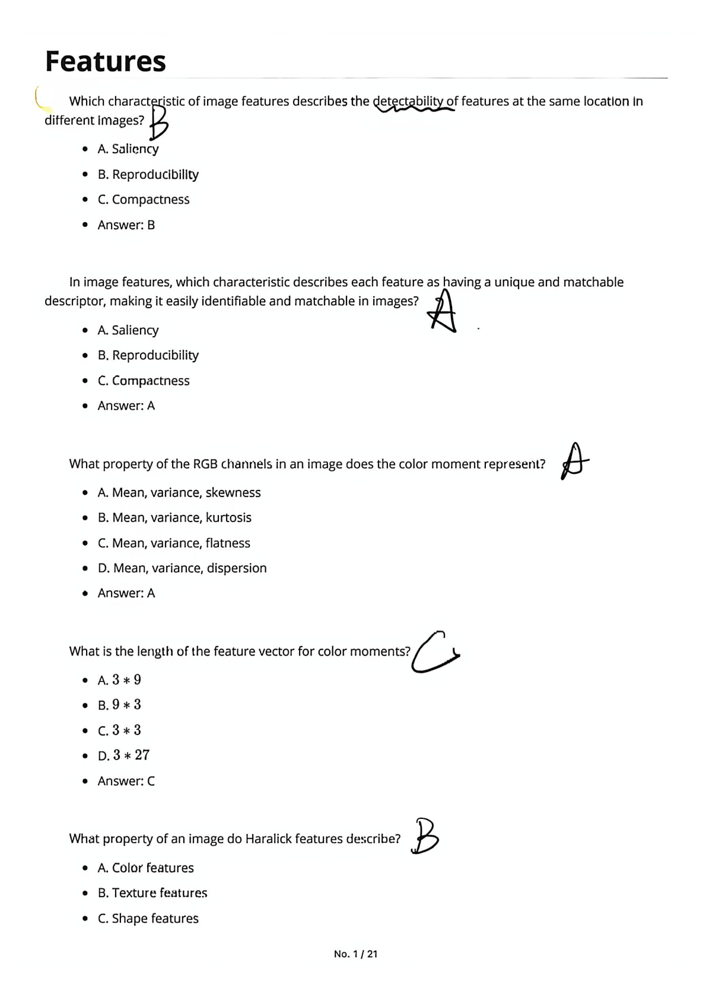

### Editable OCR text

```text
Features
( Which characteristic of image features describes the detectability of features at the same locatlon In
different Images? B
° A. Saliency
e B. Reproducibility
© C. Compactness
© Answer: B
In image features, which characteristic describes each feature as having a unique and matchable
descriptor, making it easily identifiable and matchable in images? 4
e A. Saliency :
¢ B, Reproducibility
© C. Compactness
e Answer: A
What property of the RGB channels in an image does the color moment represent? ft
e A. Mean, variance, skewness
e B. Mean, variance, kurtosis
e C. Mean, variance, flatness
e D. Mean, variance, dispersion
e Answer: A
What is the length of the feature vector for color maments
2 A3#9
© B.9*3
¢ C.3%3
© D.3* 27
e Answer: C
What property of an image do Haralick features describe? PR
¢ A. Color features
e B. Texture features
© C. Shape features
No.1/21
```

---

## Page 2


### Editable OCR text

```text
e D. Edge features
e Answer: B
What does the gray level co-occurrence matrix record for two pixel values with a specific spatial
relationship in an maser P
e A. Frequency and angle
¢ B. Distance and angle
¢ C. Skewness and kurtosis
e D. Mean and dispersion
e Answer: B
What invariances does the local binary pattern (LBP) possess
e A. Rotational invariance
¢ B. Gray-scale invariance
. \otational and gray-scale invariance
¢ D. Scale invariance
e Answer: C
Hie In local binary pattern (LBP), what is the value assigned if the neighboring pixel value is greater than the
center pixel value?
eA
e B.O
e C255
e D.-1
e Answer: A
Which feature is least affected when illumination changes cause uniform increase or decrease in image
gray levels? BOD
¢ A. Haralick features
¢ B. Local binary pattern (LBP)
e C. Color histogram
¢ D. Color moments
¢ Answer: BCD
No. 2/21
```

---

## Page 3

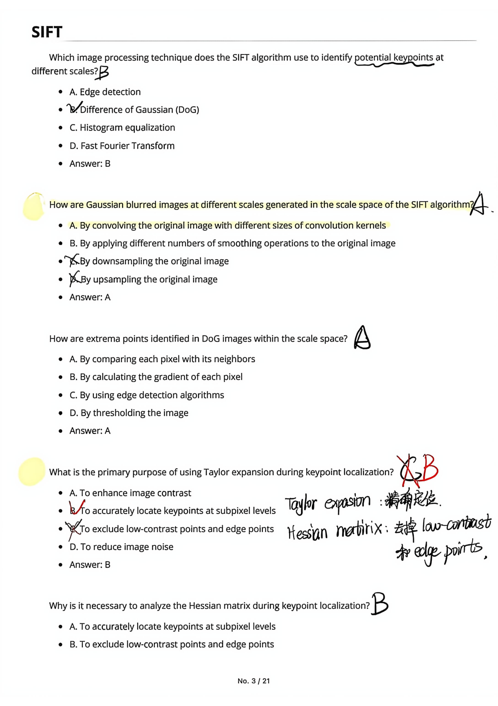

### Editable OCR text

```text
Which image processing technique does the SIFT algorithm use to identify potential keypoints at
different scales? PB
¢ A. Edge detection
° “w/bifference of Gaussian (DoG)
© C. Histogram equalization
¢ D. Fast Fourier Transform
e Answer: B
How are Gaussian blurred images at different scales generated in the scale space of the SIFT aigorthraL |
e A. By convolving the original image with different sizes of convolution kernels
¢ B. By applying different numbers of smoothing operations to the original image
o Kby downsampling the original image
e Poy upsampling the original image
© Answer: A
How are extrema points identified in DoG images within the scale space? A
© A. By comparing each pixel with its neighbors
eB. By calculating the gradient of each pixel
¢ C. By using edge detection algorithms
e D. By thresholding the image
e Answer: A
What is the primary purpose of using Taylor expansion during keypoint localization? ee)
¢ A.To enhance image contrast \ PRICE
° Ao accurately locate keypoints at subpixel levels Taylor cA . ,
te
° ‘Kro exclude low-contrast points and edge points Hessian mominix 3 ae low-conbash
¢ D.To reduce image noise 7
se Op, pov ,
° Answer: B
Why is it necessary to analyze the Hessian matrix during keypoint localization? P
e A.To accurately locate keypoints at subpixel levels
¢ B. To exclude low-contrast points and edge points
No. 3/21
```

---

## Page 4

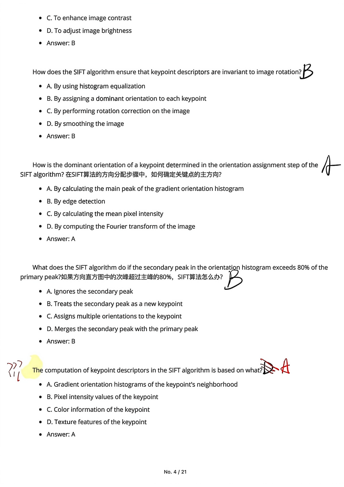

### Editable OCR text

```text
© C. To enhance image contrast
© D.To adjust image brightness
¢ Answer: B

How does the SIFT algorithm ensure that keypoint descriptors are invariant to image rotation?
¢ A. By using histogram equalization
¢ B. By assigning a dominant orientation to each keypoint
e C. By performing rotation correction on the image
¢ D. By smoothing the image
e Answer: B

How is the dominant orientation of a keypoint determined in the orientation assignment step of the IK

SIFT algorithm? ZESIFTEGANW AM DACA IA, RARER RAYE Tal?

e A. By calculating the main peak of the gradient orientation histogram
e B. By edge detection
¢ C. By calculating the mean pixel intensity
¢ D. By computing the Fourier transform of the image
e Answer: A

What does the SIFT algorithm do if the secondary peak in the orientation histogram exceeds 80% of the

primary peak?IRAM EBA A PAY RUBS S IeAI80%, SIFTHUREAD? B
° A. lgnores the secondary peak
e B. Treats the secondary peak as a new keypoint
© C. Assigns multiple orientations to the keypoint
e D. Merges the secondary peak with the primary peak
e Answer: B
0? The computation of keypoint descriptors in the SIFT algorithm is based on wnat dt
l e A. Gradient orientation histograms of the keypoint's neighborhood
e B. Pixel intensity values of the keypoint
© C. Color information of the keypoint
e D. Texture features of the keypoint
e Answer: A
No. 4/21
```

---

## Page 5

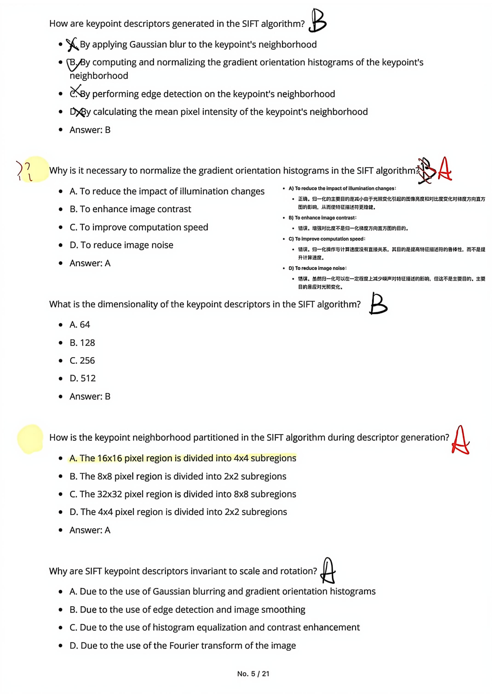

### Editable OCR text

```text
How are keypoint descriptors generated in the SIFT algorithm? B
° SCsy applying Gaussian blur to the keypoint's neighborhood
. Cy computing and normalizing the gradient orientation histograms of the keypoint's
neighborhood
e eXey performing edge detection on the keypoint's neighborhood
© D®y calculating the mean pixel intensity of the keypoint's neighborhood
e Answer: B
2 iY Why is it necessary to normalize the gradient orientation histograms in the SIFT agora [L
¢ A.To reduce the impact of illumination changes —* *) reduce the impact of llumination changes:
+ EA, B-KHERANRANAFAMRC HORACE BLA
¢ B. To enhance image contrast Da LD
+ 8) To onhance image contrast:
¢ C.To improve computation speed + MR, NITRATE.
, . ‘+ C) ToImprove computation speed:
¢ D.To reduce image noise + HR. BAC Sit ARERR, FRITTERS, MTB
withee.
: Answer: A '* 0) To reduce image noise:
+ OR, MAAACINE-EARLAOMAT NERO, ORTREMA,
BARRA KNRH.
What is the dimensionality of the keypoint descriptors in the SIFT algorithm? B
e A.64
e B.128
e C.256
e D.512
e Answer: B
How is the keypoint neighborhood partitioned in the SIFT algorithm during descriptor generation? A
e A. The 16x16 pixel region is divided into 4x4 subregions
¢ B. The 8x8 pixel region is divided into 2x2 subregions
© C. The 32x32 pixel region is divided into 8x8 subregions
© D. The 4x4 pixel region is divided into 2x2 subregions
e Answer: A
Why are SIFT keypoint descriptors invariant to scale and rotation? &
e A. Due to the use of Gaussian blurring and gradient orientation histograms
¢ B. Due to the use of edge detection and image smoothing
© C. Due to the use of histogram equalization and contrast enhancement
© D. Due to the use of the Fourier transform of the image
No. 5/21
```

---

## Page 6


### Editable OCR text

```text
e Answer: B
BoW | a =
What is the main purpose of the Bag-of-Words (BoW) method in feature encoding? A
e A. Transform images into fixed-dimension histograms
© B. Improve image resolution
© C, Enhance image contrast
e D. Optimize image registration
e Answer: A
What is the first step in the Bag-of-Words (BoW) method? f
e A. Extract local feature descriptors
¢ B. Create a visual vocabulary
¢ C. Generate image histograms
* D. Smooth the image
e Answer: A
Which method is commonly used for clustering when creating a visual vocabulary? BR
¢ A. Gaussian filtering
e B.K-means clustering
* C. Edge detection
¢ D. Color segmentation
© Answer: B
What do "visual words" represent in the BoW model? C
¢ A. Color information of the image
¢ B. Edge information of the image
¢ C. Cluster centers of local image features
¢ D. Brightness information of the image
¢ Answer: C
When generating onlreueFstogren) what does each bin in the histogram represent? '\ C
¢ A. Intensity variation of the image .
¢ B. Color variation of the image
© C. Frequency of visual words in the image
e Answer: C
No. 7/21
```

---

## Page 7

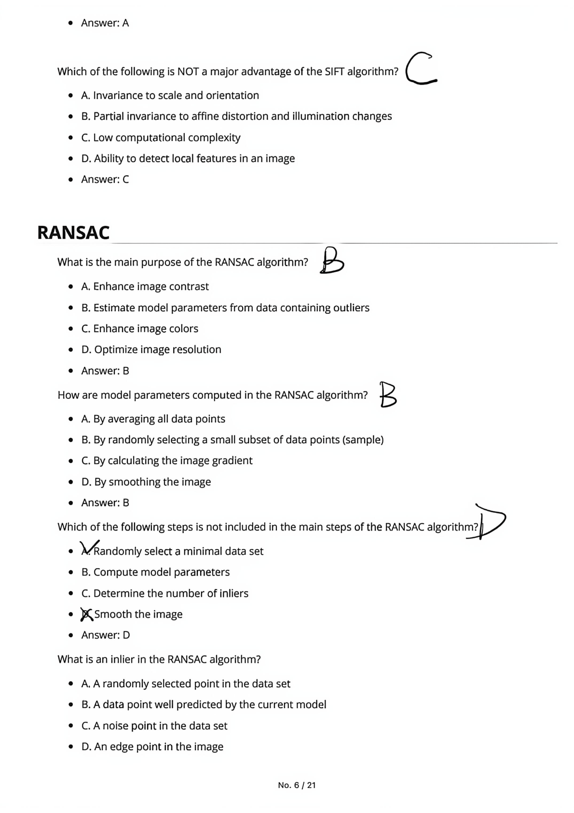

### Editable OCR text

```text
e Answer: A

Which of the following is NOT a major advantage of the SIFT algorithm? (—
¢ A. Invariance to scale and orientation
¢ B. Partial invariance to affine distortion and illumination changes
e C. Low computational complexity
¢ D. Ability to detect local features in an image
e Answer: C

RANSAC

What is the main purpose of the RANSAC algorithm? B
e A, Enhance image contrast
¢ B. Estimate model parameters from data containing outliers
© C. Enhance image colors
e D. Optimize image resolution
¢ Answer: B

How are model parameters computed in the RANSAC algorithm? RB
° A. By averaging all data points
e B. Byrandomly selecting a small subset of data points (sample)
e C. By calculating the image gradient
¢ D. By smoothing the image
e Answer: B

Which of the following steps is not included in the main steps of the RANSAC seta] 7
. randomly select a minimal data set
¢ B. Compute model parameters
¢ C. Determine the number of inliers
° smooth the image
e Answer: D

What is an inlier in the RANSAC algorithm?
¢ A.Arandomly selected point in the data set
e B.A data point well predicted by the current model
¢ C.Anoise point in the data set
e D.An edge point in the image

No. 6/21
```

---

## Page 8

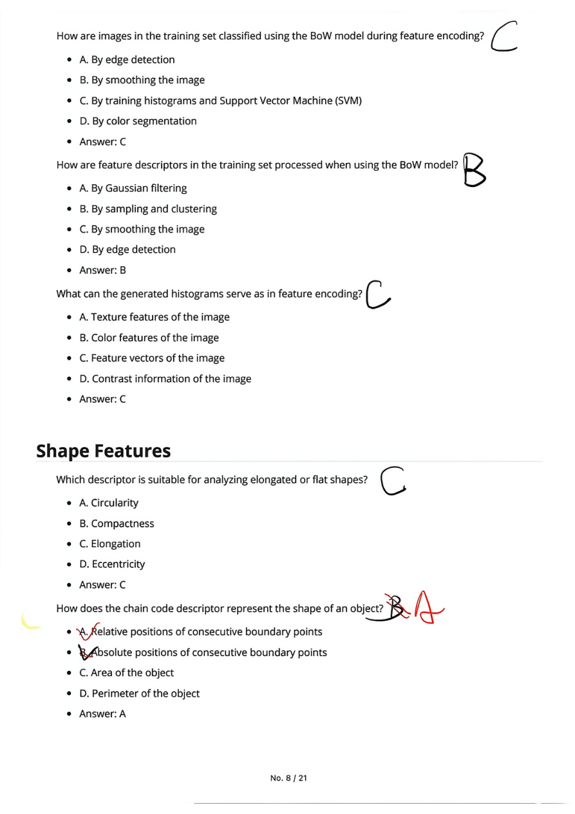

### Editable OCR text

```text
How are images in the training set classified using the BoW model during feature encoding? C
* A. By edge detection
* B. By smoothing the image
* C. By training histograms and Support Vector Machine (SVM)
* D. By color segmentation
© Answer: C

How are feature descriptors in the training set processed when using the BoW model? B
* A. By Gaussian filtering
© B. By sampling and clustering
* C. By smoothing the image
* D. By edge detection
© Answer: B

What can the generated histograms serve as in feature encoding? C
« A Texture features of the image
© B. Color features of the image
* C. Feature vectors of the image
* D. Contrast information of the image
© Answer: C

Shape Features

Which descriptor is suitable for analyzing elongated or flat shapes? C
© A.Circularity
* B.Compactness
 C.Elongation
 D. Eccentricity
Answer: C

How does the chain code descriptor represent the shape of an objece Be h-
+ \4 Aelative positions of consecutive boundary points
+ Q Absolute positions of consecutive boundary points
© C. Area of the object
* D. Perimeter of the object
© Answer: A

No. 8/21
```

---

## Page 9


### Editable OCR text

```text
Which descriptor is suitable for analyzing elliptical #41 shapes? D
* A Circularity
© B. Compactness
© C, Elongation
© D. Eccentricity
© Answer: D

Chain Code

What is the main function of the chain code descriptor? B
* A Represent the color of the object
* B. Represent the shape of the object
© C. Represent the texture of the object
‘*  D. Represent the size of the object
© Answer: B

How does the chain code descriptor represent the shape of an avec J2,
‘* A Absolute positions of consecutive boundary points
* B, Relative positions of consecutive boundary points
* C. Area of the object
* D. Perimeter of the object
© Answer: B

Local Curvature

In local curvature descriptors, what do the positive and negative values of curvature indicate? pB
* A. Positive indicates concave, negative indicates convex
* B. Positive indicates convex, negative indicates concave
* C. Positive indicates flat, negative indicates convex
* D. Positive indicates convex, negative indicates flat
* Answer: B

What do local curvature descriptors represen
* A. Global shape properties of the object

No. 9/21
```

---

## Page 10


### Editable OCR text

```text
* B. Color information of the object
* C. Local shape properties of the object
* D. Texture features of the object
© Answer: C

In local curvature descriptors, what do the positive and negative values of curvature naoe
* A. Positive indicates concave, negative indicates convex
* B. Positive indicates convex, negative indicates concave
* C. Positive indicates flat, negative indicates undulating
* D. Positive indicates undulating, negative indicates flat
« Answer: B

Global Curvature

What does total bending energy represent? C
* A. The total absolute curvature of the object's contour
 B. The total relative curvature of the object's contour
* C. The physical energy stored in the object's contour
© D. The area of the object
© Answer: C

What is total absolute curvature? A
¢ A. The integral of the absolute value of curvature along the object’s contour
* B. The integral of the relative value of curvature along the object’s contour
* C. The perimeter of the object
© D. The area of the object
* Answer: A

What is the minimum value of total absolute curvature for convex objects? B
oAr
© Br
ocd
© D.4r
© Answer: B

No. 10/21
```

---

## Page 11


### Editable OCR text

```text
What is the function of the radial distance descriptor? R
* A Measure the distance from the centroid of the shape to the boundary points
© B. Determine the curvature at various points along the shape's edge
* C. Compute the total length of the shape’s perimeter
* D. Calculate the area enclosed by the shape
Answer: A
What is the first step in shape matching? B
* A.Calculate the shape context
 B, Sample points on the shape boundary
* C. Calculate the cost matrix
© D. Perform one-to-one matching
© Answer: B
What does the shape context represent? C
* A. Color information of each point
* B. Texture information of each point
* C. Relative position distribution of each point
« D. Absolute position distribution of each point
Answer: C
What is the purpose of one-to-one matching in shape matching? B
* A. Maximize the total cost between matched point pairs
* B. Minimize the total cost between matched point pairs
* C.Calculate the perimeter of the shape
* D. Calculate the area of the shape
* Answer: B
How is the optimal transformation achieved in shape matching? ja
* A. By least squares method or RANSAC fitting
© B, By maximum the sum squares method
© C. By minimum variance method
No. 11/21
```

---

## Page 12

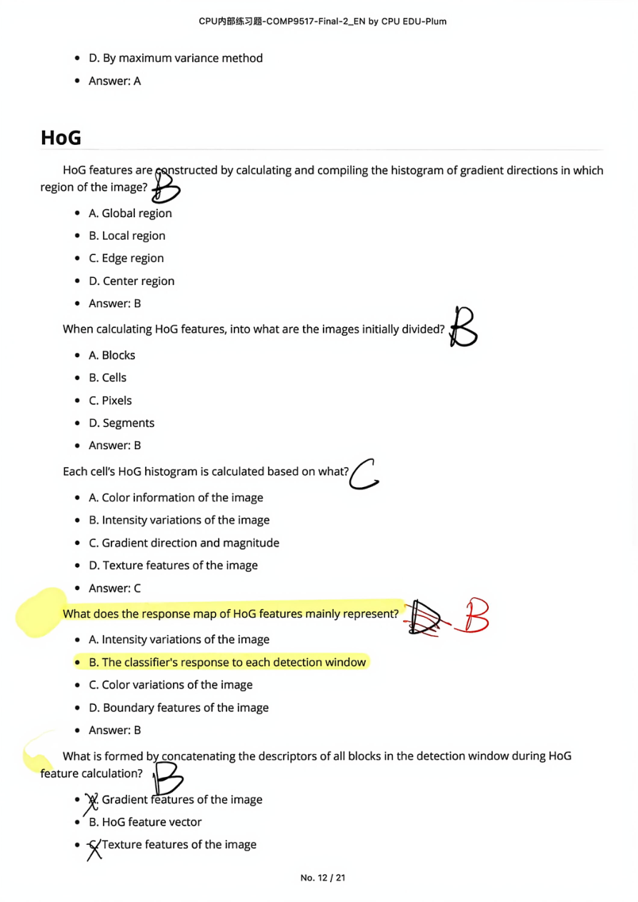

### Editable OCR text

```text
(CPUPSEBER=)-COMP9517-Final-2_EN by CPU EDU-Plum
© D. By maximum variance method
© Answer: A
HoG
HG features are eanstructed by calculating and compiling the histogram of gradient directions in which
region of the image? B
* A.Global region
* B. Local region
© C. Edge region
© D.Center region
© Answer: B
When calculating HoG features, into what are the images initially divided? BR
© A. Blocks
° B.Cells
© C. Pixels
© D. Segments
« Answer: B
Each cell's HoG histogram is calculated based on wna
* A. Color information of the image
© B. Intensity variations of the image
* C. Gradient direction and magnitude
* D. Texture features of the image
* Answer: C
What does the response map of HoG features mainly represent? & RB
« A. Intensity variations of the image
 B. The classifier's response to each detection window
* C. Color variations of the image
© D. Boundary features of the image
« Answer: B
What is formed by concatenating the descriptors of all blocks in the detection window during HoG
feature calculation?
. x Gradient ica of the image
* B.HoG feature vector
. {ren re features of the image
No. 12/21
```

---

## Page 13


### Editable OCR text

```text
© D. Edge features of the image
© Answer: B
When training the classifier, labeled example windows are used to distinguish between which two,
classes of features? B
© A. Edges and textures
© B. Objects and background
© C. Brightness and contrast
* D. Color and shape
* Answer: B
Which of the following steps is not included in the generation process of HoG concn
* A. Calculating gradient directions
© B, Calculating gradient magnitudes
© C. Normalizing histograms
* D. Generating gradient direction histograms
Answer: C
In HOG feature description, what do the bins of the direction histogram represent GSS
"3X Color information of the image
¢ B. Gradient intensity in different directions
% Intensity variations of the image
 D. Edge directions of the image
Answer: B
No. 13/21
```

---

## Page 14


### Editable OCR text

```text
ML

On what principle does the nearest class center classifier base its classification? £
* A Maximum distance principle
© B. Minimum distance principle
* C. Nearest neighbor principle
© D. Average distance principle
¢ Answer: B

In the nearest class center classifier, how is the center point of each class calculated? PA
© A. The mean of all sample points
© B. The median of all sample points
© C. The sum of the distances of all sample points
* D. The geometric center of all sample points
Answer: A

In the testing phase, how is it decided to which class the test object belongs? BR
* A. Based on the average distance from the test object to all sample points
 B, Based on the distance from the test object to the center of all classes
* C.Based on the distance from the test object to the nearest neighbor point
* D. Based on the maximum distance from the test object to all sample points
© Answer: B

KNN

What does the "kK" in KNN classifier stand tore J,
A. Number of sample points
¢ B. Number of nearest neighbors
* C. Dimensionality of feature vectors
* D. Number of classes
© Answer: B

Which of the following is not a disadvantage of the KNN classifier? D
* A. Slow for large datasets
* B, Requires homogeneous feature types and scales
* C, Not suitable for high-dimensional data
© D. Handles missing data well
¢ Answer: D

No. 14/21
```

---

## Page 15


### Editable OCR text

```text
The process of selecting the optimal K value in the KNN classifier can be described mis)
© A. Easy and quick
* B. Challenging and time-consuming
* C. Independent of the dataset
© D. Dependent on the type and number of features
© Answer: B

Bayes

What is the basic assumption of Bayesian decision theory? PB
« A.All classes are equally probable
* C. Test data has no noise
* D. Sample points are independent and identically distributed
Answer: B

In Bayesian decision theory, how is the posterior probability calculated? fay
© A. Prior probability and likelNe6d function
© B, Distaphe between test data and sample points
© C, Number of classes and number of sample points
¢ D. Feature vectors and class labels
Answer: A

What is the goal of Bayesian decision theory? C
* A.Maximize the prior probability
* B. Minimize the classification error rate
© C. Maximize the posterior probability
* D. Minimize computational complexity
© Answer: C

What does the loss function represent in Bayesian decision =P
* A. Similarity between classes
© B. Cost of classification errors
* C. Accuracy of the test data
¢ D. Distribution of the sample points
© Answer: B

What is the goal of Bayesian decision esa >
* A. Maximize expected loss

No. 15/21
```

---

## Page 16

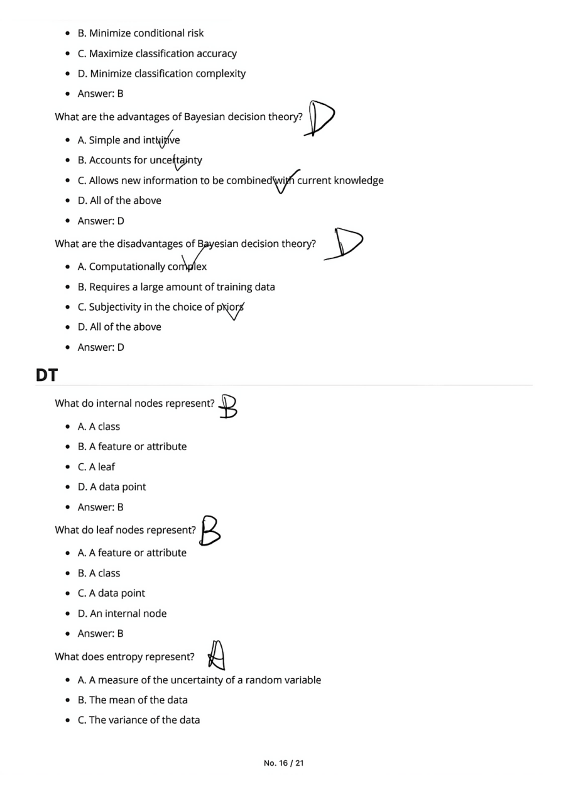

### Editable OCR text

```text
* B. Minimize conditional risk
* C. Maximize classification accuracy
* D. Minimize classification complexity
© Answer: B

What are the advantages of Bayesian decision wor
* A. Simple and intyve
© B. Accounts for unceftginty
* C. Allows new information to be combinedtyip current knowledge
© D.All of the above
Answer: D

What are the disadvantages of Bayesian decision theory? Dp
oA conputstonstyendyh
* B, Requires a large amount of training data
© C. Subjectivity in the choice of pxor
© D.All of the above ‘v
Answer: D

DT

What do internal nodes represent? £
© A.Aclass
° B.A feature or attribute
° C.Aleaf
© D.Adata point
© Answer: B

What do leaf nodes represent? B
© A.A feature or attribute
¢ B.Aclass
* C.Adata point
* D.An internal node
Answer: B

What does entropy represent? Q
 A.Ameasure of the uncertainty of a random variable
 B. The mean of the data
* C. The variance of the data

No. 16/21
```

---

## Page 17


### Editable OCR text

```text
* D. The standard deviation of the data
© Answer: A
When entropy is 0, what is the state of the random variable? A
* A. Completely certain
© B. Completely uncertain
© C.Partially certain
© D. Partially uncertain
© Answer: A
What does information gain represent? &
© A. The extent to which a feature reduces the uncertainty of class information
* B. The extent to which a feature increases the uncertainty of class information
© C. The mean of the data
* D, The variance of the data
Answer: A
Ensemble ee a
What is the purpose of ensemble learning? ja
* A.To combine multiple weak learners to create a new strong learner
* B. To use a single strong learner for classification
* C. To increase the classification error rate
* D.To reduce the size of the dataset
© Answer: A
Which of the following is not a common ensemble learning maaeer])
* A. Bagging
* B. Boosting
© C.Stacking
© D. Clustering
© Answer: D
On which ensemble learning method is Random Forest based? A
A Bagging
* B. Boosting
* C. Stacking
* D. Clustering
© Answer: A
No. 17/21
```

---

## Page 18


### Editable OCR text

```text
What happens when the correlation between trees is increased in a Random Forest? A
¢ A. The error rate of the Random Forest increases
© B. The error rate of the Random Forest decreases
* C. The error rate of the Random Forest is unaffected
* D. The depth of the trees increases
* Answer: A
What happens when the number of features m chosen in a Random Forest increases? A
‘© A. The correlation and strength between trees increase
© B, The correlation and strength between trees decrease
© C. The correlation and strength between trees are unaffected
* D. The depth of the trees increases
¢ Answer: A
What are the advantages of ensemble learning? p
© A.High accuracy on many probidns +
© B. Efficient performance on large dataset
* C.Can handle a large number of input features without needing ten ctecion
* baal Val
Answer: D
What are the disadvantages of ensemble learning? D
* A.Poor interpretabitly//
© B. More complex and aw aon decision trees
© C. Requires significant computational redyat~es
+ D.Allof the abd
© Answer: D
Whatjis the process of selecting samples from each sample set in the construction of a Random Forest
called? ay
©’ A. Bootstrap sampling
© B. Cluster analysis
* C. Data smoothing
* D, Data normalization
* Answer: A
How is it determined to which class the data belongs in a Random Forest? A
¢ A. By majority voting
© B. By calculating the mean
No. 18 / 21
```

---

## Page 19

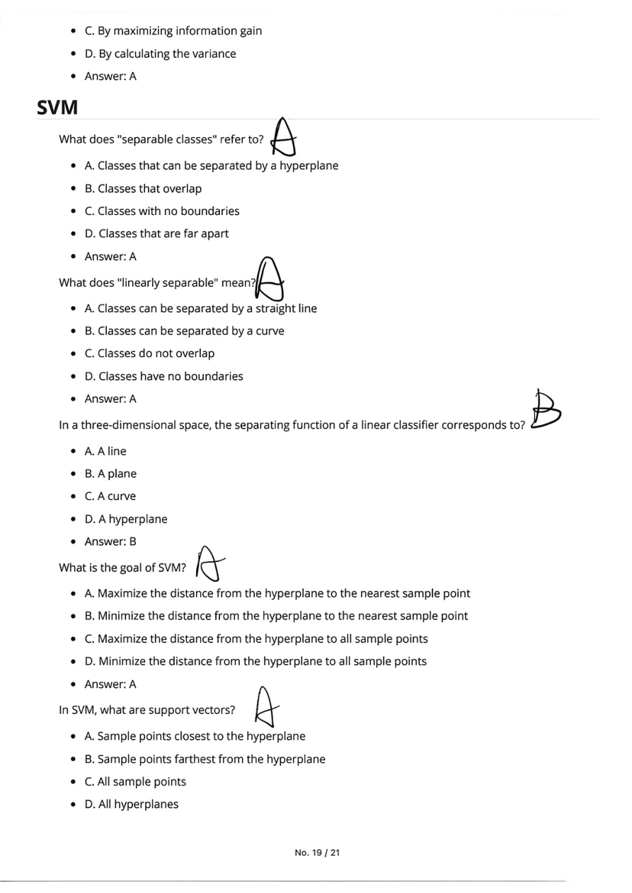

### Editable OCR text

```text
© C, By maximizing information gain
© D. By calculating the variance
© Answer: A
SVM
What does "separable classes" refer to? h
* A. Classes that can be separated by a hyperplane
* B. Classes that overlap
* C. Classes with no boundaries
© D. Classes that are far apart
© Answer: A
What does “linearly separable" mo
© A Classes can be separated by a straight line
* B. Classes can be separated by a curve
© C. Classes do not overlap
* D. Classes have no boundaries
* Answer: A B
Ina three-dimensional space, the separating function of a linear classifier corresponds to?
*° AAline
* B.Aplane
* C.Acurve
© D.Ahyperplane
© Answer: B
What is the goal of SVM? ky
* A. Maximize the distance from the hyperplane to the nearest sample point
* B, Minimize the distance from the hyperplane to the nearest sample point
* C. Maximize the distance from the hyperplane to all sample points
* D. Minimize the distance from the hyperplane to all sample points
© Answer: A
In SVM, what are support vectors? A
* A Sample points closest to the hyperplane
* B. Sample points farthest from the hyperplane
© C.All sample points
* D.All hyperplanes
No. 19/21
```

---

## Page 20

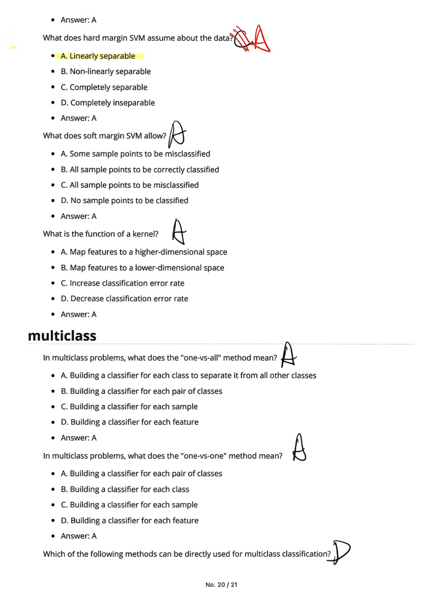

### Editable OCR text

```text
© Answer: A
What does hard margin SVM assume about the SAWN
© A Linearly separable
* B. Non-linearly separable
* C. Completely separable
* D. Completely inseparable
* Answer: A
What does soft margin SVM allow? kb
« A.Some sample points to be misclassified
* B.All sample points to be correctly classified
* C.All sample points to be misclassified
* D.No sample points to be classified
© Answer: A
What is the function of a kernel? &
« A. Map features to a higher-dimensional space
* B. Map features to a lower-dimensional space
© C. Increase classification error rate
© D. Decrease classification error rate
Answer: A
multiclass
In multiclass problems, what does the "one-vs-all" method mean? fy
A. Building a classifier for each class to separate it from all other classes
¢ B. Building a classifier for each pair of classes
© C. Building a classifier for each sample
¢ D. Building a classifier for each feature
© Answer: A
In multiclass problems, what does the "one-vs-one" method mean? f\
¢ A. Building a classifier for each pair of classes
© B. Building a classifier for each class
© C. Building a classifier for each sample
© D. Building a classifier for each feature
© Answer: A
Which of the following methods can be directly used for multiclass cesseaore |
No. 20 / 21
```

---

## Page 21


### Editable OCR text

```text
. Wh nearest neighbors (KNN)
. Vo. ‘ision trees
. > oresen techniques
. spf of the above
* Answer: D
What is a Type | error (false positive)? »
* A. The system incorrectly thinks a person does not have a disease
© B. The system incorrectly thinks a person has a disease
* C. The system correctly thinks a person has a disease
* D. The system correctly thinks a person does not have a disease
© Answer: B
What is a Type Il error (false negative)? B
* A. The system incorrectly thinks a person does not have a disease
© B. The system incorrectly thinks a person has a disease
* C. The system correctly thinks a person has a disease
© D. The system correctly thinks a person does not have a disease
* Answer: A
Which type of error is usually more catastrophic in miscesteation
© A.Type | error
© B. Type ll error
© C. Both are equally serious
* D. Cannot be determined
© Answer: B
No. 21/21
```

---

## Page 22

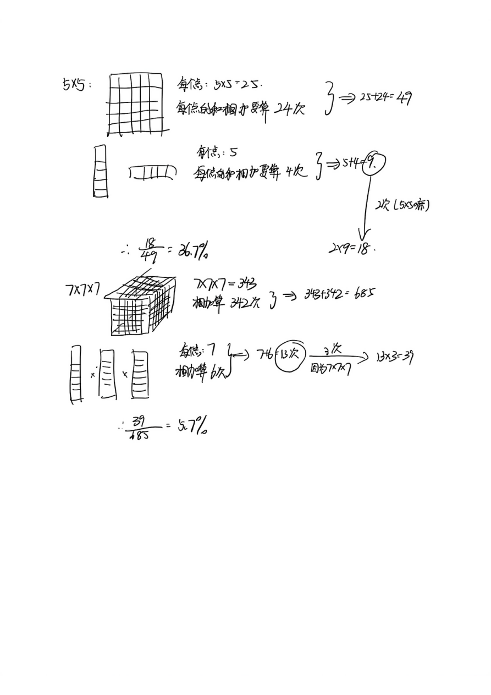

### Editable OCR text

```text
5X5 : BAS: XS72S- _
=> asaee
Rieediitr He D441 4 ? 7
Be: 5 3s
CIID Seapmrth vt >
IR LSxXsoff)
2 fe bith GEIB
arte | Aa. zen > JID $8E
Hi 7 tay 74f0R) Ky \yuaes
: a E etal” 64) DEK) > }
```

---

## Page 23

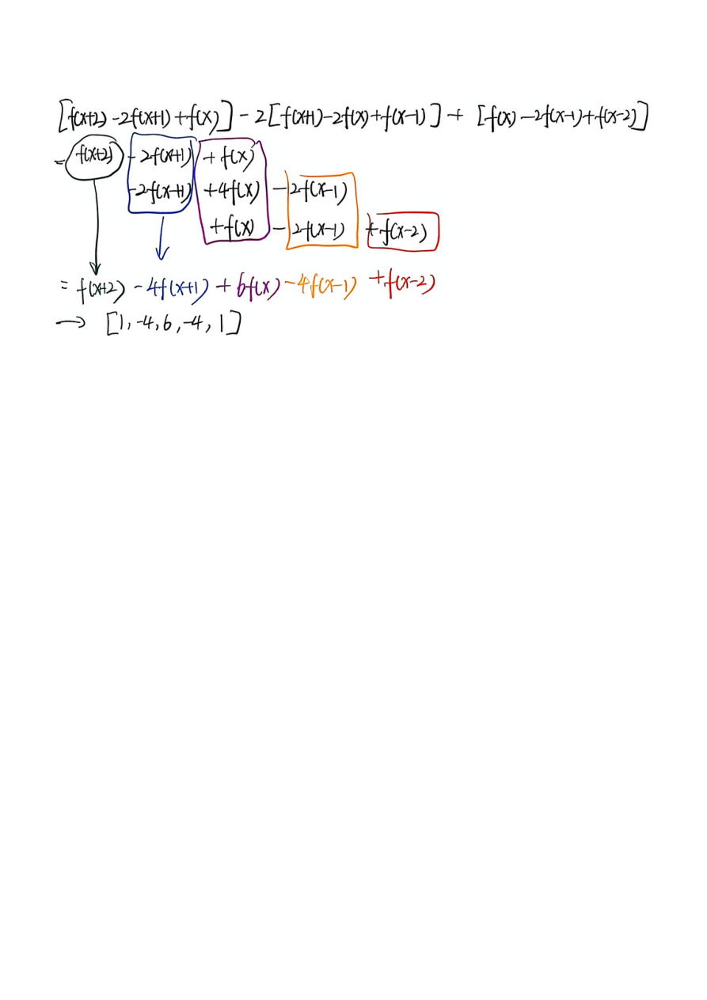

### Editable OCR text

```text
[Horny -2¢e
xt!)
sate 0) - 2 forty-2fuy+f- J
* + Toy — 4
: Shoe oy-4os2))
* {oH2) - iorenirs
```

---
