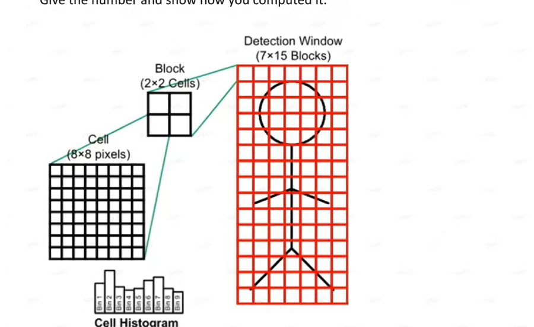
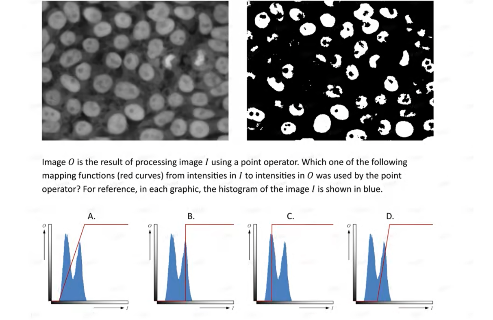

# COMP9517 CPU Question Bank - Answers and Brief Explanations

> 整理说明：按 PDF 页面顺序保留题目；每题添加答案和简要解析。图片题只保留必要图片资源。

## Answer Index / 答案速查

- Q1: B
- Q2: B
- Q3: B
- Q4: B
- Q5: B
- Q6: B
- Q7: B
- Q8: 3780
- Q9: C
- Q10: C
- Q11: B
- Q12: B
- Q13: B
- Q14: B
- Q15: B
- Q16: D
- Q17: C
- Q18: B
- Q19: C
- Q20: B
- Q21: C
- Q22: B
- Q23: C
- Q24: B
- Q25: A
- Q26: C
- Q27: C
- Q28: D
- Q29: C
- Q30: D
- Q31: C
- Q32: D
- Q33: C
- Q34: A
- Q35: A
- Q36: A
- Q37: B
- Q38: B
- Q39: B
- Q40: D
- Q41: B
- Q42: C
- Q43: B
- Q44: C
- Q45: B

---
## Page 1

### Question 1

**Question (1 mark): What is the purpose of convolutional layers in CNNs?**

A. Reducing the size of the feature maps.  
B. Calculating the dot product of the input and kernels.  
C. Applying a nonlinear activation function.  
D. Making the network learn faster.

**Answer / 答案：B**

**Brief Explanation / 简要解析：** Convolutional layers apply learnable kernels to local input regions; this is computed as dot products / convolution to produce feature maps.

---

### Question 2

**Question: Which one of the following lines describes the purpose of convolutional layers in CNNs?**

A. Reducing the size of the feature maps.  
B. Calculating the dot product of the input and kernels.  
C. Applying a nonlinear activation function.  
D. Making the network learn faster.

**Answer / 答案：B**

**Brief Explanation / 简要解析：** Same as Q1: a convolution layer uses kernels/filters to compute local dot products and extract features.

---

### Question 3

**Question: Which one of the following lines best describes the key benefit of CNNs over traditional ANNs for image classification?**

A. CNNs are computationally less expensive.  
B. CNNs automatically learn hierarchical features.  
C. CNNs require fewer network layers.  
D. CNNs can learn nonlinear mappings.

**Answer / 答案：B**

**Brief Explanation / 简要解析：** CNNs learn low-level to high-level hierarchical visual features automatically, unlike traditional ANNs that do not exploit image structure as directly.

---

### Question 4

**Question: Which one of the following lines describes the purpose of convolutional layers in CNNs?**

A. Reducing the size of the feature maps.  
B. Calculating the dot product of the input and kernels.  
C. Applying a nonlinear activation function.  
D. Making the network learn faster.

**Answer / 答案：B**

**Brief Explanation / 简要解析：** Convolutional layers compute local dot products between the input patch and kernels.

---

### Question 5

**Question: Which one of the following lines best describes the key benefit of CNNs over traditional ANNs for image classification?**

A. CNNs are computationally less expensive.  
B. CNNs automatically learn hierarchical features.  
C. CNNs require fewer network layers.  
D. CNNs can learn nonlinear mappings.

**Answer / 答案：B**

**Brief Explanation / 简要解析：** The key advantage is automatic hierarchical feature learning.

---

### Question 6

**Question: Which one of the following lines describes the purpose of convolutional layers in CNNs?**

A. Reducing the size of the feature maps.  
B. Calculating the dot product of the input and kernels.  
C. Applying a nonlinear activation function.  
D. Making the network learn faster.

**Answer / 答案：B**

**Brief Explanation / 简要解析：** The direct operation of a convolutional layer is applying kernels through dot products over local regions.

---

## Page 2

### Question 7

**Question: Which one of the following lines best describes the key benefit of CNNs over traditional ANNs for image classification?**

A. CNNs are computationally less expensive.  
B. CNNs automatically learn hierarchical features.  
C. CNNs require fewer network layers.  
D. CNNs can learn nonlinear mappings.

**Answer / 答案：B**

**Brief Explanation / 简要解析：** CNNs learn hierarchical features such as edges, textures, parts, and objects automatically.

---

### Question 8

**Question (1 mark): Consider the figure below, which illustrates the histogram of oriented gradients (HOG) feature. What is the dimensionality (number of features) of a standard HOG feature vector? Give the number and show how you computed it.**

**Answer / 答案：3780**

**Brief Explanation / 简要解析：** The figure shows a 7 x 15 block detection window. Each block has 2 x 2 cells, and each cell histogram has 9 orientation bins, so 7 x 15 x 2 x 2 x 9 = 3780.

---

### Question 9

**Question (1 mark): In many image processing operations, the image must be expanded a little bit to solve the boundary problem. What type of expansion is implicitly used by the Fourier transform?**

A. Padding  
B. Clamping  
C. Wrapping  
D. Mirroring

**Answer / 答案：C**

**Brief Explanation / 简要解析：** The Fourier transform assumes periodic extension of the signal/image, which corresponds to wrapping at the boundaries.

---

### Question 10

**Question: In many image processing operations, the image must be expanded a little bit to solve the boundary problem. Which one of the following types of expansion is implicitly used by the Fourier transform?**

A. Padding  
B. Clamping  
C. Wrapping  
D. Mirroring

**Answer / 答案：C**

**Brief Explanation / 简要解析：** Fourier-domain processing implicitly treats the image as periodic, so the boundary condition is wrapping.

---

### Question 11

**Question: Which one of the following statements about image segmentation methods is incorrect?**

A. Thresholding based on pixel intensity yields poor results if the regions to be segmented have overlapping intensity distributions.  
B. Level-set segmentation uses an object boundary representation that makes it hard to deal with topological changes.  
C. Region splitting techniques aim to optimize some metric of intra-region similarity and inter-region dissimilarity.  
D. Watershed segmentation often results in over-segmentation because image regions may contain multiple local minima.

**Answer / 答案：B**

**Brief Explanation / 简要解析：** Level-set methods use implicit boundary representations and can naturally handle topological changes, so saying they make topological changes hard is incorrect.

---

## Page 3

### Question 12

**Question: Which one of the following statements about intensity transformations is incorrect?**

A. Contrast stretching linearly maps intensities between two values to the full output range.  
B. Log transformation maps a narrow range of high intensities to a wider range of output values.  
C. Power transformation can map intensities similar to log and inverse log transformations.  
D. Piecewise linear transformations can achieve contrast stretching and intensity slicing.

**Answer / 答案：B**

**Brief Explanation / 简要解析：** Log transformation expands low-intensity/dark values and compresses high-intensity values; it does not map high intensities to a wider output range.

---

### Question 13

**Question: Which one of the following statements about intensity transformations is incorrect?**

A. Contrast stretching linearly maps intensities between two values to the full output range.  
B. Log transformation maps a narrow range of high intensities to a wider range of output values.  
C. Power transformation can map intensities similar to log and inverse log transformations.  
D. Piecewise linear transformations can achieve contrast stretching and intensity slicing.

**Answer / 答案：B**

**Brief Explanation / 简要解析：** The incorrect part is “high intensities”: log transformation mainly expands low intensities.

---

### Question 14

**Question: Given the following input image `I` (on the left) and output image `O` (on the right):**

Image `O` is the result of processing image `I` using a point operator. Which one of the following mapping functions (red curves) from intensities in `I` to intensities in `O` was used by the point operator? For reference, in each graphic, the histogram of the image `I` is shown in blue.

A. Mapping function A  
B. Mapping function B  
C. Mapping function C  
D. Mapping function D

**Answer / 答案：B**

**Brief Explanation / 简要解析：** The output is essentially a binary thresholded image selecting bright regions. Option B is the step threshold placed near the brighter peak.

---

### Question 15

**Question: Which one of the following statements about intensity transformations is incorrect?**

A. Contrast stretching linearly maps intensities between two values to the full output range.  
B. Log transformation maps a narrow range of high intensities to a wider range of output values.  
C. Power transformation can map intensities similar to log and inverse log transformations.  
D. Piecewise linear transformations can achieve contrast stretching and intensity slicing.

**Answer / 答案：B**

**Brief Explanation / 简要解析：** Log transformation enhances dark regions by expanding low intensities, while compressing bright regions.

---

## Page 4

### Question 16

**Question: Which one of the following strategies will not help to reduce overfitting of neural networks?**

A. Applying dropout.  
B. Using early stopping.  
C. Augmenting the data.  
D. Increasing the number of network parameters.

**Answer / 答案：D**

**Brief Explanation / 简要解析：** Increasing the number of parameters usually increases model capacity and can worsen overfitting rather than reduce it.

---

### Question 17

**Question: In many image processing operations, the image must be expanded a little bit to solve the boundary problem. Which one of the following types of expansion is implicitly used by the Fourier transform?**

A. Padding  
B. Clamping  
C. Wrapping  
D. Mirroring

**Answer / 答案：C**

**Brief Explanation / 简要解析：** The Fourier transform assumes periodic repetition of the image, equivalent to wrapping.

---

### Question 18

**Question: What is the effect of the following 2D convolution kernel on an image?**

\[
\begin{bmatrix}
0 & 1 & 0 \\
1 & -4 & 1 \\
0 & 1 & 0
\end{bmatrix}
\]

A. It approximates the sum of first-order derivatives in `x` and `y`.  
B. It approximates the sum of second-order derivatives in `x` and `y`.  
C. It approximates the product of first-order derivatives in `x` and `y`.  
D. It approximates the product of second-order derivatives in `x` and `y`.

**Answer / 答案：B**

**Brief Explanation / 简要解析：** This is a 4-neighbour Laplacian kernel, approximating the sum of second derivatives in x and y.

---

### Question 19

**Question: Given the following 2D convolution kernel:**

\[
\begin{bmatrix}
1 & 0 & -1 \\
2 & 0 & -2 \\
1 & 0 & -1
\end{bmatrix}
\]

**Which one of the following correctly describes the effect of this kernel when applied to an image?**

A. Smoothing in `x` and first-order differentiation in `y`.  
B. Smoothing in `x` and second-order differentiation in `y`.  
C. First-order differentiation in `x` and smoothing in `y`.  
D. Second-order differentiation in `x` and smoothing in `y`.

**Answer / 答案：C**

**Brief Explanation / 简要解析：** This Sobel-type kernel differentiates in x using [1, 0, -1] and smooths in y using [1, 2, 1]^T.

---

## Page 5

### Question 20

**Question: What is the effect of the following 2D convolution kernel on an image?**

\[
\begin{bmatrix}
0 & 1 & 0 \\
1 & -4 & 1 \\
0 & 1 & 0
\end{bmatrix}
\]

A. It approximates the sum of first-order derivatives in `x` and `y`.  
B. It approximates the sum of second-order derivatives in `x` and `y`.  
C. It approximates the product of first-order derivatives in `x` and `y`.  
D. It approximates the product of second-order derivatives in `x` and `y`.

**Answer / 答案：B**

**Brief Explanation / 简要解析：** The kernel is the discrete Laplacian, i.e. second derivative in x plus second derivative in y.

---

### Question 21

**Question: Given the following 2D convolution kernel:**

\[
\begin{bmatrix}
1 & 0 & -1 \\
2 & 0 & -2 \\
1 & 0 & -1
\end{bmatrix}
\]

**Which one of the following correctly describes the effect of this kernel when applied to an image?**

A. Smoothing in `x` and first-order differentiation in `y`.  
B. Smoothing in `x` and second-order differentiation in `y`.  
C. First-order differentiation in `x` and smoothing in `y`.  
D. Second-order differentiation in `x` and smoothing in `y`.

**Answer / 答案：C**

**Brief Explanation / 简要解析：** The kernel detects vertical intensity changes: first-order differentiation in x, smoothing in y.

---

### Question 22

**Question: What is the effect of the following 2D convolution kernel on an image?**

\[
\begin{bmatrix}
0 & 1 & 0 \\
1 & -4 & 1 \\
0 & 1 & 0
\end{bmatrix}
\]

A. It approximates the sum of first-order derivatives in `x` and `y`.  
B. It approximates the sum of second-order derivatives in `x` and `y`.  
C. It approximates the product of first-order derivatives in `x` and `y`.  
D. It approximates the product of second-order derivatives in `x` and `y`.

**Answer / 答案：B**

**Brief Explanation / 简要解析：** It is a Laplacian kernel, approximating the sum of second-order derivatives.

---

## Page 6

### Question 23

**Question: Given the following 2D convolution kernel:**

\[
\begin{bmatrix}
1 & 0 & -1 \\
2 & 0 & -2 \\
1 & 0 & -1
\end{bmatrix}
\]

**Which one of the following correctly describes the effect of this kernel when applied to an image?**

A. Smoothing in `x` and first-order differentiation in `y`.  
B. Smoothing in `x` and second-order differentiation in `y`.  
C. First-order differentiation in `x` and smoothing in `y`.  
D. Second-order differentiation in `x` and smoothing in `y`.

**Answer / 答案：C**

**Brief Explanation / 简要解析：** It is a Sobel X-style filter: derivative in x and smoothing in y.

---

### Question 24

**Question (1 mark): Which one of the following equations concerning convolution (`*`) of two images (`f` and `g`) is correct?**

A. `f * g = (g * f)^(-1)`  
B. `f * (g + h) = (f * g) + (f * h)`  
C. `a · (f * g) = (a · f) * (a · g)`  
D. `f * g = f̂ * ĝ`

**Answer / 答案：B**

**Brief Explanation / 简要解析：** Convolution is distributive over addition: f * (g + h) = f * g + f * h.

---

### Question 25

**Question: Suppose we have a 2D image that is very noisy and we want to smooth it by filtering with a uniform kernel of size 5 × 5 voxels. Let `S` be the total number of floating-point operations required per pixel to perform the operation when using a dimensionally separated implementation of the filter. Let `N` be the total number of floating-point operations required per pixel to perform the operation when using a dimensionally nonseparated implementation of the filter.**

**What is the ratio `S/N` as a percentage rounded to one decimal?**

A. 36.7%  
B. 40.0%  
C. 58.8%  
D. 66.7%

**Answer / 答案：A**

**Brief Explanation / 简要解析：** Non-separated 5x5 filtering needs 25 multiplications + 24 additions = 49 operations. Separable filtering needs two 1D passes: 10 multiplications + 8 additions = 18 operations. S/N = 18/49 = 36.7%.

---

### Question 26

**Question (1 mark): Which one of the following statements on image filtering is incorrect?**

A. Median filtering reduces noise in images.  
B. Low-pass filtering smooths fine details in images.  
C. High-pass filtering results in blurry images.  
D. Notch filtering removes specific image frequencies.

**Answer / 答案：C**

**Brief Explanation / 简要解析：** High-pass filtering enhances edges and fine details; it does not make images blurry.

---

### Question 27

**Question: Which one of the following statements on image filtering is incorrect?**

A. Median filtering reduces noise in images.  
B. Low-pass filtering results in blurry images.  
C. High-pass filtering smooths fine details in images.  
D. Notch filtering removes specific image frequencies.

**Answer / 答案：C**

**Brief Explanation / 简要解析：** High-pass filtering does not smooth fine details; low-pass filtering does.

---

## Page 7

### Question 28

**Question: Which one of the following statements is correct for random forest classifiers?**

A. Increasing the correlation between the individual trees decreases the random forest classification error rate.  
B. Reducing the number of selected features at each node increases the correlation between the individual trees.  
C. Reducing the number of selected features at each node increases the strength of the individual trees.  
D. Increasing the strength of the individual trees decreases the random forest classification error rate.

**Answer / 答案：D**

**Brief Explanation / 简要解析：** Random forest error decreases when individual trees are stronger and less correlated; option D states the strength part correctly.

---

### Question 29

**Question: Which one of the following statements is correct for pattern recognition?**

A. Pattern recognition is defined as the process of model training on a training dataset and then testing on an independent test set.  
B. The dimension of feature vectors should be smaller than the number of training samples in order to avoid the overfitting problem.  
C. The simple kNN classifier needs homogeneous feature types and scales so that the classification performance can be better.  
D. SVM is a powerful classifier that can separate classes even when the feature space exhibits significant overlaps between classes.

**Answer / 答案：C**

**Brief Explanation / 简要解析：** kNN relies on distances, so features should have compatible types and scales; otherwise distance comparisons become misleading.

---

### Question 30

**Question: Which one of the following statements is correct for random forest classifiers?**

A. Increasing the correlation between the individual trees decreases the random forest classification error rate.  
B. Reducing the number of selected features at each node increases the correlation between the individual trees.  
C. Reducing the number of selected features at each node increases the strength of the individual trees.  
D. Increasing the strength of the individual trees decreases the random forest classification error rate.

**Answer / 答案：D**

**Brief Explanation / 简要解析：** Stronger individual trees generally reduce random forest classification error if correlation is controlled.

---

### Question 31

**Question: Which one of the following statements is correct for pattern recognition?**

A. Pattern recognition is defined as the process of model training on a training dataset and then testing on an independent test set.  
B. The dimension of feature vectors should be smaller than the number of training samples in order to avoid the overfitting problem.  
C. The simple kNN classifier needs homogeneous feature types and scales so that the classification performance can be better.  
D. SVM is a powerful classifier that can separate classes even when the feature space exhibits significant overlaps between classes.

**Answer / 答案：C**

**Brief Explanation / 简要解析：** Because kNN is distance-based, homogeneous/scaled features help performance.

---

## Page 8

### Question 32

**Question: Which one of the following statements is correct for random forest classifiers?**

A. Increasing the correlation between the individual trees decreases the random forest classification error rate.  
B. Reducing the number of selected features at each node increases the correlation between the individual trees.  
C. Reducing the number of selected features at each node increases the strength of the individual trees.  
D. Increasing the strength of the individual trees decreases the random forest classification error rate.

**Answer / 答案：D**

**Brief Explanation / 简要解析：** Increasing tree strength tends to reduce random forest error; increasing correlation would usually hurt.

---

### Question 33

**Question: Which one of the following statements is correct for pattern recognition?**

A. Pattern recognition is defined as the process of model training on a training dataset and then testing on an independent test set.  
B. The dimension of feature vectors should be smaller than the number of training samples in order to avoid the overfitting problem.  
C. The simple kNN classifier needs homogeneous feature types and scales so that the classification performance can be better.  
D. SVM is a powerful classifier that can separate classes even when the feature space exhibits significant overlaps between classes.

**Answer / 答案：C**

**Brief Explanation / 简要解析：** Simple kNN needs comparable feature scales and types because its decision is based on distance.

---

### Question 34

**Question: Which one of the following statements about object tracking is incorrect?**

A. The particle filtering method assumes that the dynamics model and the measurement model can be parameterized.  
B. The hidden Markov model assumes that the measurements depend only on the current state of the objects.  
C. The prediction step of Bayesian inference assumes that the current state of the objects depends only on the previous state.  
D. The Kalman filtering method assumes that the dynamics and measurement noise are additive Gaussian.

**Answer / 答案：A**

**Brief Explanation / 简要解析：** Particle filters do not require the same strict parametric Gaussian assumptions as Kalman filters; they approximate distributions with particles.

---

### Question 35

**Question: Which one of the following statements about object tracking is incorrect?**

A. The particle filtering method assumes that the dynamics model and the measurement model can be parameterized.  
B. The hidden Markov model assumes that the measurements depend only on the current state of the objects.  
C. The prediction step of Bayesian inference assumes that the current state of the objects depends only on the previous state.  
D. The Kalman filtering method assumes that the dynamics and measurement noise are additive Gaussian.

**Answer / 答案：A**

**Brief Explanation / 简要解析：** The particle filtering method is more flexible and does not require fully parameterized Gaussian dynamics/measurement models.

---

## Page 9

### Question 36

**Question: Which one of the following statements about object tracking is incorrect?**

A. The particle filtering method assumes that the dynamics model and the measurement model can be parameterized.  
B. The hidden Markov model assumes that the measurements depend only on the current state of the objects.  
C. The prediction step of Bayesian inference assumes that the current state of the objects depends only on the previous state.  
D. The Kalman filtering method assumes that the dynamics and measurement noise are additive Gaussian.

**Answer / 答案：A**

**Brief Explanation / 简要解析：** Particle filters represent uncertainty by samples, so option A is the incorrect statement among the tracking assumptions.

---

### Question 37

**Question (1 mark): What does transfer learning with CNNs involve?**

A. Training a model from scratch for each new task.  
B. Using a pretrained model and fine-tuning it for a new task.  
C. Converting image data to text data to facilitate learning.  
D. Combining multiple CNNs into a single model for better performance.

**Answer / 答案：B**

**Brief Explanation / 简要解析：** Transfer learning uses a model pretrained on a large/source task and fine-tunes or adapts it to a new task.

---

### Question 38

**Question: Which one of the following lines describes the purpose of transfer learning?**

A. Training a model from scratch for each new task.  
B. Using a pretrained model and fine-tuning it for a new task.  
C. Converting image data to text data to facilitate learning.  
D. Combining multiple models into a single model for better performance.

**Answer / 答案：B**

**Brief Explanation / 简要解析：** The purpose is to reuse learned features from a pretrained model and adapt them to the new problem.

---

### Question 39

**Question: Which one of the following lines describes the purpose of transfer learning?**

A. Training a model from scratch for each new task.  
B. Using a pretrained model and fine-tuning it for a new task.  
C. Converting image data to text data to facilitate learning.  
D. Combining multiple models into a single model for better performance.

**Answer / 答案：B**

**Brief Explanation / 简要解析：** Transfer learning means using a pretrained model rather than training entirely from scratch.

---

### Question 40

**Question: Which one of the following statements about colour spaces is incorrect?**

A. The R, G, and B channels of the RGB colour space are often correlated.  
B. The H and the S channel of the HSV colour space are confounded.  
C. The Y channel of the YCbCr colour space represents the brightness.  
D. The a* channel of the L*a*b* colour space is the green-blue component.

**Answer / 答案：D**

**Brief Explanation / 简要解析：** In L*a*b*, a* represents green-red, while b* represents blue-yellow. So “green-blue component” is incorrect.

---

### Question 41

**Question: Which one of the following networks is most suited for image segmentation tasks?**

A. Multilayer perceptron (MLP)  
B. Fully convolutional network (FCN)  
C. Region proposal network (RPN)  
D. Recurrent neural network (RNN)

**Answer / 答案：B**

**Brief Explanation / 简要解析：** FCNs produce dense pixel-level predictions and are designed for image segmentation.

---

## Page 10

### Question 42

**Question: Which one of the following statements about data augmentation for image classification using CNNs is correct?**

A. Augmentation increases the number of parameters in the model.  
B. Augmentation reduces the size of the dataset to speed up training.  
C. Augmentation generates new training data by transforming the existing data.  
D. Augmentation reduces the depth of the network for better performance.

**Answer / 答案：C**

**Brief Explanation / 简要解析：** Data augmentation creates additional training examples by applying transformations such as flips, crops, rotations, or color changes.

---

### Question 43

**Question: Which one of the following statements about feature descriptors is incorrect?**

A. Haralick features are derived from gray-level co-occurrence matrices.  
B. SIFT achieves rotation invariance by computing gradient histograms at multiple scales.  
C. LBP describes local image texture and can be multiresolution and rotation-invariant.  
D. Colour moments have lower representation capability than the colour histogram.

**Answer / 答案：B**

**Brief Explanation / 简要解析：** SIFT rotation invariance mainly comes from assigning a dominant orientation to each keypoint; multi-scale processing is mainly for scale invariance.

---

### Question 44

**Question (1 mark): Given a binary input image `I` to which we apply the following algorithm:**

Step 1: Create a copy `C` of input image `I`.  
Step 2: Copy the boundary pixels of `C` into new image `B`.  
Step 3: Compute the reconstruction `R` of `C` from `B`.  
Step 4: Compute output `O` by subtracting `R` from `I`.

**What does the output image `O` contain?**

A. The same objects as the input image whatever the input.  
B. The same objects as the input image but with holes filled.  
C. The same objects as the input image except the boundary objects.  
D. The same objects as the input image but with touching objects separated.

**Answer / 答案：C**

**Brief Explanation / 简要解析：** Reconstruction from boundary pixels recovers boundary-touching objects; subtracting this from the original removes boundary objects, leaving only non-boundary objects.

---

### Question 45

**Question: Which one of the following statements about motion analysis is incorrect?**

A. Detection of moving objects by subtraction of successive images in a video works best if the background is constant.  
B. Sparse motion estimation in a video can be done by template matching and minimising the mutual information measure.  
C. Dense motion estimation using optical flow assumes that each small neighbourhood remains constant over time.  
D. Optical flow provides an equation for each pixel but requires further constraints to solve the equation uniquely.

**Answer / 答案：B**

**Brief Explanation / 简要解析：** Template matching can be used for sparse motion, but mutual information is normally maximized, not minimized, for matching/alignment; thus the statement is incorrect.
