# COMP9517 简单概念题库（可编辑版）

> 说明：本 Markdown 由上传的 PDF 整理而成；文字内容尽量保持可编辑，PDF 中的配图已提取到 `images/` 文件夹并按页码插入。

---

## Page 1

COMP9517 期末复习

### 点运算 / Point Operations

幂次变换可以通过哪种方法调整图像对比度？/ Power Transformation
can adjust image contrast through which method?

- A. 对数变换 / Log Transformation

- B. 伽马校正 / Gamma Correction

- C. 拉普拉斯变换 / Laplace Transformation

- D. 傅里叶变换 / Fourier Transformation

- **答案：**B.

**详细讲解：**

伽马校正是图像处理中重要的点运算，其数学表达式为 s = c·r^γ，其中：

- r 是输入像素值，s 是输出像素值

- c 是常数，γ 是伽马值

- 当 γ < 1 时，图像变亮（增强暗部细节）

- 当 γ > 1 时，图像变暗（增强亮部细节）

- 当 γ = 1 时，为线性变换

伽马校正是幂次变换的典型应用，主要用于校正显示设备的非线性响应特性。选项A对数变换主要用于

动态范围压缩；选项C拉普拉斯变换不是图像增强方法；选项D傅里叶变换用于频域分析。

伽马校正主要用于？/ Gamma Correction is primarily used for?

- A. 调整图像亮度 / Adjusting image brightness

- B. 增强图像对比度 / Enhancing image contrast

- C. 噪声去除 / Noise removal

- D. 图像分割 / Image segmentation

- **答案：**A

**详细讲解：**

伽马校正的主要目的是调整图像的整体亮度分布，补偿显示设备（如CRT显示器）的非线性特性。人眼

对亮度的感知是非线性的，伽马校正可以：

---

## Page 2

1. 使图像在不同设备上显示一致

2. 优化图像在人眼中的视觉效果

3. 提高图像在暗部或亮部的细节可见性

虽然伽马校正会影响对比度，但其主要目标是亮度调整，而非专门的对比度增强。

分段线性变换的主要目的是？/ The main purpose of piecewise linear
transformation is?

- A. 平滑图像 / Smoothing images

- B. 增强特定灰度级内的细节 / Enhancing details within specific gray levels

- C. 噪声去除 / Noise removal

- D. 改善图像边缘 / Improving image edges

- **答案：**B .

**详细讲解：**

分段线性变换允许对不同的灰度级范围应用不同的线性变换，这样可以：

1. 对感兴趣的灰度范围进行拉伸，增强细节

2. 对不重要的灰度范围进行压缩，减少空间占用

3. 实现更精细的对比度控制

例如在医学图像中，可能只关心某个特定密度范围的组织结构。

灰度级分层通常用于？/ Gray-level slicing is typically used for?

- A. 增强图像中的特定灰度级 / Enhancing specific gray levels in images

- B. 平滑图像 / Smoothing images

- C. 直方图均衡化 / Histogram equalization

- D. 图像压缩 / Image compression

- **答案：**A .

**详细讲解：**

灰度级分层是一种突出显示特定灰度范围的技术：

1. 保持感兴趣的灰度级不变或增强

2. 将其他灰度级设为较低值或保持不变

3. 常用于突出显示特定密度或亮度的区域

例如在X光片中突出显示骨骼结构，或在卫星图像中突出显示特定地物。

---

## Page 3

直方图匹配的主要用途是？/ The primary use of Histogram Matching
is?

- A. 增强图像对比度 / Enhancing image contrast

- B. 调整图像以匹配目标直方图 / Adjusting the image to match a target histogram

- C. 边缘检测 / Edge detection

- D. 噪声去除 / Noise removal

- **答案：**B .

**详细讲解：**

直方图匹配（规定化）的目标是将输入图像的直方图变换为指定的目标直方图形状：

1. 不同于直方图均衡化的均匀分布目标

2. 可以实现特定的色调分布效果

3. 常用于图像风格转换、颜色校正等应用

4. 实现步骤：输入图像均衡化 → 目标直方图均衡化 → 反向映射

直方图均衡化的主要目的是？/ The main purpose of Histogram
Equalization is?

- A. 增强图像对比度 / Enhancing image contrast

- B. 平滑图像 / Smoothing images

- C. 图像压缩 / Image compression

- D. 噪声去除 / Noise removal

- **答案：**A .

**详细讲解：**

直方图均衡化通过重新分布像素灰度值来增强图像对比度：

1. 将原始直方图转换为近似均匀分布

2. 充分利用整个灰度级范围

3. 增强图像的视觉效果和细节可见性

4. 数学基础：累积分布函数（CDF）的单调性

但需注意：可能产生过度增强或伪影效果。

多级阈值分割与单级阈值分割的主要区别是？/ The main difference
between multilevel thresholding and single-level thresholding is?

---

## Page 4

- A. 增强对比度 / Enhancing contrast

- B. 平滑图像 / Smoothing images

- C. 为图像分割生成多个阈值 / Generating multiple thresholds for image segmentation

- D. 噪声去除 / Noise removal

- **答案：**C .

**详细讲解：**

单级阈值分割使用一个阈值将图像分为前景和背景两部分，而多级阈值分割使用多个阈值将图像分为

多个区域：

- 单级：f(x,y) = {255 if g(x,y) > T, 0 if g(x,y) ≤ T}

- 多级：使用T1, T2, ..., Tn等多个阈值，产生n+1个分割区域

- 多级阈值适用于包含多个目标或多种材质的复杂图像

图像平滑的主要用途是？/ The primary use of Image Smoothing is?

- A. 增强图像对比度 / Enhancing image contrast

- B. 噪声去除 / Noise removal

- C. 边缘检测 / Edge detection

- D. 图像分割 / Image segmentation

- **答案：**B .

**详细讲解：**

图像平滑（也称为图像滤波）的主要目的是去除或减少图像中的噪声：

1. 通过邻域平均操作减少随机噪声

2. 常用方法：均值滤波、高斯滤波、中值滤波

3. 副作用：可能会模糊边缘和细节

4. 需要在噪声去除和细节保持之间找到平衡

以下哪种方法用于边缘检测？/ Which method is used for edge
detection?

- A. Sobel算子 / Sobel Operator

- B. 直方图均衡化 / Histogram Equalization

- C. 对数变换 / Log Transformation

- D. 灰度级分层 / Gray-level Slicing

- **答案：**A .

---

## Page 5

**详细讲解：**

Sobel算子是经典的一阶导数边缘检测算子：

- 使用两个3×3卷积核分别检测水平和垂直边缘

- 结合了平滑和微分操作，对噪声有一定抗性

- 其他边缘检测方法：Prewitt、Roberts、Canny等

- 选项B、C、D都不是专门的边缘检测方法

图像锐化的主要用途是？/ The primary use of Image Sharpening is?

- A. 增强图像细节 / Enhancing image details

- B. 平滑图像 / Smoothing images

- C. 噪声去除 / Noise removal

- D. 颜色变换 / Color transformation

- **答案：**A .

**详细讲解：**

图像锐化与平滑相反，目的是增强图像中的细节和边缘：

1. 通过高通滤波器或拉普拉斯算子实现

2. 常用方法：非锐化掩模、高通滤波、拉普拉斯锐化

3. 会放大高频成分，包括噪声

4. 适用于模糊图像的细节恢复

对数变换在处理哪种类型的图像时特别有效？/ Log Transformation is
particularly effective in processing which type of images?

- A. 高亮度图像 / High-brightness images

- B. 低亮度图像 / Low-brightness images

- C. 噪声图像 / Noisy images

- D. 边缘图像 / Edge images

- **答案：**B.

**详细讲解：**

对数变换 s = c·log(1+r) 对于低亮度图像特别有效：

1. 压缩高灰度值，扩展低灰度值

2. 增强暗部细节的可见性

---

## Page 6

3. 常用于动态范围很大的图像（如天文图像、医学图像）

4. 利用了人眼对低亮度区域更敏感的特性

Otsu/Isodata/Triangle方法用于哪种类型的图像处理？/
Otsu's/Isodata/Triangle methods are used for which type of image
processing?

- A. 对比度增强 / Contrast enhancement

- B. 边缘检测 / Edge detection

- C. （自动）图像分割 / (Automatic) Image segmentation

- **答案：**C .

**详细讲解：**

这三种方法都是自动阈值选择算法，用于图像分割：

- Otsu方法：最大化类间方差，适用于双峰直方图

- Isodata方法：迭代选择阈值，使前景和背景的均值平衡

- Triangle方法：基于直方图几何形状的三角形方法

- 都无需人工设定阈值，实现自动图像分割

这三种方法中哪种适用于单峰/双峰分布？/ Which of the three methods
is suitable for unimodal/bimodal distributions?

**详细讲解：**

- Otsu方法：专门为双峰分布设计，假设图像包含前景和背景两个主要区域

- Triangle方法：更适合单峰分布，特别是偏斜分布

- Isodata方法：对分布形状要求较宽松，但在双峰时效果更好

Isodata方法中的阈值(t)最终会收敛到？/ The threshold (t) in the
Isodata method will eventually converge to?

- A. 任意值 / An arbitrary value

- B. 图像的平均灰度级 / The mean gray level of the image

- C. 前景和背景的平均灰度级 / The average gray level of the foreground and background

- D. 初始阈值 / The initial threshold

- **答案：**C .

**详细讲解：**

---

## Page 7

Isodata算法的迭代过程：

1. 初始设定一个阈值T₀

2. 将像素分为两组：G₁(≤T)和G₂(>T)

3. 计算两组的均值：μ₁和μ₂

4. 更新阈值：T = (μ₁ + μ₂)/2

5. 重复直至收敛

最终阈值是前景和背景均值的平均值，确保了分割的平衡性。

Otsu方法中选择阈值的标准是？/ The criteria for selecting the
threshold in the Otsu method are?

- A. 最大类间方差 / Maximum between-class variance

- B. 最小类间方差 / Minimum between-class variance

- C. 最大类内方差 / Maximum within-class variance

- D. 最小类内方差 / Minimum within-class variance

- **答案：**A, D.

**详细讲解：**

Otsu方法基于统计学原理，同时满足两个等价标准：

1. 最大化类间方差：使前景和背景之间的差异最大化

2. 最小化类内方差：使前景内部和背景内部的差异最小化

数学关系：总方差 = 类间方差 + 类内方差（常数）

因此最大化类间方差等价于最小化类内方差。

Otsu方法假设图像直方图有几个峰？/ How many peaks does the Otsu
method assume in the image histogram?

- A. 一个 / One

- B. 两个 / Two

- C. 三个 / Three

- D. 四个 / Four

- **答案：**B .

**详细讲解：**

Otsu方法的基本假设：

1. 图像包含两个主要区域：前景和背景

---

## Page 8

2. 直方图呈现双峰分布特征

3. 最优阈值位于两峰之间的谷底

4. 如果图像不满足双峰假设，Otsu方法可能失效

### 卷积与邻域算子 / Convolution & Neighborhood Operators

卷积核的定义是什么？/ What is the definition of a convolution kernel?

- A. 固定长度的向量 / A fixed-length vector

- B. 用于定义如何组合邻近像素信息的小矩阵 / A small matrix used to define how to combine

neighboring pixel information

- C. 图像压缩算法 / An algorithm for image compression

- D. 边缘检测滤波器 / A filter for edge detection

- **答案：**B .

**详细讲解：**

卷积核（也称滤波器或模板）是图像处理中的核心概念：

1. 本质：通常是3×3、5×5等小尺寸矩阵

2. 功能：定义当前像素与邻域像素的权重关系

3. 作用：通过滑动窗口操作实现各种图像处理效果

4. 应用：边缘检测、模糊、锐化、特征提取等

例如：3×3均值滤波核为 [1/9, 1/9, 1/9; 1/9, 1/9, 1/9; 1/9, 1/9, 1/9]

在滑动窗口操作中，卷积核的中心与什么对齐？/ In the sliding window
operation, where is the center of the convolution kernel aligned?

- A. 图像的左上角 / Top-left corner of the image

- B. 图像的右下角 / Bottom-right corner of the image

- C. 当前像素 / Current pixel

- D. 图像的中间 / Middle of the image

- **答案：**C.

**详细讲解：**

滑动窗口操作的核心机制：

1. 对齐方式：卷积核中心与当前处理像素对齐

---

## Page 9

2. 计算过程：核内每个权重与对应邻域像素相乘后求和

3. 边界处理：需要特殊处理边界像素（填充、镜像、环绕等）

4. 输出位置：计算结果赋给当前像素位置

邻域算子和卷积核的主要区别是什么？/ What is the main difference
between a neighborhood operator and a convolution kernel?

- A. 邻域算子是涵盖所有局部区域操作的更广泛概念 / Neighborhood operator is a broader

concept encompassing all local area operations

- B. 卷积核用于非线性操作 / Convolution kernels are used for nonlinear operations

- C. 邻域算子仅用于边缘检测 / Neighborhood operators are only used for edge detection

- D. 卷积核比邻域算子更复杂 / Convolution kernels are more complex than neighborhood

operators

- **答案：**A.

**详细讲解：**

概念层次关系：

1. 邻域算子：所有基于像素邻域的操作（包括线性和非线性）

2. 卷积核：特指线性邻域操作的权重矩阵

3. 关系：卷积是邻域算子的一个子集

4. 非线性邻域算子：中值滤波、形态学操作等不能用卷积表示

卷积运算的性质是什么？/ What is the nature of the convolution
operation?

- A. 线性、平移不变操作 / Linear, translation-invariant operation

- B. 非线性、平移不变操作 / Nonlinear, translation-invariant operation

- C. 线性、平移可变操作 / Linear, translation-variant operation

- D. 非线性、平移可变操作 / Nonlinear, translation-variant operation

- **答案：**A.

**详细讲解：**

卷积的重要性质：

1. 线性性：满足叠加原理 conv(af₁+bf₂, h) = a·conv(f₁,h) + b·conv(f₂,h)

---

## Page 10

2. 平移不变性：如果输入平移，输出也相应平移，处理方式不变

3. 数学意义：这些性质使得卷积在频域分析中有重要应用

4. 实际意义：保证了滤波器在图像不同位置的一致性

卷积运算满足哪些性质？/ Which properties does the convolution
operation satisfy?

- A. 交换律 / Commutative property

- B. 结合律 / Associative property

- C. 分配律 / Distributive property

- D. 以上所有 / All of the above

- **答案：**D.

**详细讲解：**

卷积的数学性质：

1. 交换律：f * g = g * f（滤波器和图像可交换）

2. 结合律：(f * g) * h = f * (g * h)（多个滤波器的级联）

3. 分配律：f * (g + h) = f * g + f * h（线性性的体现）

4. 实际意义：这些性质为复杂滤波器的设计和分析提供理论基础

对于卷积，如果输入f(x,y)产生输出g(x,y)，那么平移输入f(x-Δx, y-Δy)的
输出是什么？/ For convolution, if the input f(x,y) produces the
output g(x,y), what will be the output for the shifted input f(x-Δx, y-
Δy)?

- A. g(x, y)

- B. g(x+Δx, y+Δy)

- C. g(x-Δx, y-Δy)

- D. 无法确定 / Cannot be determined

- **答案：**C.

**详细讲解：**

平移不变性的数学表达：

1. 原理：输入的平移导致输出的相同平移

2. 数学表示：conv(f(x-Δx, y-Δy), h) = g(x-Δx, y-Δy)

3. 物理意义：滤波器对图像不同位置的相同模式产生相同响应

---

## Page 11

4. 应用价值：保证了特征检测的位置无关性

当扩展图像边界时，哪种方法将所有添加的像素设为常数（零）值？/
When extending an image beyond its borders, which method sets all
added pixels to a constant (zero) value?

- A. 填充 / Padding

- B. 钳制 / Clamping

- C. 环绕 / Wrapping

- D. 镜像 / Mirroring

- **答案：**A .

**详细讲解：**

边界处理方法详解：

1. Padding（零填充）：边界外设为0或指定常数值

2. 优点：实现简单，计算快速

3. 缺点：可能在边界产生伪影

4. 适用：当边界外确实应该是背景时使用

哪种边界处理方法重复所有边界像素值？/ Which border handling
method repeats all border pixel values?

- A. 填充 / Padding

- B. 钳制 / Clamping

- C. 环绕 / Wrapping

- D. 镜像 / Mirroring

- **答案：**B .

**详细讲解：**

钳制（Clamping）方法：

1. 原理：将最边缘的像素值向外扩展

2. 效果：边界外的虚拟像素与边界像素相同

3. 优点：避免了零填充的不连续性

4. 应用：适用于边界处确实应该延续内部值的情况

---

## Page 12

哪种方法通过从对面复制像素值来处理边界？/ Which method handles
borders by copying pixel values from the opposite side?

- A. 填充 / Padding

- B. 钳制 / Clamping

- C. 环绕 / Wrapping

- D. 镜像 / Mirroring

- **答案：**C.

**详细讲解：**

环绕（Wrapping）方法：

1. 原理：将图像看作周期性拓展，左边界连接右边界

2. 实现：模运算实现坐标回绕

3. 适用：纹理分析、周期性模式处理

4. 限制：只适用于具有周期性特征的图像

哪种方法在边界处反射像素值？/ Which method reflects pixel values at
the border?

- A. 填充 / Padding

- B. 钳制 / Clamping

- C. 环绕 / Wrapping

- D. 镜像 / Mirroring

- **答案：**D.

**详细讲解：**

镜像（Mirroring）方法：

1. 原理：以边界为轴，将内部像素镜像翻转到边界外

2. 优点：保持了边界处的连续性和平滑性

3. 实现：使用对称性扩展图像

4. 应用：最常用的边界处理方法，适用于大多数自然图像

### 图像滤波 / Image Filtering

---

## Page 13

图像滤波的主要目的是什么？/ What is the primary purpose of image
filtering?

- A. 增强图像颜色 / Enhancing image colors

- B. 处理图像中的噪声和细节 / Processing noise and details in images

- C. 对图像进行几何变换 / Performing geometric transformations on images

- D. 压缩图像 / Compressing images

- **答案：**B.

**详细讲解：**

图像滤波是图像处理的核心技术：

1. 主要目标：改善图像质量，增强或抑制某些特征

2. 处理对象：噪声、边缘、纹理等图像特征

3. 分类方式：线性/非线性、低通/高通/带通滤波

4. 应用领域：预处理、特征提取、图像增强等

高通滤波器主要用于？/ High-pass filters are primarily used for?

- A. 噪声去除 / Noise removal

- B. 增强图像中的边缘和细节 / Enhancing edges and details in images

- C. 平滑图像 / Smoothing images

- D. 颜色变换 / Color transformation

- **答案： **B.

**详细讲解：**

高通滤波器的特性和应用：

1. 频域特性：允许高频成分通过，抑制低频成分

2. 空域效果：突出图像中的急剧变化（边缘、细节）

3. 典型应用：边缘检测、图像锐化、细节增强

4. 副作用：会放大噪声，需要配合降噪处理

线性滤波器的常见例子是？/ A common example of a linear filter is?

- A. 中值滤波器 / Median filter

- B. 均值滤波器 / Mean filter

---

## Page 14

- C. Sobel算子 / Sobel operator

- D. 拉普拉斯算子 / Laplace operator

- **答案：**B.

**详细讲解：**

线性滤波器的特征：用图像中每个像素的邻域像素的均值作为输出。

1. 数学性质：满足叠加原理和齐次性

2. 实现方式：通过卷积运算实现

3. 常见类型：均值、高斯、Sobel、Laplace等

4. 非线性对比：中值滤波器不能用卷积表示，属于非线性滤波器

以下哪个滤波器是非线性滤波器？/ Which of the following filters is a
nonlinear filter?

- A. 均值滤波器 / Mean filter

- B. 箱式滤波器 / Box filter

- C. 中值滤波器 / Median filter

- D. 高斯滤波器 / Gaussian filter

- **答案：**C.

**详细讲解：**

中值滤波器的非线性特性：

1. 工作原理：选择邻域像素的中值作为输出

2. 非线性体现：不满足 median(af₁+bf₂) = a·median(f₁) + b·median(f₂)

3. 优点：能有效去除脉冲噪声，保持边缘

4. 应用：椒盐噪声去除、边缘保持平滑

均值滤波的常见用途是什么？/ What is the common use of mean
filtering?

- A. 图像锐化 / Image sharpening

- B. 图像模糊和噪声减少 / Image blurring and noise reduction

- C. 边缘检测 / Edge detection

- D. 图像增强 / Image enhancement

- **答案：**B.

---

## Page 15

**详细讲解：**

均值滤波的特点和应用：

1. 原理：用邻域像素的平均值替换中心像素

2. 效果：平滑图像，减少噪声

3. 副作用：会模糊边缘和细节

4. 适用噪声：高斯噪声等加性噪声

高斯滤波器卷积核的权重是如何分布的？/ How are the weights of the
Gaussian filter's convolution kernel distributed?

- A. 所有权重相等 / All weights are equal

- B. 中心像素权重最高，随距离中心距离增加而递减 / The center pixel has the highest weight,

decreasing with distance from the center

- C. 边缘像素权重最高 / Edge pixels have the highest weight

- D. 权重随机分布 / Weights are randomly distributed

- **答案：**B.

**详细讲解：**

高斯滤波器的数学基础：

1. 数学模型：基于二维高斯函数 G(x,y) = (1/2πσ²)e^(-(x²+y²)/2σ²)

2. 权重分布：中心最大，向外呈钟形衰减

3. 参数控制：σ控制平滑程度，σ越大平滑效果越强

4. 优势：在平滑和细节保持间达到较好平衡

高斯滤波器的一个重要性质是？/ An important property of the
Gaussian filter is?

- A. 只适用于低频噪声 / Only suitable for low-frequency noise

- B. 适用于所有频率噪声 / Suitable for all frequency noise

- C. 频域中的卷积运算仍保持高斯函数形式 / The convolution operation in the frequency domain

remains a Gaussian function

- D. 不适用于边缘检测 / Not suitable for edge detection

- **答案：**C.

**详细讲解：**

高斯函数的重要性质：

---

## Page 16

1. 自相似性：高斯函数与高斯函数的卷积仍是高斯函数

2. 频域性质：高斯函数的傅里叶变换仍是高斯函数

3. 可分离性：二维高斯核可分解为两个一维高斯核

4. 理论意义：这些性质为多尺度分析提供了理论基础

与均值滤波相比，哪个保留更多图像细节？/ Compared to mean
filtering, which one retains more image details?

- A. 高斯滤波 / Gaussian filtering

- B. 均值滤波 / Mean filtering

- C. 两者相同 / They are the same

- D. 取决于具体应用 / Depends on the specific application

- **答案：**A.

**详细讲解：**

高斯滤波与均值滤波的比较：

1. 权重分布：高斯滤波器中心权重大，边缘权重小；均值滤波器权重相等

2. 细节保持：高斯滤波对远离中心的像素影响较小，更好保持局部结构

3. 平滑效果：均值滤波产生更强的平滑效果

4. 计算复杂度：均值滤波计算更简单

中值滤波对哪种类型的噪声特别有效？/ Median filtering is particularly
effective for which type of noise?

- A. 高斯噪声 / Gaussian noise

- B. 椒盐噪声 / Salt-and-pepper noise

- C. 带状噪声 / Band noise

- D. 周期性噪声 / Periodic noise

- **答案：**B.

**详细讲解：**

中值滤波器的优势：

1. 椒盐噪声特点：极值噪声，表现为随机的黑白点

2. 中值特性：中值对极值不敏感，能有效过滤异常值

3. 边缘保持：不会平均化处理，能保持边缘清晰

---

## Page 17

4. 局限性：对高斯噪声等加性噪声效果有限

高斯噪声是什么类型的随机信号？/ What type of random signal is
Gaussian noise?

- A. 幅度相对均匀且具有随机性的连续随机信号 / Continuous random signal with relatively

uniform amplitude and randomness

- B. 幅度极端值的离散随机信号 / Discrete random signal with extreme amplitude values

- C. 连续确定性信号 / Continuous deterministic signal

- D. 离散确定性信号 / Discrete deterministic signal

- **答案：**A.

**详细讲解：**

高斯噪声的特征：

1. 概率分布：服从正态分布N(μ, σ²)

2. 幅度特性：大部分噪声值集中在均值附近

3. 加性性质：通常作为加性噪声模型

4. 来源：热噪声、电子噪声等自然现象

椒盐噪声是什么类型的随机噪声？/ What type of random noise is salt-
and-pepper noise?

- A. 连续随机噪声 / Continuous random noise

- B. 离散随机噪声 / Discrete random noise

- C. 连续确定性噪声 / Continuous deterministic noise

- D. 离散确定性噪声 / Discrete deterministic noise

- **答案：**B.

**详细讲解：**

椒盐噪声的特征：

1. 取值特性：只取极端值（0或255）

2. 空间分布：随机出现在图像各位置

3. 成因：传输错误、A/D转换错误等

4. 视觉效果：像撒了黑胡椒和白盐的斑点

哪种滤波器对去除椒盐噪声特别有效？/ Which filter is particularly
effective in removing salt-and-pepper noise?

---

## Page 18

- A. 高斯滤波器 / Gaussian filter

- B. 均值滤波器 / Mean filter

- C. 中值滤波器 / Median filter

- D. 边缘检测 / Edge detection

- **答案：**C.

**详细讲解：**

中值滤波器的去噪机制：

1. 抗噪原理：椒盐噪声在邻域中通常是少数，中值能避开这些极值

2. 效果对比：线性滤波器会被噪声影响，产生模糊

3. 窗口大小：需要根据噪声密度选择合适的滤波窗口

4. 边缘保持：不会像线性滤波器那样模糊边缘

为什么高斯滤波和均值滤波会导致图像模糊？/ Why do Gaussian
filtering and mean filtering cause images to blur?

- A. 它们增强了图像的高频成分 / They enhance the high-frequency components of the image

- B. 它们将所有像素值设为零 / They set all pixel values to zero

- C. 它们对图像进行平均化，导致细节丢失 / They average the image, causing detail loss

- D. 它们只处理图像的低频成分 / They only process the low-frequency components of the

image

- **答案：**C.

**详细讲解：**

模糊产生的机制：

1. 平均化效应：邻域像素的加权平均减少了局部变化

2. 高频抑制：边缘、纹理等高频信息被平滑掉

3. 空间相关性：增强了像素间的空间相关性

4. 信息损失：不可逆的细节信息丢失

高斯噪声和椒盐噪声的区别是什么？/ What is the difference between
Gaussian noise and salt-and-pepper noise?

- A. 高斯噪声是离散的，椒盐噪声是连续的 / Gaussian noise is discrete, salt-and-pepper noise is

continuous

---

## Page 19

- B. 高斯噪声具有相对均匀的幅度和随机性，椒盐噪声具有极端幅度值 / Gaussian noise has

relatively uniform amplitude and randomness, salt-and-pepper noise has extreme amplitude

values

- C. 高斯噪声是确定性的，椒盐噪声是随机的 / Gaussian noise is deterministic, salt-and-pepper

noise is random

- D. 高斯噪声只有黑点，椒盐噪声只有白点 / Gaussian noise only has black dots, salt-and-pepper

noise only has white dots

- **答案：**B.

**详细讲解：**

两种噪声的对比：

特征
高斯噪声
椒盐噪声

幅度分布
正态分布，连续值
极端值（0或255）

空间特性
每个像素都可能受影响
随机位置的孤立点

视觉效果
整体模糊，颗粒感
黑白斑点

最佳滤波器
高斯滤波器
中值滤波器

### 边缘提取/锐化 / Edge Extraction/Sharpening

非锐化掩模的第一步是应用哪种滤波器？/ The first step in Unsharp
Masking is to apply which filter?

- A. 高通滤波器 / High-pass filter

- B. 低通滤波器 / Low-pass filter

- C. 边缘检测滤波器 / Edge detection filter

- D. 中值滤波器 / Median filter

- **答案：**B.

**详细讲解：**

非锐化掩模（Unsharp Masking）是一种经典的图像锐化技术，其工作原理：

1. 第一步：对原图像应用低通滤波器（如高斯滤波）得到平滑图像

2. 第二步：用原图像减去平滑图像，得到掩模（包含高频细节）

---

## Page 20

3. 第三步：将掩模加回原图像，实现锐化效果

4. 数学表达：锐化图像 = 原图像 + k×(原图像 - 低通滤波图像)

这种方法的优势是可以通过调整参数k来控制锐化强度。

非锐化掩模方法的目的是？/ The purpose of the Unsharp Masking
method is?

- A. 噪声去除 / Noise removal

- B. 增强图像对比度 / Enhancing image contrast

- C. 锐化图像中的边缘和细节 / Sharpening edges and details in the image

- D. 平滑图像 / Smoothing the image

- **答案：**C.

**详细讲解：**

非锐化掩模的主要目标是图像锐化：

1. 增强边缘：突出图像中的边缘信息

2. 细节恢复：恢复因模糊而丢失的细节

3. 视觉改善：提高图像的视觉清晰度

4. 应用场景：医学影像、印刷、摄影后处理等

相比直接高通滤波，非锐化掩模提供了更好的控制能力和更自然的效果。

在非锐化掩模方法中，掩模图像包含图像的哪一部分？/ In the Unsharp
Masking method, the mask image contains which part of the image?

- A. 低频细节 / Low-frequency details

- B. 高频细节 / High-frequency details

- C. 中频细节 / Mid-frequency details

- D. 所有频率细节 / All frequency details

- **答案：**B.

**详细讲解：**

掩模图像的构成和作用：

5. 构成原理：掩模 = 原图像 - 低通滤波后的图像

6. 频率特性：主要包含被低通滤波器滤除的高频成分

7. 内容分析：边缘、纹理、细小结构等高频信息

---

## Page 21

8. 锐化机制：将这些高频细节重新加强到原图像中

这解释了为什么非锐化掩模能够有效增强图像的锐度和细节。

高通滤波锐化方法中使用什么类型的滤波器？/ What type of filter is
used in high-pass filtering sharpening methods?

- A. 高斯滤波器 / Gaussian filter

- B. 均值滤波器 / Mean filter

- C. 拉贝尔或拉普拉斯滤波器 / Laplacian filter

- D. 中值滤波器 / Median filter

- **答案：**C .

**详细讲解：**

高通滤波锐化的核心滤波器：

1. 拉普拉斯算子：二阶导数算子，检测强度变化

2. 常用核：[0 -1 0; -1 4 -1; 0 -1 0] 或 [-1 -1 -1; -1 8 -1; -1 -1 -1]

3. 锐化公式：锐化图像 = 原图像 - c×拉普拉斯(原图像)

4. 效果特点：直接、强烈的锐化效果

拉普拉斯滤波器是各向同性的，能够检测所有方向的边缘。

5. 高通滤波锐化的主要缺点是？/ The main disadvantage of high-pass
filtering sharpening is?

- A. 锐化效果不明显 / The sharpening effect is not obvious

- B. 参数调整复杂 / Complex parameter adjustment

- C. 可能放大图像噪声 / It may amplify image noise

- D. 计算成本高 / High computational cost

- **答案：**C .

**详细讲解：**

高通滤波锐化的局限性：

1. 噪声放大：高通滤波器同时增强边缘和噪声

2. 无选择性：无法区分有用的边缘和无用的噪声

3. 伪影产生：可能在平滑区域产生振铃效应

4. 解决方案：

◦
预先进行降噪处理

---

## Page 22

◦
使用自适应锐化算法

◦
结合边缘检测，选择性锐化

6. 高通滤波锐化的一个特征是？/ One characteristic of high-pass
filtering sharpening is?

- A. 提供平滑效果 / Provides smoothing effect

- B. 直接且强烈的锐化效果 / Direct and strong sharpening effect

- C. 从图像中去除噪声 / Removes noise from the image

- D. 增强图像的低频部分 / Enhances the low-frequency parts of the image

- **答案：**B .

**详细讲解：**

高通滤波锐化的特点：

1. 直接性：一步完成锐化处理，无需多个步骤

2. 强烈性：锐化效果明显，边缘对比度大幅提升

3. 即时性：处理速度快，适合实时应用

4. 对比分析：

◦
与非锐化掩模相比：控制性较差但效果更直接

◦
与平滑滤波相比：作用完全相反

◦
与噪声去除相比：可能增加而非减少噪声

### 导数滤波器 / Derivative Filters

一阶导数滤波器的主要功能是？/ The main function of first-order
derivative filters is?

- A. 平滑图像 / Smoothing images

- B. 增强图像对比度 / Enhancing image contrast

- C. 检测图像中的边缘 / Detecting edges in images

- D. 噪声去除 / Noise removal

- **答案：**C.

**详细讲解：**

---

## Page 23

一阶导数滤波器是边缘检测的核心工具：

1. 数学原理：检测图像强度的一阶变化率

2. 边缘特征：边缘处强度变化最大，一阶导数达到极值

3. 常用算子：Sobel、Prewitt、Roberts等

4. 方向性：可以检测特定方向的边缘

5. 应用领域：边缘检测、特征提取、图像分割预处理

一阶导数的峰值位置对应于图像中边缘的位置。

2. 二阶导数滤波器可以提供什么信息？/ Second-order derivative filters
can provide what information?

- A. 图像强度的变化率 / The rate of change of image intensity

- B. 图像的颜色分布 / The color distribution of the image

- C. 图像的频率分布 / The frequency distribution of the image

- D. 图像的亮度分布 / The brightness distribution of the image

- **答案：**A .

**详细讲解：**

二阶导数滤波器的信息内容：

1. 变化率信息：检测强度变化的变化率（二阶变化）

2. 零交叉检测：边缘在二阶导数中表现为零交叉点

3. 拉普拉斯算子：最常用的二阶导数算子

4. 边缘定位：比一阶导数提供更精确的边缘定位

5. 特点对比：

◦
一阶导数：边缘处有极值

◦
二阶导数：边缘处过零点

3. Prewitt和Sobel算子有什么共同点？/ What do Prewitt and Sobel
operators have in common?

- A. 都是二阶导数算子 / Both are second-order derivative operators

- B. 都在一个方向上平滑，在另一个方向上微分 / Both smooth in one direction and differentiate

in another direction

---

## Page 24

- C. 都是低通滤波器 / Both are low-pass filters

- D. 都是非线性滤波器 / Both are nonlinear filters

- **答案：**B .

**详细讲解：**

Prewitt和Sobel算子的共同特征：

1. 双重作用：

◦
在一个方向上进行平滑（减少噪声）

◦
在垂直方向上进行微分（检测边缘）

2. 核结构对比：

◦
Prewitt x方向：[-1 0 1; -1 0 1; -1 0 1]

◦
Sobel x方向：[-1 0 1; -2 0 2; -1 0 1]

3. 优势：相比简单的微分算子，具有更好的抗噪性

4. 区别：Sobel算子对中心行/列给予更大权重

4. Sobel算子的中心权重是？/ The central weight of the Sobel
operator is?

- A. 1

- B. 2

- C. 0

- D. -1

- **答案：**C .

**详细讲解：**

Sobel算子的核结构分析：

1. x方向Sobel核：

代码块

1

[-1 0 1]

2

[-2 0 2]

3

[-1 0 1]

2. y方向Sobel核：

代码块

---

## Page 25

1

[-1 -2 -1]

2

[ 0 0 0]

3

[ 1 2 1]

3. 中心权重为0的意义：

◦
不直接使用中心像素值

◦
强调邻域像素间的差异

◦
实现纯微分操作

4. 权重2的作用：对中心行/列给予更大影响，提高检测精度

### 可分离滤波器核 / Separable Filter Kernels

1. 可分离滤波器核的优势是什么？/ What is the advantage of a
separable filter kernel?

- A. 提高计算效率 / Improving computational efficiency

- B. 提高滤波精度 / Improving filtering accuracy

- C. 增强图像对比度 / Enhancing image contrast

- D. 减少图像噪声 / Reducing image noise

- **答案：**A .

**详细讲解：**

可分离滤波器核的计算优势：

1. 计算复杂度降低：

◦
原来：N×N核需要N²次乘法

◦
分离后：两个1×N核只需要2N次乘法

◦
对于大核(如15×15)，效率提升显著

2. 内存访问优化：更好的缓存局部性

3. 并行处理：易于在GPU等并行架构上实现

4. 数学条件：核矩阵可以表示为两个向量的外积

例如：3×3高斯核可分离为[1 2 1]ᵀ × [1 2 1]

---

## Page 26

2. x方向Sobel算子的卷积核是什么？/ What is the convolution kernel
of the Sobel operator in the x-direction?

- A. ([1 0 -1])

- B. ([1 2 1])

- C. ([0 1 0])

- D. ([1 1 1])

- **答案：**A .

**详细讲解：**

Sobel算子的可分离结构：

1. x方向Sobel核分解：

代码块

1

[-1 0 1] [1] [-1 0 1]

2

[-2 0 2] = [2] ×

3

[-1 0 1] [1]

2. 分离向量：

◦
垂直平滑向量：[1 2 1]ᵀ

◦
水平微分向量：[-1 0 1]

3. 物理意义：先在y方向平滑，再在x方向求导

4. 计算效率：从9次乘法减少到6次乘法

3. x方向高斯滤波器的平滑核是什么？/ What is the smoothing kernel of
the Gaussian filter in the x-direction?

- A. ([1 2 1])

- B. ([1 0 -1])

- C. ([1 1 1])

- D. ([1 -2 1])

- **答案：**A .

**详细讲解：**

高斯滤波器的可分离性质：

---

## Page 27

1. 数学基础：二维高斯函数可分离

◦
G(x,y) = G(x) × G(y)

◦
每个方向都是一维高斯函数

2. 近似核 [1 2 1]：

◦
对应于σ≈0.85的高斯函数

◦
归一化后：[1/4, 1/2, 1/4]

3. 分离优势：

◦
3×3高斯核：9次乘法 → 6次乘法

◦
5×5高斯核：25次乘法 → 10次乘法

4. 精度保持：分离后结果与原始核完全一致

### 拉普拉斯滤波 / Laplacian Filtering

拉普拉斯滤波器主要用于检测图像中的什么？/ Laplacian filters are
primarily used to detect what in an image?

- A. 低频成分 / Low-frequency components

- B. 高频成分 / High-frequency components

- C. 图像颜色 / Image color

- D. 图像亮度 / Image brightness

- **答案：**B .

**详细讲解：**

拉普拉斯滤波器的频域特性：

1. 高频检测：作为二阶导数算子，对高频变化敏感

2. 边缘检测：图像边缘处有强烈的强度变化

3. 数学原理：∇²f = ∂²f/∂x² + ∂²f/∂y²

4. 频域响应：在频域中，拉普拉斯算子的响应随频率平方增长

5. 应用场景：边缘检测、图像锐化、特征提取

2. 拉普拉斯滤波器的卷积核是什么？/ What is the convolution kernel of
the Laplacian filter?

---

## Page 28

- A. ([1\0\1\1])

- B. ([0\1\0\0])

⎡0

⎤

1
−4

0
1
0⎦

- C. ⎣

1
0

1

⎡−1

⎤

−1

−1
−1
−1⎦

- D.

−1
−1

−1

⎣

- **答案：**C .

**详细讲解：**

拉普拉斯算子的离散化形式：

1. 4连通拉普拉斯核（选项C）：

代码块

1

[ 0 1 0]

2

[ 1 -4 1]

3

[ 0 1 0]

2. 8连通拉普拉斯核（选项D）：

代码块

1

[1 1 1]

2

[1 -8 1]

3

[1 1 1]

3. 设计原理：

◦
中心权重为负，周围权重为正

◦
所有权重之和为0（高通特性）

◦
检测局部强度的二阶变化

4. 应用选择：4连通常用于标准边缘检测

3. 在拉普拉斯滤波中，边缘通常被认为位于二阶导数的什么点？/ In
Laplacian filtering, edges are usually considered to be at what point
of the second derivative?

---

## Page 29

- A. 最大值 / Maximum

- B. 最小值 / Minimum

- C. 零交叉点 / Zero-crossing

- D. 常数值 / Constant value

- **答案：**C .

**详细讲解：**

零交叉边缘检测原理：

1. 数学基础：

◦
一阶导数在边缘处达到极值

◦
二阶导数在边缘处穿过零点

2. 零交叉检测：寻找二阶导数从正变负或从负变正的位置

3. 优势：

◦
提供精确的边缘定位

◦
对照明变化不敏感

◦
闭合的边缘轮廓

4. 实现方法：

◦
直接检测符号变化

◦
使用高斯-拉普拉斯算子（LoG）

4. 拉普拉斯滤波器的功能是什么？/ What is the function of the
Laplacian filter?

- A. 平滑图像 / Smoothing images

- B. 增强图像对比度 / Enhancing image contrast

- C. 检测图像中的边缘 / Detecting edges in images

- D. 降低图像亮度 / Reducing image brightness

- **答案：**C .

**详细讲解：**

拉普拉斯滤波器的核心功能：

1. 边缘检测：主要应用，检测所有方向的边缘

2. 各向同性：对所有方向的边缘响应一致

---

## Page 30

3. 锐化应用：锐化图像 = 原图像 - c×拉普拉斯(原图像)

4. 特征提取：提取图像中的线条和边缘特征

5. 局限性：对噪声敏感，通常需要预先平滑

5. 梯度向量的方向表示什么？/ What does the direction of the gradient
vector indicate?

- A. 最低强度的方向 / Direction of lowest intensity

- B. 最高强度的方向 / Direction of highest intensity

- C. 强度变化最慢的方向 / Direction of slowest intensity change

- D. 强度变化最快的方向 / Direction of fastest intensity change

- **答案：**D .

**详细讲解：**

梯度向量的方向意义：

1. 数学定义：∇f = (∂f/∂x, ∂f/∂y)

2. 方向特性：指向强度变化最快的方向

3. 边缘关系：垂直于边缘方向

4. 计算方法：θ = arctan(Gy/Gx)

5. 实际应用：

◦
边缘跟踪

◦
纹理分析

◦
特征描述子计算

6. 梯度向量的幅度表示什么？/ What does the magnitude of the
gradient vector indicate?

- A. 梯度向量的方向 / Direction of the gradient vector

- B. 局部强度变化的幅度 / Magnitude of local intensity change

- C. 图像亮度 / Image brightness

- D. 图像对比度 / Image contrast

- **答案：**B .

**详细讲解：**

---

## Page 31

梯度幅度的物理意义：

1. 数学表达：|∇f| = √[(∂f/∂x)² + (∂f/∂y)²]

2. 强度变化率：表示该点强度变化的剧烈程度

3. 边缘强度：幅度越大，边缘越明显

4. 阈值处理：常用于边缘检测的阈值判断

5. 应用价值：

◦
边缘检测算法的核心指标

◦
图像质量评估

◦
自动聚焦系统

7. 强度梯度向量在图像处理中的主要功能是什么？/ What is the main
function of the intensity gradient vector in image processing?

- A. 平滑图像 / Smoothing images

- B. 增强图像对比度 / Enhancing image contrast

- C. 检测图像中的边缘和细节 / Detecting edges and details in images

- D. 噪声去除 / Noise removal

- **答案：**C .

**详细讲解：**

梯度向量的综合功能：

1. 边缘检测：最重要的应用，检测强度不连续性

2. 细节识别：识别纹理、线条等细节特征

3. 特征提取：为SIFT、SURF等算法提供基础

4. 图像分割：基于梯度的分水岭算法

5. 立体视觉：计算视差图

6. 运动估计：光流计算的基础

7. 应用领域：

◦
计算机视觉

◦
医学图像分析

◦
遥感图像处理

---

## Page 32

### 傅里叶变换 / Fourier Transform

1. 傅里叶变换的基本构建块是什么？/ What are the basic building
blocks of the Fourier transform?

- A. 正弦和余弦函数 / Sine and cosine functions

- B. 多项式 / Polynomials

- C. 指数函数 / Exponential functions

- D. 对数函数 / Logarithmic functions

- **答案：**A .

**详细讲解：**

傅里叶变换的数学基础：

1. 基函数：正弦和余弦函数构成完整的正交基

2. 欧拉公式：e^(jωt) = cos(ωt) + j·sin(ωt)

3. 分解原理：任何周期函数都可以表示为不同频率正弦余弦函数的线性组合

4. 物理意义：将复杂信号分解为简单的谐波成分

5. 在图像中的应用：

◦
二维傅里叶变换使用二维正弦余弦基函数

◦
每个基函数对应特定的空间频率和方向

2. 傅里叶变换将空间域图像转换为什么？/ What does the Fourier
transform convert a spatial domain image into?

- A. 时域 / Time domain

- B. 频域 / Frequency domain

- C. 空间频率域 / Spatial frequency domain

- D. 颜色域 / Color domain

- **答案：**B .

**详细讲解：**

空域到频域的变换：

---

## Page 33

1. 域的概念：

◦
空域：像素强度随空间位置的分布

◦
频域：不同空间频率成分的幅度和相位

2. 物理意义：

◦
显示图像中包含的周期性模式

◦
分析图像的频率特性

3. 表示方法：

◦
幅度谱：显示各频率成分的强度

◦
相位谱：显示各频率成分的相位信息

4. 应用价值：滤波设计、压缩、分析等

3. 在频域中，高频成分对应于图像中的什么？/ In the frequency
domain, what do high-frequency components correspond to in an
image?

- A. 图像的整体亮度 / Overall brightness of the image

- B. 图像中快速变化的细节（如边缘）/ Rapidly changing details in the image (e.g., edges)

- C. 图像的颜色信息 / Color information of the image

- D. 图像中的噪声 / Noise in the image

- **答案：**B .

**详细讲解：**

频域成分与空域特征的对应关系：

1. 高频成分特征：

◦
对应图像中的快速变化

◦
边缘、纹理、细节、噪声

◦
在频谱中远离中心位置

2. 低频成分特征：

◦
对应图像中的缓慢变化

◦
整体亮度、大面积的平滑区域

◦
在频谱中心位置

3. 实际应用：

---

## Page 34

◦
高通滤波：保留高频，去除低频（锐化）

◦
低通滤波：保留低频，去除高频（平滑）

4. 噪声的复杂性：噪声可能分布在各个频段

4. 傅里叶变换的卷积性质描述了什么？/ What does the convolution
property of the Fourier transform describe?

- A. 空域中的卷积对应于频域中的乘积 / Convolution in the spatial domain corresponds to

multiplication in the frequency domain

- B. 空域中的乘积对应于频域中的卷积 / Multiplication in the spatial domain corresponds to

convolution in the frequency domain

- C. 空域中的加法对应于频域中的减法 / Addition in the spatial domain corresponds to

subtraction in the frequency domain

- D. 空域中的减法对应于频域中的加法 / Subtraction in the spatial domain corresponds to

addition in the frequency domain

- **答案：**A .

**详细讲解：**

卷积定理的重要性：

1. 数学表达：F{f ⊛ h} = F{f} · F{h}

2. 实际意义：

◦
空域卷积运算 → 频域简单乘法

◦
大
简化了复杂滤波操作

3. 计算优势：

◦
大核卷积：空域O(N²M²) → 频域O(N²logN)

◦
对于大图像和大核特别有效

4. 应用实例：

◦
快速卷积算法

◦
频域滤波设计

◦
信号处理中的快速算法

5. 傅里叶变换的微分性质描述了什么？/ What does the differentiation
property of the Fourier transform describe?

---

## Page 35

- A. 空域中的微分对应于频域中的乘法 / Differentiation in the spatial domain corresponds to

multiplication in the frequency domain

- B. 空域中的微分对应于频域中的微分 / Differentiation in the spatial domain corresponds to

differentiation in the frequency domain

- C. 空域中的微分对应于频域中的卷积 / Differentiation in the spatial domain corresponds to

convolution in the frequency domain

- D. 空域中的微分对应于频域中的乘法和常数乘法 / Differentiation in the spatial domain

corresponds to multiplication and constant multiplication in the frequency domain

- **答案：**D .

**详细讲解：**

微分定理的数学表达：

1. 一维情况：F{df/dx} = jω·F{f}

2. 二维情况：

◦
F{∂f/∂x} = ju·F{f}

◦
F{∂f/∂y} = jv·F{f}

3. 物理意义：

◦
微分运算增强高频成分

◦
频率越高，放大倍数越大

4. 应用：

◦
边缘检测的频域实现

◦
高通滤波器设计

◦
图像锐化的理论基础

6. 在频域滤波中，低频成分通常对应于图像中的什么？/ In frequency
domain filtering, what do low-frequency components typically
correspond to in an image?

- A. 快速变化的细节 / Rapidly changing details

- B. 图像的背景和大的平滑区域 / Background and large smooth areas of the image

- C. 图像中的噪声 / Noise in the image

- D. 图像的颜色信息 / Color information of the image

- **答案：**B .

---

## Page 36

**详细讲解：**

低频成分的图像特征：

1. 对应内容：

◦
图像的整体结构和形状

◦
大面积的平滑区域

◦
缓慢的亮度变化

◦
图像的主要内容轮廓

2. 在频谱中的位置：靠近直流分量（中心）

3. 滤波应用：

◦
低通滤波：保留主要结构，去除细节和噪声

◦
图像压缩：主要保留低频信息

4. 与高频的互补性：低频+高频=完整图像

7. 傅里叶图像中心化的目的是什么？/ What is the purpose of centering
a Fourier image?

- A. 简化计算 / Simplify computation

- B. 在频域中对称排列频谱以便于处理 / Symmetrically arrange the spectrum in the frequency

domain for easier processing

- C. 增强图像对比度 / Enhance image contrast

- D. 从图像中去除噪声 / Remove noise from the image

- **答案：**B .

**详细讲解：**

频域中心化的必要性：

1. 技术原因：

◦
标准FFT将零频率放在角落

◦
中心化将直流分量移到中心

◦
实现：乘以(-1)^(x+y)

2. 视觉优势：

◦
频谱更直观，低频在中心，高频在边缘

◦
便于观察和分析频率分布

---

## Page 37

◦
滤波器设计更直观

3. 处理便利：

◦
径向滤波器设计

◦
对称性分析

◦
频域操作的可视化

8. 以下哪个不是频域滤波的步骤？/ Which of the following is not a step
in frequency domain filtering?

- A. 将输入图像乘以(-1)^(x+y)进行中心化 / Multiply the input image by (-1)^(x+y) to center it

- B. 对图像执行二维离散傅里叶变换 / Perform 2D discrete Fourier transform on the image

- C. 在频域中应用滤波器 / Apply the filter in the frequency domain

- D. 对滤波后的图像执行边缘检测 / Perform edge detection on the filtered image

- **答案：**D .

**详细讲解：**

频域滤波的标准流程：

1. 预处理：中心化（乘以(-1)^(x+y)）

2. 正向变换：计算2D DFT/FFT

3. 频域操作：与滤波器函数相乘

4. 逆向变换：计算逆2D DFT/FFT

5. 后处理：取实部，去中心化

选项D（边缘检测）不是频域滤波流程的一部分，而是一个独立的图像处理操作。频域滤波的目标是根

据频率特性修改图像，而不是提取特定特征。

### 滤波器 / Filters

1. 低通滤波器的主要功能是什么？/ What is the main function of a low-
pass filter?

- A. 增强图像中的高频成分 / Enhance high-frequency components in the image

---

## Page 38

- B. 允许低频信号通过，减少高频成分 / Allow low-frequency signals to pass through, reducing

high-frequency components

- C. 增强图像对比度 / Enhance image contrast

- D. 从图像中去除低频成分 / Remove low-frequency components from the image

- **答案：**B .

**详细讲解：**

低通滤波器的工作原理和应用：

1. 频域特性：允许低于截止频率的成分通过，抑制高频成分

2. 空域效果：

◦
图像平滑和模糊

◦
噪声去除（高频噪声）

◦
细节丢失

3. 典型应用：

◦
图像预处理中的降噪

◦
抗锯齿处理

◦
图像金字塔构建

4. 常见实现：高斯滤波器、理想低通滤波器、巴特沃斯滤波器

2. 高通滤波器的主要功能是什么？/ What is the main function of a high-
pass filter?

- A. 增强图像中的低频成分 / Enhance low-frequency components in the image

- B. 平滑图像 / Smooth the image

- C. 允许高频信号通过，减少低频成分 / Allow high-frequency signals to pass through, reducing

low-frequency components

- D. 增强图像颜色 / Enhance image colors

- **答案：**C .

**详细讲解：**

高通滤波器的特性和用途：

1. 频域特性：允许高于截止频率的成分通过，抑制低频成分

2. 空域效果：

◦
边缘增强和锐化

---

## Page 39

◦
细节突出

◦
去除背景（低频）信息

3. 应用场景：

◦
边缘检测预处理

◦
图像锐化

◦
纹理分析

4. 设计方法：理想高通、巴特沃斯高通、高斯高通滤波器

3. 带通滤波器的主要功能是什么？/ What is the main function of a
band-pass filter?

- A. 只允许特定频率范围内的信号通过 / Allowing only signals within a specific frequency range

to pass through

- B. 去除所有频率信号 / Removing all frequency signals

- C. 增强图像亮度 / Enhancing image brightness

- D. 增强图像颜色 / Enhancing image colors

- **答案：**A .

**详细讲解：**

带通滤波器的设计和应用：

1. 工作原理：只保留特定频率范围[f₁, f₂]的成分

2. 构成方法：

◦
高通滤波器 × 低通滤波器

◦
从低通滤波器中减去更小的低通滤波器

3. 应用场景：

◦
纹理分析（特定尺度的纹理）

◦
周期性模式检测

◦
去除特定频率范围的噪声

4. 参数设计：需要确定通过频带的上下限

4. 陷波滤波器的功能是什么？/ What is the function of a notch filter?

- A. 增强特定频率成分 / Enhance specific frequency components

---

## Page 40

- B. 只允许特定频率成分通过 / Allow only specific frequency components to pass through

- C. 消除特定频率成分 / Eliminate specific frequency components

- D. 增强图像对比度 / Enhance image contrast

- **答案：**C.

**详细讲解：**

陷波滤波器的特殊用途：

1. 工作机制：在特定频率处创建"陷波"，抑制该频率

2. 设计特点：

◦
在陷波频率处传递函数为0或接近0

◦
其他频率处传递函数接近1

3. 典型应用：

◦
去除周期性干扰（如电源线干扰）

◦
去除莫尔条纹

◦
消除特定频率的噪声

4. 设计形式：

◦
理想陷波滤波器

◦
高斯陷波滤波器

◦
巴特沃斯陷波滤波器

5. 逆傅里叶变换用于什么？/ What is the inverse Fourier transform
used for?

- A. 将频域信息转换回空域 / Converting frequency domain information back to the spatial

domain

- B. 将时域信息转换回空域 / Converting time domain information back to the spatial domain

- C. 将颜色域信息转换回频域 / Converting color domain information back to the frequency

domain

- D. 增强图像对比度 / Enhancing image contrast

- **答案：**A.

**详细讲解：**

逆傅里叶变换的作用和重要性：

1. 基本功能：将频域处理后的结果转换回空域图像

---

## Page 41

2. 数学表达：f(x,y) = ∫∫ F(u,v)e^(j2π(ux+vy))dudv

3. 处理流程中的位置：

◦
空域图像 → 傅里叶变换 → 频域

◦
频域滤波 → 逆傅里叶变换 → 空域图像

6. 频域滤波的一个主要优势是什么？/ What is one major advantage of
frequency domain filtering?

- A. 对滤波效果的精确控制 / Precise control over filtering effects

- B. 更快的计算 / Faster computation

- C. 处理非线性变换的能力 / Ability to handle nonlinear transformations

- D. 增强图像亮度 / Enhancing image brightness

- **答案：**A .

**详细讲解：**

频域滤波的优势分析：

1. 精确控制（选项A）：

◦
可以精确设计滤波器的频率响应

◦
直观的频率选择性设计

◦
避免空域设计的试错过程

2. 计算效率：

◦
对于大核卷积，频域可能更快

◦
但包含FFT/IFFT的开销

◦
不总是比空域快（选项B不够准确）

3. 设计灵活性：

◦
理想滤波器在频域易于实现

◦
复杂滤波器形状的精确控制

◦
多种滤波器类型的统一框架

4. 理论分析：便于频率特性分析和滤波器设计

---

## Page 42

### 特征 / Features

图像特征的哪个特性描述了在不同图像的相同位置检测特征的可检测性？/
Which characteristic of image features describes the detectability of
features at the same location in different images?

- A. 显著性 / Saliency

- B. 可重现性 / Reproducibility

- C. 紧凑性 / Compactness

- **答案：**B

**详细讲解：**

图像特征的可重现性（Reproducibility）是特征检测算法的核心要求：

1. 定义：同一物理点在不同拍摄条件下（光照、角度、尺度变化）能够被一致检测到

2. 重要性：

◦
特征匹配的基础

◦
三维重建的前提

◦
目标跟踪的保证

3. 影响因素：

◦
算法的稳定性

◦
噪声抗性

◦
几何变换不变性

4. 评估方法：重复检测率、匹配精度等指标

在图像特征中，哪个特性描述每个特征具有独特且可匹配的描述符，使其
在图像中容易识别和匹配？/ In image features, which characteristic
describes each feature as having a unique and matchable
descriptor, making it easily identifiable and matchable in images?

- A. 显著性 / Saliency

- B. 可重现性 / Reproducibility

- C. 紧凑性 / Compactness

- **答案：**A

**详细讲解：**

显著性（Saliency）是特征的独特性和可区分性：

---

## Page 43

1. 含义：特征点在其邻域中具有明显的局部特性

2. 体现方式：

◦
强烈的梯度变化

◦
独特的纹理模式

◦
明显的几何结构

3. 优势：

◦
减少误匹配

◦
提高检索效率

◦
增强识别准确性

4. 应用实例：SIFT等算法通过检测极值点来确保显著性

图像RGB通道的颜色矩表示什么属性？/ What property of the RGB
channels in an image does the color moment represent?

- A. 均值、方差、偏度 / Mean, variance, skewness

- B. 均值、方差、峰度 / Mean, variance, kurtosis

- C. 均值、方差、平坦度 / Mean, variance, flatness

- D. 均值、方差、离散度 / Mean, variance, dispersion

- **答案：**A

**详细讲解：**

颜色矩（Color Moments）是描述图像颜色分布的统计特征：

1. 三个矩的含义：

◦
一阶矩（均值）：颜色的平均值，反映主导颜色

◦
二阶矩（方差）：颜色分布的广度

◦
三阶矩（偏度）：颜色分布的不对称性

2. 计算公式：

◦
μ = (1/N)Σpᵢ

◦
σ² = (1/N)Σ(pᵢ-μ)²

◦
s = ∛[(1/N)Σ(pᵢ-μ)³]

3. 优点：计算简单、对光照变化相对稳定

4. 应用：图像检索、内容分析

---

## Page 44

颜色矩的特征向量长度是多少？/ What is the length of the feature
vector for color moments?

- A. 3 * 9

- B. 9 * 3

- C. 3 * 3

- D. 3 * 27

- **答案：**C

**详细讲解：**

颜色矩特征向量的构成：

1. 维度计算：

◦
RGB三个通道：3

◦
每个通道三个矩（均值、方差、偏度）：3

◦
总维度：3 × 3 = 9

2. 向量结构：

◦
[R_mean, R_var, R_skew, G_mean, G_var, G_skew, B_mean, B_var, B_skew]

3. 特点：

◦
低维度特征，计算效率高

◦
全局颜色特征，忽略空间信息

◦
适合快速颜色匹配

Haralick特征描述图像的什么属性？/ What property of an image do
Haralick features describe?

- A. 颜色特征 / Color features

- B. 纹理特征 / Texture features

- C. 形状特征 / Shape features

- D. 边缘特征 / Edge features

- **答案：**B

**详细讲解：**

Haralick特征是经典的纹理分析方法：

1. 基础理论：基于灰度共生矩阵（GLCM）

---

## Page 45

2. 14个Haralick特征：

◦
能量（Energy）

◦
对比度（Contrast）

◦
相关性（Correlation）

◦
均值（Mean）

◦
标准差（Standard Deviation）

◦
熵（Entropy）等

3. 优势：

◦
描述纹理的统计特性

◦
对旋转和光照变化相对稳定

◦
广泛应用于医学图像、遥感等领域

4. 应用：纹理分类、图像分割、材质识别

灰度共生矩阵记录图像中具有特定空间关系的两个像素值的什么信息？/
What does the gray level co-occurrence matrix record for two pixel
values with a specific spatial relationship in an image?

- A. 频率和角度 / Frequency and angle

- B. 距离和角度 / Distance and angle

- C. 偏度和峰度 / Skewness and kurtosis

- D. 均值和离散度 / Mean and dispersion

- **答案：**B

**详细讲解：**

灰度共生矩阵（GLCM）的基本概念：

1. 定义：统计图像中在指定距离和角度下，不同灰度级像素对的出现频率

2. 空间关系参数：

◦
距离d：两个像素之间的距离（通常为1、2、3等）

◦
角度θ：两个像素的方向关系（0°、45°、90°、135°）

3. 矩阵含义：P(i,j|d,θ) 表示在距离d、角度θ下，灰度值i和j共同出现的概率

4. 纹理描述：通过统计这些共生关系来描述图像的纹理特性

---

## Page 46

局部二值模式（LBP）具有什么不变性？/ What invariances does the
local binary pattern (LBP) possess?

- A. 旋转不变性 / Rotational invariance

- B. 灰度不变性 / Gray-scale invariance

- C. 旋转和灰度不变性 / Rotational and gray-scale invariance

- D. 尺度不变性 / Scale invariance

- **答案：**C

**详细讲解：**

LBP的不变性特征：

1. 灰度不变性：

◦
只考虑相对大小关系，不依赖绝对灰度值

◦
对光照变化具有鲁棒性

◦
算法：比较邻域像素与中心像素的大小关系

2. 旋转不变性：

◦
通过旋转不变LBP（LBP^{ri}）实现

◦
将二进制模式旋转到最小值对应的位置

◦
减少了模式的种类，提高了稳定性

3. 计算方法：

◦
基本LBP：LBP = Σ(s(g_p - g_c) × 2^p)

◦
s(x) = 1 if x≥0, else 0

4. 应用：人脸识别、纹理分类、表面检测

在局部二值模式（LBP）中，如果邻域像素值大于中心像素值，分配的值
是什么？/ In local binary pattern (LBP), what is the value assigned if
the neighboring pixel value is greater than the center pixel value?

- A. 1

- B. 0

- C. 255

- D. -1

---

## Page 47

- **答案：**A

**详细讲解：**

LBP的二值化规则：

1. 比较规则：

◦
如果邻域像素 ≥ 中心像素：分配值1

◦
如果邻域像素 < 中心像素：分配值0

2. 编码过程：

◦
按顺时针或逆时针方向遍历邻域

◦
将8个二进制位组合成一个8位数

◦
例：11001010₂ = 202₁₀

3. 几何意义：

◦
1表示该方向上有"边缘"或"凸起"

◦
0表示该方向上有"凹陷"

4. 优势：简单、快速、对照明变化鲁棒

当光照变化导致图像灰度级均匀增加或减少时，哪个特征受影响最小？/
Which feature is least affected when illumination changes cause
uniform increase or decrease in image gray levels?

- A. Haralick特征 / Haralick features

- B. 局部二值模式（LBP）/ Local binary pattern (LBP)

- C. 颜色直方图 / Color histogram

- D. 颜色矩 / Color moments

- **答案：**B

**详细讲解：**

光照不变性分析：

1. LBP的优势：

◦
只比较相对大小关系

◦
均匀光照变化不改变像素间的大小关系

◦
具有天然的光照不变性

2. 其他特征的局限性：

---

## Page 48

◦
Haralick特征：基于绝对灰度值，会受光照影响

◦
颜色直方图：直接依赖像素值分布

◦
颜色矩：基于统计值，受光照强度影响

3. 应用价值：使LBP成为鲁棒的纹理描述符

### SIFT算法 / SIFT Algorithm

SIFT算法使用哪种图像处理技术在不同尺度上识别潜在关键点？/ Which
image processing technique does the SIFT algorithm use to identify
potential keypoints at different scales?

- A. 边缘检测 / Edge detection

- B. 高斯差分（DoG）/ Difference of Gaussian (DoG)

- C. 直方图均衡化 / Histogram equalization

- D. 快速傅里叶变换 / Fast Fourier Transform

- **答案：**B

**详细讲解：**

SIFT关键点检测原理：

1. DoG操作：

◦
DoG(x,y,σ) = L(x,y,kσ) - L(x,y,σ)

◦
L是高斯卷积后的图像

◦
k是尺度因子（通常为√2）

2. 多尺度检测：

◦
在不同的σ值下计算DoG

◦
形成尺度空间金字塔

◦
每个octave包含多个尺度层

3. 理论基础：

◦
DoG近似尺度归一化的拉普拉斯算子

◦
对尺度变化具有不变性

---

## Page 49

在SIFT算法的尺度空间中，如何生成不同尺度的高斯模糊图像？/ How
are Gaussian blurred images at different scales generated in the
scale space of the SIFT algorithm?

- A. 通过将原始图像与不同大小的卷积核卷积 / By convolving the original image with different

sizes of convolution kernels

- B. 通过对原始图像应用不同次数的平滑操作 / By applying different numbers of smoothing

operations to the original image

- C. 通过对原始图像进行下采样 / By downsampling the original image

- D. 通过对原始图像进行上采样 / By upsampling the original image

- **答案：**A

**详细讲解：**

SIFT尺度空间构建方法：

1. 高斯卷积核：

◦
G(x,y,σ) = (1/2πσ²)e^(-(x²+y²)/2σ²)

◦
σ控制模糊程度，核大小为6σ+1

◦
不同σ值产生不同尺度的模糊图像

2. 尺度空间构建：

◦
L(x,y,σ) = G(x,y,σ) * I(x,y)

◦
每个octave包含s+3层图像

◦
σ按几何级数增长：σ, kσ, k²σ...

3. 效率优化：

◦
递归计算：L(x,y,kσ) = G(x,y,σ') * L(x,y,σ)

◦
其中σ' = √((kσ)² - σ²)

4. octave间关系：

◦
下一个octave通过下采样生成

◦
保持相对尺度关系

在尺度空间的DoG图像中如何识别极值点？/ How are extrema points
identified in DoG images within the scale space?

---

## Page 50

- A. 通过将每个像素与其邻域比较 / By comparing each pixel with its neighbors

- B. 通过计算每个像素的梯度 / By calculating the gradient of each pixel

- C. 通过使用边缘检测算法 / By using edge detection algorithms

- D. 通过对图像进行阈值处理 / By thresholding the image

- **答案：**A

**详细讲解：**

DoG极值点检测方法：

1. 2D邻域比较：

◦
每个像素与8个邻域像素比较

◦
包括同尺度的8个邻域

2. 极值条件：

◦
必须是所有8个邻域中的最大值或最小值

◦
既是空间极值也是尺度极值

◦
确保特征的稳定性

3. 检测过程：

◦
遍历DoG图像的每个像素

◦
检查是否满足极值条件

◦
记录极值点的位置和尺度

4. 后续处理：

◦
低对比度点过滤

◦
边缘响应点过滤

◦
亚像素精度定位

在关键点定位过程中使用泰勒展开的主要目的是什么？/ What is the
primary purpose of using Taylor expansion during keypoint
localization?

- A. 增强图像对比度 / To enhance image contrast

- B. 在亚像素级别准确定位关键点 / To accurately locate keypoints at subpixel levels

- C. 排除低对比度点和边缘点 / To exclude low-contrast points and edge points

- D. 减少图像噪声 / To reduce image noise

---

## Page 51

- **答案：**B

**详细讲解：**

泰勒展开在关键点定位中的作用：

1. 亚像素精度定位：

◦
DoG函数的泰勒展开：D(x) = D + ∂D^T/∂x · x + (1/2)x^T ∂²D/∂x² x

◦
求导数为0的点：x̂
= -∂²D^(-1)/∂x² · ∂D/∂x

◦
得到亚像素级别的精确位置

2. 数学原理：

◦
在离散极值点附近进行连续函数近似

◦
通过二次函数拟合找到真正的极值位置

◦
提高定位精度到亚像素级别

3. 实际效果：

◦
减少量化误差

◦
提高特征点的稳定性

◦
改善匹配精度

4. 计算步骤：

◦
计算一阶和二阶偏导数

◦
解线性方程组求偏移量

◦
更新关键点位置

在关键点定位过程中为什么需要分析海塞矩阵？/ Why is it necessary to
analyze the Hessian matrix during keypoint localization?

- A. 在亚像素级别准确定位关键点 / To accurately locate keypoints at subpixel levels

- B. 排除低对比度点和边缘点 / To exclude low-contrast points and edge points

- C. 增强图像对比度 / To enhance image contrast

- D. 调整图像亮度 / To adjust image brightness

- **答案：**B

**详细讲解：**

海塞矩阵在关键点筛选中的作用：

1. 边缘响应检测：

---

## Page 52

◦
海塞矩阵H = [Dxx Dxy; Dxy Dyy]

◦
计算主曲率比：r = λmax/λmin

◦
如果r > (γ+1)²/γ，则为边缘点（通常γ=10）

2. 低对比度点过滤：

◦
检查DoG响应值：|D(x̂
)| > 阈值

◦
通常阈值为0.03（归一化后）

◦
去除不稳定的特征点

3. 数学原理：

◦
特征值反映局部曲率特性

◦
边缘点一个方向曲率大，一个方向曲率小

◦
角点两个方向曲率都较大

4. 筛选效果：

◦
提高特征点质量

◦
减少误匹配

◦
增强算法鲁棒性

SIFT算法如何确保关键点描述子对图像旋转不变？/ How does the SIFT
algorithm ensure that keypoint descriptors are invariant to image
rotation?

- A. 通过使用直方图均衡化 / By using histogram equalization

- B. 通过为每个关键点分配主方向 / By assigning a dominant orientation to each keypoint

- C. 通过对图像进行旋转校正 / By performing rotation correction on the image

- D. 通过对图像进行平滑 / By smoothing the image

- **答案：**B

**详细讲解：**

SIFT旋转不变性实现：

1. 主方向计算：

◦
在关键点邻域计算梯度方向直方图

◦
36个方向bins（每10°一个）

◦
使用高斯加权（σ = 1.5×关键点尺度）

---

## Page 53

2. 主方向确定：

◦
找到直方图中的最大峰值

◦
该方向作为关键点的主方向

◦
所有后续计算相对于此方向

3. 描述子计算：

◦
将坐标系旋转到主方向

◦
梯度方向相对于主方向计算

◦
实现完全的旋转不变性

4. 多方向处理：

◦
一个位置可能有多个不同方向的关键点

在SIFT算法的方向分配步骤中，如何确定关键点的主方向？/ How is the
dominant orientation of a keypoint determined in the orientation
assignment step of the SIFT algorithm?

- A. 通过计算梯度方向直方图的主峰值 / By calculating the main peak of the gradient orientation

histogram

- B. 通过边缘检测 / By edge detection

- C. 通过计算平均像素强度 / By calculating the mean pixel intensity

- D. 通过计算图像的傅里叶变换 / By computing the Fourier transform of the image

- **答案：**A

**详细讲解：**

主方向计算的详细过程：

1. 梯度计算：

◦
幅值：m(x,y) = √[(L(x+1,y)-L(x-1,y))² + (L(x,y+1)-L(x,y-1))²]

◦
方向：θ(x,y) = atan2(L(x,y+1)-L(x,y-1), L(x+1,y)-L(x-1,y))

2. 直方图构建：

◦
36个方向bins，每个覆盖10°

◦
使用高斯权重w(x,y) = exp(-(x²+y²)/2σ²)

◦
σ = 1.5 × 关键点的尺度

3. 峰值检测：

◦
找到直方图中的最大值

---

## Page 54

◦
找到直方图中的最大值
◦
使用抛物线拟合精确定位峰值

◦
插值得到亚度级精度的方向

4. 平滑处理：

◦
对直方图进行平滑以减少噪声影响

◦
通常使用加权平均

如果SIFT算法中方向直方图的次峰值超过主峰值的80%，算法会做什
么？/ What does the SIFT algorithm do if the secondary peak in the
orientation histogram exceeds 80% of the primary peak?

- A. 忽略次峰值 / Ignores the secondary peak

- B. 将次峰值视为新的关键点 / Treats the secondary peak as a new keypoint

- C. 为关键点分配多个方向 / Assigns multiple orientations to the keypoint

- D. 将次峰值与主峰值合并 / Merges the secondary peak with the primary peak

- **答案：**B

**详细讲解：**

多方向关键点处理策略：

1. 80%规则：

◦
检查所有峰值是否达到主峰值的80%

◦
这个阈值经过实验优化确定

◦
确保只有显著的方向被保留

2. 新关键点创建：

◦
为每个符合条件的次峰值创建新关键点

◦
位置相同，但方向不同

◦
增加了匹配的机会

3. 优势：

◦
处理具有多个主导方向的复杂结构

◦
如对称的角点、T型结构等

◦
提高在复杂纹理中的匹配性能

4. 计算成本：

◦
增加了特征点数量

---

## Page 55

◦
提高了计算复杂度

◦
但显著改善了匹配率

SIFT算法中关键点描述子的计算基于什么？/ The computation of
keypoint descriptors in the SIFT algorithm is based on what?

- A. 关键点邻域的梯度方向直方图 / Gradient orientation histograms of the keypoint's

neighborhood

- B. 关键点的颜色信息 / Color information of the keypoint

- C. 关键点的纹理特征 / Texture features of the keypoint

- D. 关键点的频域特征 / Frequency domain features of the keypoint

- **答案：**A

**详细讲解：**

SIFT描述子的核心原理：

1. 梯度方向直方图：

◦
在16×16像素邻域内计算梯度

◦
将区域分为4×4个子区域

◦
每个子区域计算8方向直方图

2. 描述子构成：

◦
4×4×8 = 128维向量

◦
每一维代表特定方向的梯度累积

◦
捕获局部形状信息

3. 相对主方向：

◦
所有梯度方向相对于关键点主方向

◦
实现旋转不变性

◦
保持方向的相对关系

4. 高斯加权：

◦
距离中心越远，权重越小

◦
σ = 0.5 × 窗口宽度

◦
减少边界效应

---

## Page 56

SIFT算法中如何生成关键点描述子？/ How are keypoint descriptors
generated in the SIFT algorithm?

- A. 通过对关键点邻域应用高斯模糊 / By applying Gaussian blur to the keypoint's neighborhood

- B. 通过计算和归一化关键点邻域的梯度方向直方图 / By computing and normalizing the

gradient orientation histograms of the keypoint's neighborhood

- C. 通过对关键点邻域进行边缘检测 / By performing edge detection on the keypoint's

neighborhood

- D. 通过计算关键点邻域的平均像素强度 / By calculating the mean pixel intensity of the

keypoint's neighborhood

- **答案：**B

**详细讲解：**

SIFT描述子生成的完整过程：

1. 邻域采样：

◦
在关键点周围选择16×16像素窗口

◦
窗口大小根据关键点尺度调整

◦
坐标系对齐到关键点主方向

2. 梯度计算：

◦
计算每个像素的梯度幅值和方向

◦
方向相对于关键点主方向

◦
使用高斯权重减少边界影响

3. 直方图统计：

◦
4×4子区域，每个计算8方向直方图

◦
使用三线性插值分配权重

◦
累积加权梯度幅值

4. 归一化处理：

◦
首次归一化到单位长度

◦
截断大于0.2的值

◦
再次归一化增强鲁棒性

---

## Page 57

为什么在SIFT算法中需要对梯度方向直方图进行归一化？/ Why is it
necessary to normalize the gradient orientation histograms in the
SIFT algorithm?

- A. 为了减少光照变化的影响 / To reduce the impact of illumination changes

- B. 为了增强图像对比度 / To enhance image contrast

- C. 为了提高计算速度 / To improve computation speed

- D. 为了减少图像噪声 / To reduce image noise

- **答案：**A

**详细讲解：**

SIFT归一化的重要性：

1. 光照不变性：

◦
整体光照变化影响所有梯度幅值

◦
归一化保持相对关系不变

◦
消除亮度缩放的影响

2. 对比度鲁棒性：

◦
对比度变化等价于梯度缩放

◦
归一化后描述子保持稳定

◦
提高在不同对比度下的匹配率

3. 两次归一化策略：

◦
第一次：归一化到单位长度

◦
截断：限制单个元素最大值0.2

◦
第二次：再次归一化

4. 截断的作用：

◦
减少强边缘的主导作用

◦
避免单一方向过度影响

◦
提高对几何变形的鲁棒性

SIFT算法中关键点描述子的维数是多少？/ What is the dimensionality
of the keypoint descriptors in the SIFT algorithm?

---

## Page 58

- A. 64

- B. 128

- C. 256

- D. 512

- **答案：**B

**详细讲解：**

SIFT描述子维数的计算和意义：

1. 维数计算：

◦
空间划分：4×4 = 16个子区域

◦
方向划分：每个子区域8个方向

◦
总维数：4×4×8 = 128维

2. 维数选择的考虑：

◦
足够高以提供区分性

◦
不过高避免计算负担

◦
经过大量实验验证的最优值

3. 存储和匹配：

◦
每个描述子128个浮点数

◦
匹配通常用欧氏距离

◦
128维提供良好的匹配性能

4. 与其他特征比较：

◦
HOG: 通常更高维

◦
LBP: 通常更低维

◦
SURF: 64维或128维

SIFT算法对光照变化和几何变形具有部分不变性的原因是什么？/ What
makes the SIFT algorithm partially invariant to illumination changes
and geometric distortions?

- A. 由于使用了高斯模糊和梯度方向直方图 / Due to the use of Gaussian blurring and gradient

orientation histograms

- B. 由于使用了边缘检测和图像平滑 / Due to the use of edge detection and image smoothing

---

## Page 59

- C. 由于使用了直方图均衡化和对比度增强 / Due to the use of histogram equalization and

contrast enhancement

- D. 由于使用了图像的傅里叶变换 / Due to the use of the Fourier transform of the image

- **答案：**A

**详细讲解：**

SIFT不变性的技术基础：

1. 高斯模糊的作用：

◦
创建尺度空间表示

◦
提供尺度不变性

◦
减少噪声和细节的影响

◦
增强特征的稳定性

2. 梯度方向直方图的优势：

◦
捕获局部形状信息

◦
对光照变化鲁棒（归一化）

◦
相对方向关系保持稳定

◦
对小幅几何变形不敏感

3. 组合效果：

◦
尺度空间 + 主方向 → 旋转和尺度不变

◦
归一化梯度直方图 → 光照不变

◦
局部描述 → 对全局变形的局部鲁棒性

4. 局限性：

◦
仅部分仿射不变

◦
对大幅透视变形敏感

◦
计算复杂度较高

以下哪项不是SIFT算法的主要优势？/ Which of the following is NOT a
major advantage of the SIFT algorithm?

- A. 对尺度和方向不变 / Invariance to scale and orientation

- B. 对仿射失真和光照变化部分不变 / Partial invariance to affine distortion and illumination

changes

- C. 计算复杂度低 / Low computational complexity

---

## Page 60

- D. 能够检测图像中的局部特征 / Ability to detect local features in an image

- **答案：**C

**详细讲解：**

SIFT算法的优缺点分析：

1. 主要优势：

◦
尺度不变性：通过尺度空间和DoG检测

◦
旋转不变性：通过主方向分配

◦
光照鲁棒性：通过描述子归一化

◦
局部特征检测：稳定的关键点检测

2. 计算复杂度问题：

◦
需要构建尺度空间金字塔

◦
DoG计算和极值检测耗时

◦
128维描述子计算复杂

◦
匹配阶段计算量大

3. 性能 vs 效率权衡：

◦
高质量特征 ↔ 高计算成本

◦
后续算法如SURF追求更高效率

◦
SIFT注重特征质量而非速度

4. 应用考虑：

◦
适合离线处理

◦
对实时性要求不高的场合

◦
质量优先的应用

### RANSAC算法 / RANSAC Algorithm

RANSAC算法的主要目的是什么？/ What is the main purpose of the
RANSAC algorithm?

- A. 增强图像对比度 / Enhance image contrast

- B. 从包含异常值的数据中估计模型参数 / Estimate model parameters from data containing

outliers

---

## Page 61

- C. 增强图像颜色 / Enhance image colors

- D. 优化图像分辨率 / Optimize image resolution

- **答案：**B

**详细讲解：**

RANSAC (Random Sample Consensus) 算法的核心作用：

1. 鲁棒估计：

◦
在存在大量异常值（outliers）的数据中估计模型参数

◦
不受异常值影响的参数估计方法

◦
适用于噪声数据和错误匹配的情况

2. 应用场景：

◦
图像匹配中的基础矩阵估计

◦
立体视觉中的极线几何估计

◦
点云配准和平面拟合

3. 核心思想：

◦
随机采样最小数据集

◦
迭代寻找最优模型

◦
通过内点数量评估模型质量

4. 优势：对异常值具有很强的鲁棒性

RANSAC算法中如何计算模型参数？/ How are model parameters
computed in the RANSAC algorithm?

- A. 通过平均所有数据点 / By averaging all data points

- B. 通过随机选择最小数据点子集（样本）/ By randomly selecting a small subset of data points

(sample)

- C. 通过计算图像梯度 / By calculating the image gradient

- D. 通过平滑图像 / By smoothing the image

- **答案：**B

**详细讲解：**

RANSAC参数估计的核心方法：

1. 最小样本集：

---

## Page 62

◦
随机选择拟合模型所需的最小数据点数

◦
例如：直线需要2个点，圆需要3个点，基础矩阵需要8个点

◦
确保样本集足够小以减少包含异常值的概率

2. 迭代过程：

◦
每次迭代随机选择新的最小样本集

◦
基于该样本集计算模型参数

◦
评估模型对所有数据的拟合程度

3. 参数计算：

◦
使用最小二乘法或其他拟合方法

◦
基于当前样本集的解析解

◦
计算速度快，适合迭代算法

4. 随机性优势：避免被异常值主导的局部最优解

RANSAC算法的主要步骤中不包括以下哪项？/ Which of the following
steps is not included in the main steps of the RANSAC algorithm?

- A. 随机选择最小数据集 / Randomly select a minimal data set

- B. 计算模型参数 / Compute model parameters

- C. 确定内点数量 / Determine the number of inliers

- D. 平滑图像 / Smooth the image

- **答案：**D

**详细讲解：**

RANSAC算法的标准流程：

1. 核心步骤：

◦
随机采样：选择最小数据点集合

◦
模型拟合：基于样本计算模型参数

◦
内点统计：计算符合模型的数据点数量

◦
模型评估：根据内点数量评估模型质量

◦
迭代优化：重复上述步骤寻找最佳模型

2. 不相关操作：

◦
图像平滑属于预处理步骤

---

## Page 63

◦
不是RANSAC算法本身的组成部分

◦
RANSAC专注于参数估计而非图像处理

3. 终止条件：

◦
达到预设迭代次数

◦
找到足够好的模型（内点数量超过阈值）

◦
置信度达到要求

4. 输出结果：最优模型参数和对应的内点集合

RANSAC算法中的内点是什么？/ What is an inlier in the RANSAC
algorithm?

- A. 数据集中随机选择的点 / A randomly selected point in the data set

- B. 当前模型能够很好预测的数据点 / A data point well predicted by the current model

- C. 数据集中的噪声点 / A noise point in the data set

- D. 图像中的边缘点 / An edge point in the image

- **答案：**B

**详细讲解：**

内点（Inlier）的概念和重要性：

1. 定义：

◦
与当前模型拟合良好的数据点

◦
到模型的距离小于预设阈值

◦
被认为是"正确"的观测数据

2. 判断标准：

◦
距离阈值：点到模型的几何距离 < δ

◦
对于直线：点到直线的垂直距离

◦
对于基础矩阵：极线约束误差

3. 作用：

◦
评估模型质量的关键指标

◦
内点数量越多，模型越可靠

◦
用于最终的模型精化

4. 与异常值的区别：

---

## Page 64

◦
内点：符合真实模型的观测

◦
异常值：错误匹配或噪声导致的错误观测

◦
RANSAC的目标是最大化内点数量

BoW（词袋模型）/ Bag-of-Words (BoW)

词袋模型（BoW）方法在特征编码中的主要目的是什么？/ What is the
main purpose of the Bag-of-Words (BoW) method in feature
encoding?

- A. 将图像转换为固定维度的直方图 / Transform images into fixed-dimension histograms

- B. 提高图像分辨率 / Improve image resolution

- C. 增强图像对比度 / Enhance image contrast

- D. 优化图像配准 / Optimize image registration

- **答案：**A

**详细讲解：**

BoW模型的核心目标和原理：

1. 特征量化：

◦
将变长的局部特征集转换为固定长度的向量

◦
实现不同图像间的特征统一表示

◦
便于后续的分类和检索算法

2. 维度统一：

◦
不同图像可能有不同数量的特征点

◦
BoW将所有图像表示为相同维度的直方图

◦
维度等于视觉词汇表的大小

3. 统计表示：

◦
统计每个视觉词汇在图像中的出现频率

◦
忽略特征的空间位置信息

◦
关注特征类型的分布模式

---

## Page 65

词袋模型（BoW）方法的第一步是什么？/ What is the first step in the
Bag-of-Words (BoW) method?

- A. 提取局部特征描述子 / Extract local feature descriptors

- B. 创建视觉词汇表 / Create a visual vocabulary

- C. 生成图像直方图 / Generate image histograms

- D. 平滑图像 / Smooth the image

- **答案：**A

**详细讲解：**

BoW模型的完整流程：

1. 特征提取（第一步）：

◦
从训练图像中提取局部特征（如SIFT、SURF等）

◦
获得特征描述子的集合

◦
每个描述子表示图像的局部特性

2. 后续步骤：

◦
聚类分析：对所有特征描述子进行聚类

◦
词汇表构建：聚类中心构成视觉词汇表

◦
特征量化：将特征分配给最近的视觉词汇

◦
直方图生成：统计视觉词汇的出现频率

3. 特征提取的重要性：

◦
质量决定了最终表示的好坏

◦
需要具有区分性和稳定性

◦
常用特征：SIFT、SURF等

4. 预处理考虑：

◦
特征标准化和归一化

◦
降维处理（如PCA）

创建视觉词汇表时通常使用哪种聚类方法？/ Which method is
commonly used for clustering when creating a visual vocabulary?

- A. 高斯滤波 / Gaussian filtering

---

## Page 66

- B. K均值聚类 / K-means clustering

- C. 边缘检测 / Edge detection

- D. 颜色分割 / Color segmentation

- **答案：**B

**详细讲解：**

K-means聚类在BoW中的应用：

1. 选择原因：

◦
算法简单高效，适合大规模数据

◦
能够有效处理高维特征描述子

◦
聚类中心直接作为视觉词汇

◦
广泛验证的有效性

2. 聚类过程：

◦
输入：所有训练图像的特征描述子

◦
设定：聚类数K（词汇表大小）

◦
输出：K个聚类中心（视觉词汇）

◦
迭代优化：最小化类内平方和

3. 参数选择：

◦
K值：通常500-10000，平衡表达能力和计算效率

◦
初始化：K-means++等改进方法

◦
距离度量：欧氏距离或余弦距离

4. 替代方法：

◦
层次聚类：计算复杂度高

◦
高斯混合模型：概率化的表示

◦
近似方法：如Approximate K-means

BoW模型中的"视觉词汇"代表什么？/ What do "visual words"
represent in the BoW model?

- A. 图像的颜色信息 / Color information of the image

- B. 图像的边缘信息 / Edge information of the image

- C. 局部图像特征的聚类中心 / Cluster centers of local image features

---

## Page 67

- D. 图像的亮度信息 / Brightness information of the image

- **答案：**C

**详细讲解：**

视觉词汇（Visual Words）的本质：

1. 定义：

◦
通过聚类得到的特征空间中的代表点

◦
每个聚类中心代表一类相似的局部特征

◦
类比文本处理中的"单词"概念

2. 形成过程：

◦
收集大量局部特征描述子

◦
使用K-means等算法进行聚类

◦
聚类中心即为视觉词汇

◦
词汇表大小通常为数百到数万

3. 语义含义：

◦
每个视觉词汇代表一种局部模式

◦
如：角点、边缘、纹理等

◦
具有一定的视觉语义

4. 应用方式：

◦
新特征通过最近邻分配到视觉词汇

◦
统计词汇出现频率形成直方图

◦
实现从连续特征到离散符号的转换

生成图像直方图时，直方图中的每个bin代表什么？/ When generating
an Image histogram, what does each bin in the histogram represent?

- A. 图像的强度变化 / Intensity variation of the image

- B. 图像的颜色变化 / Color variation of the image

- C. 视觉词汇在图像中的频率 / Frequency of visual words in the image

- D. 图像的对比度 / Contrast of the image

- **答案：**C

**详细讲解：**

---

## Page 68

BoW直方图的构造和含义：

1. bin的定义：

◦
每个bin对应词汇表中的一个视觉词汇

◦
bin的值表示该视觉词汇在图像中的出现次数

◦
直方图维度等于词汇表大小

2. 统计过程：

◦
提取图像的所有局部特征

◦
将每个特征分配给最近的视觉词汇

◦
累加每个词汇的出现次数

◦
可选择归一化处理

3. 直方图特性：

◦
稀疏性：大部分bin值为0

◦
顺序无关：只关心频率不关心位置

◦
固定维度：便于机器学习算法

4. 归一化方法：

◦
L1归一化：除以总特征数

◦
L2归一化：除以向量模长

◦
TF-IDF权重：考虑词汇的区分性

在特征编码过程中，如何使用BoW模型对训练集中的图像进行分类？/
How are images in the training set classified using the BoW model
during feature encoding?

- A. 通过边缘检测 / By edge detection

- B. 通过图像平滑 / By smoothing the image

- C. 通过训练直方图和支持向量机（SVM）/ By training histograms and Support Vector Machine

(SVM)

- D. 通过颜色分割 / By color segmentation

- **答案：**C

**详细讲解：**

BoW模型在图像分类中的应用：

1. 训练阶段：

---

## Page 69

◦
将图像转换为BoW直方图特征

◦
使用带标签的训练数据

◦
训练分类器（如SVM、随机森林等）

◦
学习特征与类别的映射关系

2. SVM的优势：

◦
适合高维稀疏的BoW特征

◦
具有良好的泛化能力

◦
支持非线性核函数

◦
对小样本数据效果好

3. 分类流程：

◦
特征提取 → BoW量化 → 直方图生成 → SVM分类

◦
每个步骤都可以优化和调参

◦
端到端的监督学习框架

4. 其他分类器选择：

◦
朴素贝叶斯：适合文本类比

◦
随机森林：集成学习方法

◦
神经网络：深度学习方法

使用BoW模型时，训练集中的特征描述子如何处理？/ How are feature
descriptors in the training set processed when using the BoW
model?

- A. 通过高斯滤波 / By Gaussian filtering

- B. 通过采样和聚类 / By sampling and clustering

- C. 通过图像平滑 / By smoothing the image

- D. 通过边缘检测 / By edge detection

- **答案：**B

**详细讲解：**

训练集特征描述子的处理流程：

1. 采样策略：

◦
从所有训练图像中提取特征描述子

---

## Page 70

◦
由于数据量巨大，通常需要采样

◦
随机采样或密度采样

◦
平衡不同类别的特征数量

2. 聚类分析：

◦
使用K-means等算法对采样的特征进行聚类

◦
聚类数K决定了词汇表的大小

◦
聚类中心作为视觉词汇

◦
优化聚类质量以提高表达能力

3. 处理考虑：

◦
特征标准化：确保不同维度的平衡

◦
降维处理：减少计算复杂度

◦
去除异常值：提高聚类质量

4. 优化策略：

◦
层次聚类：构建多层次词汇表

◦
在线聚类：处理大规模数据

◦
判别性聚类：考虑类别信息

在特征编码中，生成的直方图可以作为什么？/ What can the generated
histograms serve as in feature encoding?

- A. 图像的纹理特征 / Texture features of the image

- B. 图像的颜色特征 / Color features of the image

- C. 图像的特征向量 / Feature vectors of the image

- D. 图像的对比度信息 / Contrast information of the image

- **答案：**C

**详细讲解：**

BoW直方图作为特征向量的意义：

1. 特征向量的定义：

◦
图像的数值化表示

◦
固定维度的向量形式

◦
适合机器学习算法输入

---

## Page 71

◦
保留图像的关键信息

2. BoW直方图的特性：

◦
维度固定：等于词汇表大小

◦
数值稀疏：大部分元素为0

◦
统计特性：反映特征分布

◦
语义丰富：包含视觉模式信息

3. 作为特征向量的优势：

◦
标准化表示：不同图像具有相同格式

◦
计算效率：向量运算快速

◦
可比性：支持相似度计算

◦
可扩展：易于与其他特征融合

4. 应用场景：

◦
图像分类：作为分类器输入

◦
图像检索：计算图像相似度

◦
聚类分析：图像内容分析

◦
特征融合：与其他特征结合

### 形状特征 / Shape Features

哪种描述符适用于分析细长或扁平的形状？/ Which descriptor is
suitable for analyzing elongated or flat shapes?

- A. 圆形度 / Circularity

- B. 紧凑性 / Compactness

- C. 伸长度 / Elongation

- D. 偏心率 / Eccentricity

- **答案：**C

**详细讲解：**

伸长度描述符的定义和应用：

1. 伸长度定义：

---

## Page 72

◦
衡量形状在主轴方向上的延伸程度

◦
通常定义为长轴与短轴的比值

◦
### Elongation = Major_Axis_Length / Minor_Axis_Length

2. 计算方法：

◦
通过主成分分析（PCA）确定主轴

◦
计算协方差矩阵的特征值

◦
长轴 = √(最大特征值)，短轴 = √(最小特征值)

3. 取值范围和含义：

◦
伸长度 ≥ 1，值越大形状越细长

◦
伸长度 = 1：圆形或正方形

◦
伸长度 > 3：明显的细长形状

4. 应用场景：

◦
检测线状物体（道路、河流、管道）

◦
分析细胞形态

◦
工业零件的质量检测

链码描述符如何表示物体的形状？/ How does the chain code
descriptor represent the shape of an object?

- A. 连续边界点的相对位置 / Relative positions of consecutive boundary points

- B. 连续边界点的绝对位置 / Absolute positions of consecutive boundary points

- C. 物体的面积 / Area of the object

- D. 物体的周长 / Perimeter of the object

- **答案：**A

**详细讲解：**

链码描述符的原理和特点：

1. 基本概念：

◦
使用方向编码序列表示边界形状

◦
记录从一个边界点到下一个边界点的方向

◦
通常使用8方向编码（0-7）或4方向编码（0-3）

2. 编码方案：

---

## Page 73

◦
8方向：0°, 45°, 90°, 135°, 180°, 225°, 270°, 315°

◦
每个方向用数字0-7表示

◦
顺时针或逆时针遍历边界

3. 优势：

◦
平移不变性：相对位置不受起始点影响

◦
压缩效率：用少量数字表示复杂边界

◦
易于计算：简单的方向计算

4. 应用和变种：

◦
差分链码：相邻链码的差值，具有旋转不变性

◦
归一化链码：处理不同尺度的形状

◦
形状匹配和识别

哪种描述符适用于分析椭圆形状？/ Which descriptor is suitable for
analyzing elliptical shapes?

- A. 圆形度 / Circularity

- B. 紧凑性 / Compactness

- C. 伸长度 / Elongation

- D. 偏心率 / Eccentricity

- **答案：**D

**详细讲解：**

偏心率在椭圆分析中的应用：

1. 偏心率定义：

◦
描述椭圆偏离圆形的程度

◦
e = √(1 - b²/a²)，其中a为长半轴，b为短半轴

◦
或者 e = c/a，其中c为焦点到中心的距离

2. 取值范围和含义：

◦
e = 0：完美圆形

◦
0 < e < 1：椭圆形，值越大越扁

◦
e = 1：抛物线（退化情况）

◦
e > 1：双曲线（退化情况）

---

## Page 74

3. 计算方法：

◦
通过最小二乘法拟合椭圆

◦
计算协方差矩阵的特征值

◦
e = √(1 - λmin/λmax)

4. 应用领域：

◦
天体轨道分析

◦
细胞形态学研究

◦
工业检测中的椭圆零件分析

### 局部曲率 / Local Curvature

在局部曲率描述符中，曲率的正值和负值表示什么？/ In local curvature
descriptors, what do the positive and negative values of curvature
indicate?

- A. 正值表示凹形，负值表示凸形 / Positive indicates concave, negative indicates convex

- B. 正值表示凸形，负值表示凹形 / Positive indicates convex, negative indicates concave

- C. 正值表示平坦，负值表示凸形 / Positive indicates flat, negative indicates convex

- D. 正值表示凸形，负值表示平坦 / Positive indicates convex, negative indicates flat

- **答案：**B

**详细讲解：**

局部曲率的符号约定和几何意义：

1. 曲率符号约定：

◦
正曲率：曲线向内弯曲，形成凸形（convex）

◦
负曲率：曲线向外弯曲，形成凹形（concave）

◦
零曲率：直线段，局部平坦

2. 数学定义：

◦
### 曲率 κ = d²y/dx² / (1 + (dy/dx)²)^(3/2)

◦
### 或参数形式：κ = (x'y'' - y'x') / (x'² + y'²)^(3/2)

3. 几何直觉：

◦
正曲率：像圆的外侧，中心在曲线"内侧"

---

## Page 75

◦
负曲率：像圆的内侧，中心在曲线"外侧"

◦
符号与曲线的凹凸性相关

4. 应用意义：

◦
角点检测：高曲率点

◦
边缘分类：凸边缘vs凹边缘

◦
形状分析：局部几何特征

局部曲率描述符表示什么？/ What do local curvature descriptors
represent?

- A. 物体的全局形状属性 / Global shape properties of the object

- B. 物体的颜色信息 / Color information of the object

- C. 物体的局部形状属性 / Local shape properties of the object

- D. 物体的纹理特征 / Texture features of the object

- **答案：**C

**详细讲解：**

局部曲率描述符的特征和应用：

1. 局部性特征：

◦
描述边界上每个点的局部几何性质

◦
反映曲线在该点附近的弯曲程度

◦
不依赖于整体形状的全局信息

2. 形状属性：

◦
几何信息：弯曲度、方向变化率

◦
拓扑信息：凹凸性、转折点

◦
尺度信息：可以在多个尺度上计算

3. 计算方法：

◦
离散曲率：基于相邻点的角度变化

◦
连续曲率：基于参数曲线的导数

◦
多尺度曲率：使用不同的邻域大小

4. 应用领域：

◦
角点检测：寻找高曲率点

---

## Page 76

◦
形状匹配：基于曲率模式的匹配

◦
对象识别：曲率作为形状特征

◦
图像分割：基于曲率的边界分析

### 全局曲率 / Global Curvature

总弯曲能量表示什么？/ What does total bending energy represent?

- A. 物体轮廓的总绝对曲率 / The total absolute curvature of the object's contour

- B. 物体轮廓的总相对曲率 / The total relative curvature of the object's contour

- C. 存储在物体轮廓中的物理能量 / The physical energy stored in the object's contour

- D. 物体的面积 / The area of the object

- **答案：**C

**详细讲解：**

总弯曲能量的物理意义和计算：

1. 物理意义：

◦
类比于弹性梁的弯曲能量

◦
曲率越大的地方，弯曲能量越高

◦
反映形状的"刚性"或"柔性"特征

2. 数学定义：

◦
E = ∫ κ²(s) ds，其中κ(s)为弧长s处的曲率

◦
能量与曲率的平方成正比

◦
积分覆盖整个轮廓

3. 计算特点：

◦
对高曲率区域（如尖角）敏感

◦
平滑曲线的弯曲能量较低

◦
具有尺度不变性（适当归一化后）

4. 应用：

◦
形状光滑化：最小化弯曲能量

◦
形状分类：不同类别有不同的能量特征

---

## Page 77

◦
轮廓匹配：能量相似的形状更可能匹配

总绝对曲率是什么？/ What is total absolute curvature?

- A. 物体轮廓上曲率绝对值的积分 / The integral of the absolute value of curvature along the

object's contour

- B. 物体轮廓上曲率相对值的积分 / The integral of the relative value of curvature along the

object's contour

- C. 物体的周长 / The perimeter of the object

- D. 物体的面积 / The area of the object

- **答案：**A

**详细讲解：**

总绝对曲率的定义和性质：

1. 数学定义：

◦
TAC = ∫ |κ(s)| ds

◦
κ(s)为弧长参数s处的曲率

◦
积分遍历整个闭合轮廓

2. 几何意义：

◦
衡量轮廓的总"弯曲量"

◦
不区分凸曲率和凹曲率的方向

◦
反映形状的复杂程度

3. 重要性质：

◦
对于凸形状：TAC ≥ 2π（Gauss-Bonnet定理）

◦
圆形：TAC = 2π（最小值）

◦
形状越复杂，TAC值越大

4. 实际应用：

◦
形状复杂度度量

◦
轮廓平滑度评估

◦
形状识别特征

凸物体的总绝对曲率的最小值是多少？/ What is the minimum value of
total absolute curvature for convex objects?

---

## Page 78

- A. π

- B. 2π

- C. π/2

- D. 4π

- **答案：**B

**详细讲解：**

凸物体总绝对曲率的理论基础：

1. Gauss-Bonnet定理：

◦
对于闭合的简单凸曲线：∫ κ ds = 2π

◦
这是拓扑不变量，与具体形状无关

◦
对凸曲线，曲率始终同号（通常为正）

2. 最小值达到条件：

◦
圆形是唯一达到最小值2π的凸形状

◦
任何其他凸形状的TAC都大于2π

◦
这反映了圆形的"最优"几何性质

3. 直觉理解：

◦
圆形具有均匀分布的曲率

◦
没有"额外"的弯曲

◦
任何偏离圆形都会增加总曲率

4. 应用意义：

◦
形状的"圆形度"度量

◦
优化问题中的约束条件

◦
形状分析的基准参考

径向距离描述符的功能是什么？/ What is the function of the radial
distance descriptor?

- A. 测量从形状质心到边界点的距离 / Measure the distance from the centroid of the shape to the

boundary points

- B. 确定形状边缘上各点的曲率 / Determine the curvature at various points along the shape's

edge

---

## Page 79

- C. 计算形状周长的总长度 / Compute the total length of the shape's perimeter

- D. 计算形状所围成的面积 / Calculate the area enclosed by the shape

- **答案：**A

**详细讲解：**

径向距离描述符的原理和应用：

1. 基本定义：

◦
以形状质心为原点

◦
计算质心到边界上每个点的距离

◦
形成径向距离函数 r(θ)

2. 表示方法：

◦
极坐标表示：r = f(θ)

◦
将2D形状转换为1D信号

◦
角度θ从0到2π变化

3. 计算步骤：

◦
计算形状的质心（重心）

◦
从质心向各个方向发射射线

◦
记录射线与边界的交点距离

4. 特征和应用：

◦
旋转不变性：通过归一化起始角度

◦
尺度不变性：通过距离归一化

◦
形状匹配：比较径向距离函数

◦
形状分类：基于距离模式的识别

◦
傅里叶描述符：对r(θ)进行频域分析

### 形状匹配 / Shape Matching

形状匹配的第一步是什么？/ What is the first step in shape matching?

- A. 计算形状上下文 / Calculate the shape context

- B. 对形状边界上的点进行采样 / Sample points on the shape boundary

---

## Page 80

- C. 计算代价矩阵 / Calculate the cost matrix

- D. 执行一对一匹配 / Perform one-to-one matching

- **答案：**B

**详细讲解：**

形状匹配的完整流程：

1. 边界采样（第一步）：

◦
在两个形状的边界上均匀采样点

◦
采样点数量通常相同（如100-200个点）

◦
保持采样点的顺序性

◦
确保采样密度适中，既不丢失重要特征又不过于冗余

2. 后续步骤顺序：

◦
计算每个采样点的形状上下文

◦
构建点对之间的代价矩阵

◦
求解最优一对一匹配

◦
估计变换参数

3. 采样策略：

◦
等弧长采样：保持几何均匀性

◦
等角度采样：适用于星形形状

◦
自适应采样：在高曲率区域增加密度

4. 采样的重要性：

◦
影响后续所有计算的精度

◦
决定匹配的计算复杂度

◦
需要平衡精度和效率

形状上下文表示什么？/ What does the shape context represent?

- A. 每个点的颜色信息 / Color information of each point

- B. 每个点的纹理信息 / Texture information of each point

- C. 每个点的相对位置分布 / Relative position distribution of each point

- D. 每个点的绝对位置分布 / Absolute position distribution of each point

- **答案：**C

---

## Page 81

**详细讲解：**

形状上下文的定义和特征：

1. 基本概念：

◦
描述某个点相对于形状上其他所有点的空间分布

◦
使用对数极坐标直方图表示

◦
每个点都有自己的形状上下文描述符

2. 表示方法：

◦
以当前点为原点建立极坐标系

◦
将空间划分为径向和角度bins

◦
统计其他点在各个bin中的分布

◦
通常使用12个角度bins × 5个径向bins

3. 相对性特征：

◦
不依赖于绝对坐标位置

◦
具有平移不变性

◦
可以通过归一化获得尺度不变性

◦
通过旋转对齐获得旋转不变性

4. 对数径向划分：

◦
内层bins较小，外层bins较大

◦
对近距离点更敏感

◦
符合形状匹配的需求

形状匹配中一对一匹配的目的是什么？/ What is the purpose of one-to-
one matching in shape matching?

- A. 最大化匹配点对之间的总代价 / Maximize the total cost between matched point pairs

- B. 最小化匹配点对之间的总代价 / Minimize the total cost between matched point pairs

- C. 计算形状的周长 / Calculate the perimeter of the shape

- D. 计算形状的面积 / Calculate the area of the shape

- **答案：**B

**详细讲解：**

一对一匹配的数学原理和实现：

---

## Page 82

1. 优化目标：

◦
寻找最优的点对应关系

◦
最小化总匹配代价：min Σ C(pi, qj)

◦
其中C(pi, qj)是点pi和qj的形状上下文距离

2. 约束条件：

◦
每个点只能匹配一个对应点

◦
一对一的映射关系

◦
保持点的相对顺序（可选）

3. 求解方法：

◦
匈牙利算法（Hungarian algorithm）

◦
最小权重完美匹配

◦
时间复杂度O(n³)

4. 代价函数设计：

◦
基于形状上下文的χ²距离

◦
### C(pi, qj) = 1/2 Σ [h_i(k) - h_j(k)]² / [h_i(k) + h_j(k)]

◦
其中h_i(k)是点i的形状上下文第k个bin

形状匹配中如何实现最优变换？/ How is the optimal transformation
achieved in shape matching?

- A. 通过最小二乘法或RANSAC拟合 / By least squares method or RANSAC fitting

- B. 通过最大二乘和方法 / By maximum the sum squares method

- C. 通过最小方差方法 / By minimum variance method

- D. 通过最大方差方法 / By maximum variance method

- **答案：**A

**详细讲解：**

最优变换估计的方法和原理：

1. 变换模型：

◦
相似变换：平移 + 旋转 + 尺度

◦
仿射变换：包含剪切变形

2. 最小二乘法：

---

## Page 83

◦
假设：匹配对应关系是正确的

◦
目标：min Σ ||T(pi) - qi||²

◦
对于相似变换有闭式解

◦
计算简单，适用于噪声较小的情况

3. RANSAC方法：

◦
处理存在错误匹配的情况

◦
随机采样子集估计变换

◦
通过内点数量评估变换质量

◦
对异常匹配具有鲁棒性

4. 迭代改进：

◦
交替优化匹配和变换

◦
初始匹配 → 估计变换 → 重新匹配 → 更新变换

◦
直到收敛到稳定解

◦
类似于ICP算法的思想

HoG（方向梯度直方图）/ Histogram of Oriented Gradients
(HoG)

HoG特征通过计算和编译图像中哪个区域的梯度方向直方图来构建？/
HoG features are constructed by calculating and compiling the
histogram of gradient directions in which region of the image?

- A. 全局区域 / Global region

- B. 局部区域 / Local region

- C. 边缘区域 / Edge region

- D. 中心区域 / Center region

- **答案：**B

**详细讲解：**

HoG特征的局部性原理：

1. 局部区域处理：

---

## Page 84

◦
将图像划分为小的局部区域（cells）

◦
每个cell通常为8×8或16×16像素

◦
在每个局部区域内计算梯度方向直方图

◦
避免全局特征可能丢失的局部细节

2. 局部性的优势：

◦
对局部几何和光照变化更鲁棒

◦
能够捕获细微的边缘和纹理信息

◦
支持多尺度特征描述

◦
减少全局光照变化的影响

3. 与全局方法的对比：

◦
全局直方图会丢失空间信息

◦
局部方法保持空间结构

◦
更适合复杂场景的目标检测

4. 应用背景：

◦
最初为行人检测而设计

◦
在目标检测领域广泛应用

◦
成为计算机视觉的经典特征

计算HoG特征时，图像最初被划分为什么？/ When calculating HoG
features, into what are the images initially divided?

- A. 块（Blocks）/ Blocks

- B. 单元（Cells）/ Cells

- C. 像素（Pixels）/ Pixels

- D. 段（Segments）/ Segments

- **答案：**B

**详细讲解：**

HoG特征的层次结构：

1. Cell（单元）- 基础单位：

◦
图像首先划分为小的cells

◦
每个cell通常为8×8像素

---

## Page 85

◦
在每个cell内计算梯度方向直方图

◦
形成局部特征描述

2. Block（块）- 归一化单位：

◦
多个相邻cells组成一个block

◦
通常一个block包含2×2个cells

◦
在block级别进行归一化

◦
提高对光照变化的鲁棒性

3. 层次关系：

◦
Pixel → Cell → Block → Detection Window

◦
每个层次都有特定的功能

◦
逐级聚合形成最终特征

4. 设计考虑：

◦
Cell大小平衡细节和计算效率

◦
重叠的blocks提供平滑过渡

◦
适应不同尺度的特征

每个单元格的HoG直方图基于什么计算？/ Each cell's HoG histogram is
calculated based on what?

- A. 图像的颜色信息 / Color information of the image

- B. 图像的强度变化 / Intensity variations of the image

- C. 梯度方向和幅度 / Gradient direction and magnitude

- D. 图像的纹理特征 / Texture features of the image

- **答案：**C

**详细讲解： **HoG直方图的计算基础是梯度方向和幅度，这是HoG算法的核心原理：

梯度计算

使用Sobel、Prewitt或简单差分算子计算梯度

得到每个像素的x方向和y方向梯度：Gx = I(x+1,y) - I(x-1,y)，Gy = I(x,y+1) - I(x,y-1)

计算梯度幅度：magnitude = √(Gx² + Gy²)

计算梯度方向：direction = arctan(Gy/Gx)

方向量化：

将360°（或180°无符号）划分为若干个bin（通常9个，每个40°或20°）

---

## Page 86

每个像素的梯度方向分配到对应的bin

使用梯度幅度作为权重进行投票

细胞级统计：

每个8×8像素的cell内计算直方图

累加所有64个像素的梯度信息

形成该cell的9维特征向量

为什么选择梯度：

梯度描述了图像中边缘和轮廓的信息

对光照变化具有鲁棒性（相对强度变化不敏感）

能够捕捉物体的形状特征

相比颜色信息更加稳定和通用

与其他选项的区别：

A选项（颜色信息）：HoG是基于灰度图像的梯度，不直接使用颜色

B选项（强度变化）：虽然相关，但HoG关注的是梯度而非强度本身

D选项（纹理特征）：梯度是更底层的特征，纹理是更高级的描述

HoG特征的响应图主要表示什么？/ What does the response map of
HoG features mainly represent?

- A. 图像的强度变化 / Intensity variations of the image

- B. 分类器对每个检测窗口的响应 / The classifier's response to each detection window

- C. 图像的颜色变化 / Color variations of the image

- D. 图像的边界特征 / Boundary features of the image

- **答案：**B

**详细讲解：**

HoG特征的响应图（Response Map）概念：

1. 响应图定义：

◦
分类器在图像上滑动窗口时产生的响应值分布

◦
每个位置的响应值表示该位置包含目标对象的可能性

◦
通常用热力图形式可视化

2. 生成过程：

◦
在图像上以固定步长滑动检测窗口

---

## Page 87

◦
对每个窗口位置提取HoG特征

◦
将特征输入训练好的分类器（如SVM）

◦
得到该位置的分类置信度

3. 响应值含义：

◦
高响应值：该位置很可能包含目标对象

◦
低响应值：该位置不太可能包含目标对象

◦
通过阈值化可以确定目标位置

4. 实际应用：

◦
目标检测中的候选区域生成

◦
多尺度检测的响应融合

◦
非极大值抑制前的初步筛选

在HoG特征计算中，连接检测窗口内所有块的描述符形成什么？/ What is
formed by concatenating the descriptors of all blocks in the
detection window during HoG feature calculation?

- A. 图像的梯度特征 / Gradient features of the image

- B. HoG特征向量 / HoG feature vector

- C. 图像的纹理特征 / Texture features of the image

- D. 图像的边缘特征 / Edge features of the image

- **答案：**B

**详细讲解：**

HoG特征向量的形成过程：

1. 层次结构：

◦
像素级：计算梯度方向和幅度

◦
Cell级：8×8像素区域的方向直方图（9维）

◦
Block级：2×2个cell的归一化描述符（36维）

◦
窗口级：所有block描述符的连接

2. 连接过程：

◦
检测窗口通常为64×128像素

◦
包含7×15=105个重叠的block

◦
每个block贡献36维特征

---

## Page 88

◦
最终HoG特征向量：105×36=3780维

3. 特征向量特性：

◦
高维密集特征表示

◦
包含了窗口内完整的梯度信息

◦
具有空间结构信息

◦
对平移、旋转有一定不变性

4. 与其他选项区别：

◦
A选项过于宽泛，HoG是特定的梯度特征

◦
C、D选项是更高层的语义描述

◦
B选项准确描述了连接后的结果

训练分类器时，使用带标签的示例窗口来区分哪两类特征？/ When
training the classifier, labeled example windows are used to
distinguish between which two classes of features?

- A. 边缘和纹理 / Edges and textures

- B. 对象和背景 / Objects and background

- C. 亮度和对比度 / Brightness and contrast

- D. 颜色和形状 / Color and shape

- **答案：**B

**详细讲解：**

HoG在目标检测中的分类任务：

1. 二分类问题：

◦
正样本：包含目标对象的窗口

◦
负样本：只包含背景的窗口

◦
训练分类器区分这两类

2. 样本收集：

◦
正样本：手动标注的目标区域

◦
负样本：图像中的其他区域

◦
通常负样本数量远大于正样本

3. 训练策略：

---

## Page 89

◦
困难负样本挖掘（Hard Negative Mining）

◦
增强数据平衡性

◦
提高分类器的判别能力

4. 应用场景：

◦
行人检测：行人 vs 背景

◦
车辆检测：车辆 vs 背景

◦
通用目标检测框架

以下哪个步骤不包含在HoG描述符的生成过程中？/ Which of the
following steps is not included in the generation process of HoG
descriptors?

- A. 计算梯度方向 / Calculating gradient directions

- B. 计算梯度幅值 / Calculating gradient magnitudes

- C. 归一化直方图 / Normalizing histograms

- D. 生成梯度方向直方图 / Generating gradient direction histograms

- **答案：**C

**详细讲解：**

HoG描述符生成的标准步骤：

1. 包含的步骤：

◦
梯度计算：计算每个像素的梯度方向和幅值

◦
直方图生成：在每个cell中统计梯度方向直方图

◦
块归一化：在block级别进行归一化

2. 不包含的步骤：

◦
在cell级别进行直方图归一化

◦
HoG的归一化发生在block级别，不是cell级别

3. 归一化的正确位置：

◦
Block归一化：L2-norm、L1-norm等

◦
目的：提高对光照变化的鲁棒性

◦
在多个cell组成的block上进行

4. 为什么不在cell级别归一化：

---

## Page 90

◦
保留相邻cells之间的相对关系

◦
Block级别归一化更好地处理局部光照变化

在HoG特征描述中，方向直方图的bins代表什么？/ In HoG feature
description, what do the bins of the direction histogram represent?

- A. 图像的颜色信息 / Color information of the image

- B. 不同方向的梯度强度 / Gradient intensity in different directions

- C. 图像的强度变化 / Intensity variations of the image

- D. 图像的边缘方向 / Edge directions of the image

- **答案：**B

**详细讲解：**

HoG方向直方图bins的含义：

1. Bin的定义：

◦
每个bin对应一个方向范围（如0°-20°, 20°-40°等）

◦
Bin的值表示该方向范围内的梯度强度累积

◦
通常使用9个bins，每个覆盖20°

2. 累积过程：

◦
根据梯度方向确定bin位置

◦
使用梯度幅值作为权重进行投票

◦
相邻bins可能分享权重（插值）

3. 物理意义：

◦
高值bin：该方向上有强烈的边缘或轮廓

◦
低值bin：该方向上梯度变化较弱

◦
整体模式：描述局部的形状特征

4. 应用价值：

◦
方向选择性：对特定方向敏感

◦
形状描述：通过方向分布描述形状

◦
位置不变：对小的位置偏移鲁棒

ML（机器学习基础）/ Machine Learning Fundamentals

---

## Page 91

最近类中心分类器的分类基于什么原理？/ On what principle does the
nearest class center classifier base its classification?

- A. 最大距离原理 / Maximum distance principle

- B. 最小距离原理 / Minimum distance principle

- C. 最近邻原理 / Nearest neighbor principle

- D. 平均距离原理 / Average distance principle

- **答案：**B

**详细讲解：**

最近类中心分类器的核心原理：

1. 最小距离原理：

◦
将测试样本分配到距离最近的类中心所属的类别

◦
基于欧氏距离或其他距离度量

◦
简单有效的线性分类方法

2. 数学表达：

◦
设类中心为μᵢ，测试样本为x

◦
分类决策：class(x) = argmin‖x - μᵢ‖

◦
计算x到各类中心的距离，选择最小者

3. 几何直觉：

◦
相当于用类中心的Voronoi图划分特征空间

◦
决策边界是类中心之间的垂直平分面

◦
适用于类别分布相对紧凑的情况

4. 优缺点：

◦
优点：简单快速，易于理解和实现

◦
缺点：假设类别呈球形分布，对异常值敏感

在最近类中心分类器中，每个类的中心点如何计算？/ In the nearest
class center classifier, how is the center point of each class
calculated?

---

## Page 92

- A. 所有样本点的均值 / The mean of all sample points

- B. 所有样本点的中位数 / The median of all sample points

- C. 所有样本点距离的总和 / The sum of the distances of all sample points

- D. 所有样本点的几何中心 / The geometric center of all sample points

- **答案：**A

**详细讲解：**

类中心的计算方法：

1. 均值计算：

◦
μᵢ = (1/Nᵢ) Σ xⱼ，其中xⱼ属于类别i

◦
Nᵢ是类别i中样本的数量

◦
对每个特征维度分别计算平均值

2. 为什么使用均值：

◦
均值最小化类内样本到中心的平方距离总和

◦
提供最优的类别代表点（最小二乘意义下）

◦
计算简单，统计意义明确

3. 与其他统计量的比较：

◦
中位数：对异常值更鲁棒，但计算复杂

◦
几何中心：通常指边界框中心，不考虑样本分布

◦
距离总和：不是有效的中心点定义

4. 实现考虑：

◦
增量更新：新样本加入时可以增量更新中心

◦
加权均值：可以给不同样本分配不同权重

◦
标准化：不同特征可能需要归一化处理

在测试阶段，如何决定测试对象属于哪个类别？/ In the testing phase,
how is it decided to which class the test object belongs?

- A. 基于测试对象到所有样本点的平均距离 / Based on the average distance from the test object

to all sample points

- B. 基于测试对象到所有类中心的距离 / Based on the distance from the test object to the center

of all classes

---

## Page 93

- C. 基于测试对象到最近邻点的距离 / Based on the distance from the test object to the nearest

neighbor point

- D. 基于测试对象到所有样本点的最大距离 / Based on the maximum distance from the test

object to all sample points

- **答案：**B

**详细讲解：**

最近类中心分类器的分类决策过程：

1. 距离计算：

◦
计算测试样本x到每个类中心μᵢ的距离

◦
常用欧氏距离：d(x, μᵢ) = ‖x - μᵢ‖

◦
也可使用曼哈顿距离等

2. 分类决策：

◦
选择距离最小的类中心对应的类别

◦
class(x) = argminᵢ d(x, μᵢ)

◦
简单的最小化原则

3. 与其他方法的区别：

◦
不是基于单个最近邻样本（那是KNN）

◦
不是基于到所有样本的平均距离

◦
只考虑到类中心的距离

4. 计算效率：

◦
测试时只需计算到K个类中心的距离

◦
复杂度O(K×d)，其中d是特征维度

◦
比KNN更高效，特别是大数据集

KNN（K近邻分类器）/ K-Nearest Neighbors (KNN)

KNN分类器中的"K"代表什么？/ What does the "K" in KNN classifier
stand for?

- A. 样本点的数量 / Number of sample points

- B. 最近邻的数量 / Number of nearest neighbors

---

## Page 94

- C. 特征向量的维度 / Dimensionality of feature vectors

- D. 类别的数量 / Number of classes

- **答案：**B

**详细讲解：**

KNN算法中K参数的含义：

1. K的定义：

◦
K表示用于分类决策的最近邻样本数量

◦
对于测试样本，找到训练集中距离最近的K个样本

◦
基于这K个邻居的类别进行投票决策

2. K值的影响：

◦
K=1：决策边界复杂，可能过拟合

◦
K较小：对噪声敏感，决策边界不稳定

◦
K较大：决策边界平滑，可能欠拟合

◦
K=N（全部样本）：退化为最近类中心分类器

3. K值选择策略：

◦
通常选择奇数避免平票

◦
交叉验证选择最优K值

◦
经验法则：K ≈ √N（N为训练样本数）

4. 投票机制：

◦
简单投票：每个邻居权重相等

◦
距离加权：近的邻居权重更大

◦
类别概率：输出属于各类的概率

以下哪项不是KNN分类器的缺点？/ Which of the following is not a
disadvantage of the KNN classifier?

- A. 对大数据集运行缓慢 / Slow for large datasets

- B. 需要同质的特征类型和尺度 / Requires homogeneous feature types and scales

- C. 不适合高维数据 / Not suitable for high-dimensional data

- D. 能很好地处理缺失数据 / Handles missing data well

- **答案：**D

---

## Page 95

**详细讲解：**

KNN分类器的缺点和优点分析：

1. 真实的缺点：

◦
计算效率低：对大数据集需要计算到所有样本的距离

◦
特征敏感：需要特征归一化，对不同尺度敏感

◦
维度灾难：在高维空间中距离度量失效

◦
存储需求高：需要存储所有训练样本

2. 缺失数据处理：

◦
KNN实际上不能直接处理缺失数据

◦
距离计算需要完整的特征向量

◦
需要预处理填补缺失值

3. 高维问题：

◦
高维空间中所有点距离趋于相等

◦
最近邻失去意义

◦
需要降维或特征选择

4. 计算复杂度：

◦
训练：O(1)（懒惰学习）

◦
预测：O(n×d)，n为样本数，d为维度

KNN分类器中选择最优K值的过程可以描述为：/ The process of
selecting the optimal K value in the KNN classifier can be described
as:

- A. 简单快速 / Easy and quick

- B. 具有挑战性且耗时 / Challenging and time-consuming

- C. 与数据集无关 / Independent of the dataset

- D. 取决于特征的类型和数量 / Dependent on the type and number of features

- **答案：**B

**详细讲解：**

最优K值选择的挑战性：

1. 选择方法复杂：

---

## Page 96

◦
交叉验证：k-fold CV评估不同K值

◦
留一法验证：LOO-CV，计算量更大

◦
验证集方法：单独划分验证集

2. 计算复杂度高：

◦
需要测试多个K值（如1到√n）

◦
每个K值都需要完整的验证过程

◦
大数据集上计算时间很长

3. 数据集相关性：

◦
最优K值强烈依赖于具体数据集

◦
不同类别分布需要不同K值

◦
噪声水平影响K值选择

4. 权衡考虑：

◦
偏差-方差权衡

◦
小K：低偏差，高方差

◦
大K：高偏差，低方差

◦
需要找到最佳平衡点

Bayes | 贝叶斯

贝叶斯决策理论的基本假设是什么？

What is the basic assumption of Bayesian decision theory?

- A. 所有类别的概率相等 All classes are equally probable

- B. 类别的先验概率是已知的 The prior probabilities of the classes are known

- C. 测试数据没有噪声 Test data has no noise

- D. 样本点是独立同分布的 Sample points are independent and identically distributed

- Answer: B

解析：

贝叶斯决策理论的基本假设是类别的先验概率P(ωi)是已知的。这是进行贝叶斯分类的前提条件。贝叶

斯定理基于先验概率和条件概率来计算后验概率，从而做出分类决策。没有先验概率，就无法应用贝

叶斯决策规则。

---

## Page 97

在贝叶斯决策理论中，后验概率是如何计算的？

In Bayesian decision theory, how is the posterior probability calculated?

- A. 先验概率和似然函数 Prior probability and likelihood function

- B. 测试数据和样本点之间的距离 Distance between test data and sample points

- C. 类别数量和样本点数量 Number of classes and number of sample points

- D. 特征向量和类别标签 Feature vectors and class labels

- Answer: A

解析：

根据贝叶斯定理，后验概率P(ωi|x) = P(x|ωi)P(ωi)/P(x)，其中P(ωi)是先验概率，P(x|ωi)是似然函数，

P(x)是边际概率。后验概率的计算需要先验概率和似然函数的乘积，再除以边际概率。

贝叶斯决策理论的目标是什么？

What is the goal of Bayesian decision theory?

- A. 最大化先验概率 Maximize the prior probability

- B. 最小化分类错误率 Minimize the classification error rate

- C. 最大化后验概率 Maximize the posterior probability

- D. 最小化计算复杂度 Minimize computational complexity

- Answer: C

解析：

贝叶斯决策理论的目标是最大化后验概率。这是最大后验概率（MAP）原则：给定观测值x，选择具有

最大后验概率P(ωi|x)的类别作为分类结果。这种方法在理论上能够获得最优的分类效果。

贝叶斯决策风险中的损失函数代表什么？

What does the loss function represent in Bayesian decision risk?

- A. 类别之间的相似性 Similarity between classes

---

## Page 98

- B. 分类错误的代价 Cost of classification errors

- C. 测试数据的准确性 Accuracy of the test data

- D. 样本点的分布 Distribution of the sample points

- Answer: B

解析：

损失函数λ(αi|ωj)表示当真实类别是ωj时，选择行动αi（即分类为类别i）所产生的损失或代价。它量化

了不同类型分类错误的严重程度。例如，将病人误诊为健康的损失可能比将健康人误诊为病人的损失

更大。

贝叶斯决策风险的目标是什么？

What is the goal of Bayesian decision risk?

- A. 最大化期望损失 Maximize expected loss

- B. 最小化条件风险 Minimize conditional risk

- C. 最大化分类准确率 Maximize classification accuracy

- D. 最小化分类复杂度 Minimize classification complexity

- Answer: B

解析：

贝叶斯决策风险的目标是最小化条件风险R(αi|x)。条件风险是给定观测x时选择行动αi的期望损失。贝

叶斯最优决策规则是选择能够最小化条件风险的行动，这样可以在长期内获得最小的平均损失。

贝叶斯决策理论的优点是什么？/ What are the advantages of Bayesian
decision theory?

- A. 简单直观 / Simple and intuitive

- B. 考虑不确定性 / Accounts for uncertainty

- C. 允许将新信息与当前知识结合 / Allows new information to be combined with current

knowledge

- D. 以上所有 / All of the above

- **答案：**D

**详细讲解：**

---

## Page 99

贝叶斯决策理论的主要优点：

1. 理论完备性：

◦
基于坚实的概率论基础

◦
提供最优决策准则（最小化期望风险）

◦
数学框架严谨完整

2. 不确定性量化：

◦
明确处理各种不确定性

◦
提供概率形式的置信度

◦
支持风险评估和决策

3. 知识融合能力：

◦
先验知识的自然融入

◦
通过似然函数更新知识

◦
支持增量学习

4. 适应性强：

◦
可以处理不完整信息

◦
支持在线学习和更新

◦
适用于各种应用领域

贝叶斯决策理论的缺点是什么？/ What are the disadvantages of
Bayesian decision theory?

- A. 计算复杂度高 / Computationally complex

- B. 需要大量训练数据 / Requires a large amount of training data

- C. 先验选择的主观性 / Subjectivity in the choice of priors

- D. 以上所有 / All of the above

- **答案：**D

**详细讲解：**

贝叶斯决策理论的主要缺点：

1. 计算复杂性：

◦
高维积分计算困难

◦
后验概率计算复杂

---

## Page 100

◦
需要数值近似方法（MCMC等）

2. 数据需求：

◦
准确估计先验和似然需要大量数据

◦
小样本情况下估计不可靠

◦
高维情况下数据稀疏问题

3. 主观性问题：

◦
先验概率选择带有主观性

◦
不同先验可能导致不同结果

◦
缺乏客观的先验选择标准

4. 实际应用挑战：

◦
真实分布往往未知

◦
独立性假设常常不成立

◦
模型选择和验证困难

DT | 决策树

内部节点代表什么？

What do internal nodes represent?

- A. 一个类别 A class

- B. 一个特征或属性 A feature or attribute

- C. 一个叶子节点 A leaf

- D. 一个数据点 A data point

- Answer: B

解析：

在决策树中，内部节点（非叶子节点）代表一个特征或属性的测试条件。每个内部节点对应一个特

征，根据该特征的不同取值将数据分割到不同的子树中。这些节点包含了用于分类的判断标准。

叶子节点代表什么？

What do leaf nodes represent?

---

## Page 101

- A. 一个特征或属性 A feature or attribute

- B. 一个类别 A class

- C. 一个数据点 A data point

- D. 一个内部节点 An internal node

- Answer: B

解析：

叶子节点代表分类的最终结果，即一个类别标签。当数据沿着决策树从根节点传递到叶子节点时，叶

子节点给出了该数据点的预测类别。叶子节点不再进行进一步的特征测试。

熵代表什么？

What does entropy represent?

- A. 随机变量不确定性的度量 A measure of the uncertainty of a random variable

- B. 数据的均值 The mean of the data

- C. 数据的方差 The variance of the data

- D. 数据的标准差 The standard deviation of the data

- Answer: A

解析：

熵是信息论中衡量随机变量不确定性的重要指标。对于类别分布，熵H(S) = -Σp(i)log₂p(i)，其中p(i)是

类别i的概率。熵值越大，表示数据越混乱、不确定性越高；熵值越小，表示数据越纯净、不确定性越

低。

当熵为0时，随机变量的状态是什么？

When entropy is 0, what is the state of the random variable?

- A. 完全确定 Completely certain

- B. 完全不确定 Completely uncertain

- C. 部分确定 Partially certain

- D. 部分不确定 Partially uncertain

---

## Page 102

- Answer: A

解析：

当熵为0时，表示随机变量完全确定，即所有样本都属于同一个类别。在决策树中，这意味着某个节点

的数据已经完全纯净，无需进一步分割。这是决策树构建过程中的终止条件之一。

信息增益代表什么？

What does information gain represent?

- A. 特征减少类别信息不确定性的程度 The extent to which a feature reduces the uncertainty of

class information

- B. 特征增加类别信息不确定性的程度 The extent to which a feature increases the uncertainty of

class information

- C. 数据的均值 The mean of the data

- D. 数据的方差 The variance of the data

- Answer: A

解析：

信息增益IG(S,A) = H(S) - H(S|A)，表示使用特征A进行分割后，相对于原始数据集S，信息不确定性减

少的程度。信息增益越大，说明该特征对分类越有用。决策树算法通常选择信息增益最大的特征作为

分割标准。

Ensemble | 集成学习

集成学习的目的是什么？

What is the purpose of ensemble learning?

- A. 将多个弱学习器组合成一个新的强学习器 To combine multiple weak learners to create a new

strong learner

- B. 使用单个强学习器进行分类 To use a single strong learner for classification

- C. 增加分类错误率 To increase the classification error rate

- D. 减少数据集的大小 To reduce the size of the dataset

---

## Page 103

- Answer: A

解析：

集成学习的核心思想是"三个臭皮匠顶个诸葛亮"。通过组合多个性能一般的弱学习器，可以创建一个

性能更强的学习器。这种方法能够减少过拟合，提高泛化能力，并通常获得比单个学习器更好的预测

性能。

以下哪个不是常见的集成学习方法？

Which of the following is not a common ensemble learning method?

- A. 装袋法 Bagging

- B. 提升法 Boosting

- C. 堆叠法 Stacking

- D. 聚类 Clustering

- Answer: D

解析：

聚类是无监督学习方法，用于发现数据中的隐藏结构，不属于集成学习范畴。而Bagging（如随机森

林）、Boosting（如AdaBoost、XGBoost）和Stacking都是经典的集成学习方法，它们通过不同策略

组合多个学习器。

随机森林基于哪种集成学习方法？

On which ensemble learning method is Random Forest based?

- A. 装袋法 Bagging

- B. 提升法 Boosting

- C. 堆叠法 Stacking

- D. 聚类 Clustering

- Answer: A

解析：

随机森林是基于Bagging（Bootstrap Aggregating）的集成方法。它通过自助采样创建多个训练子

集，在每个子集上训练决策树，然后通过投票或平均来组合预测结果。同时还引入了特征随机选择来

增加树之间的多样性。

---

## Page 104

在随机森林中，当树之间的相关性增加时会发生什么？

What happens when the correlation between trees is increased in a Random Forest?

- A. 随机森林的错误率增加 The error rate of the Random Forest increases

- B. 随机森林的错误率减少 The error rate of the Random Forest decreases

- C. 随机森林的错误率不受影响 The error rate of the Random Forest is unaffected

- D. 树的深度增加 The depth of the trees increases

- Answer: A

解析：

根据随机森林理论，泛化错误受到个体树错误率和树之间相关性的影响。当树之间相关性增加时，它

们的预测变得更相似，集成的多样性减少，导致整体错误率增加。这就是为什么随机森林要通过特征

随机选择来降低树之间的相关性。

在随机森林中，当选择的特征数量m增加时会发生什么？

What happens when the number of features m chosen in a Random Forest increases?

- A. 树之间的相关性和强度都增加 The correlation and strength between trees increase

- B. 树之间的相关性和强度都减少 The correlation and strength between trees decrease

- C. 树之间的相关性和强度不受影响 The correlation and strength between trees are unaffected

- D. 树的深度增加 The depth of the trees increases

- Answer: A

解析：

当特征数量m增加时，每棵树能够访问更多特征，这会增加树的强度（个体性能），但同时也会增加

树之间的相关性，因为它们使用了更多相同的特征。这是一个权衡问题：更多特征提高个体性能但减

少多样性。

集成学习的优点是什么？

What are the advantages of ensemble learning?

---

## Page 105

- A. 在许多问题上具有高准确率 High accuracy on many problems

- B. 在大数据集上性能高效 Efficient performance on large datasets

- C. 可以处理大量输入特征而无需特征选择 Can handle a large number of input features without

needing feature selection

- D. 以上所有 All of the above

- Answer: D

解析：

集成学习具有多方面优势：1）通过组合多个模型通常能获得更高的准确率；2）许多集成方法（如随

机森林）可以并行训练，在大数据集上表现高效；3）能够自动处理大量特征，内置特征重要性评估，

减少了显式特征选择的需要。

集成学习的缺点是什么？

What are the disadvantages of ensemble learning?

- A. 可解释性差 Poor interpretability

- B. 构建决策树更复杂且耗时 More complex and time-consuming to construct decision trees

- C. 需要大量计算资源 Requires significant computational resources

- D. 以上所有 All of the above

- Answer: D

解析：

集成学习的主要缺点包括：1）模型复杂度高，难以解释；2）训练和预测过程更复杂，需要更多时

间；3）需要存储和运行多个模型，消耗更多计算和存储资源。这些是为获得更好性能所付出的代价。

在随机森林构建中，从每个样本集中选择样本的过程叫什么？

What is the process of selecting samples from each sample set in the construction of a Random

Forest called?

- A. 自助采样 Bootstrap sampling

- B. 聚类分析 Cluster analysis

- C. 数据平滑 Data smoothing

- D. 数据标准化 Data normalization

---

## Page 106

- Answer: A

解析：

Bootstrap采样是从原始数据集中有放回地随机抽取样本，形成新的训练集。每个bootstrap样本通常

与原数据集大小相同，但由于有放回抽样，某些样本可能被多次选中，某些样本可能不被选中。这种

采样策略为每棵树提供了不同的训练数据。

在随机森林中，如何确定数据属于哪个类别？

How is it determined to which class the data belongs in a Random Forest?

- A. 通过多数投票 By majority voting

- B. 通过计算均值 By calculating the mean

- C. 通过最大化信息增益 By maximizing information gain

- D. 通过计算方差 By calculating the variance

- Answer: A

解析：

随机森林使用多数投票机制进行分类决策。每棵决策树对输入样本给出一个类别预测，最终的分类结

果是获得最多票数的类别。对于回归问题，则是对所有树的预测结果取平均值。这种民主投票机制能

够减少个体树的预测偏差。

SVM（支持向量机）/ Support Vector Machine

"可分类别"是指什么？/ What does "separable classes" refer to?

- A. 可以被超平面分离的类别 / Classes that can be separated by a hyperplane

- B. 重叠的类别 / Classes that overlap

- C. 没有边界的类别 / Classes with no boundaries

- D. 相距很远的类别 / Classes that are far apart

- **答案：**A

**详细讲解：**

可分类别的概念：

---

## Page 107

1. 超平面分离：

◦
存在一个超平面能够将不同类别完全分开

◦
在2D中是直线，在3D中是平面，高维中是超平面

◦
分离后每个类别在超平面的不同侧

2. 数学表达：

◦
决策函数：f(x) = w^T x + b

◦
分类规则：sign(f(x))

◦
不同类别有不同的符号

3. 几何意义：

◦
特征空间中的几何分离

◦
类别间存在明确的决策边界

◦
为SVM奠定理论基础

4. 实际意义：

◦
理想情况下的分类问题

◦
现实中常需要软间隔处理

"线性可分"是什么意思？/ What does "linearly separable" mean?

- A. 类别可以被直线分离 / Classes can be separated by a straight line

- B. 类别可以被曲线分离 / Classes can be separated by a curve

- C. 类别不重叠 / Classes do not overlap

- D. 类别没有边界 / Classes have no boundaries

- **答案：**A

**详细讲解：**

线性可分的定义和特征：

1. 线性分离：

◦
使用线性函数（直线、平面、超平面）完全分离

◦
决策边界是线性的

◦
不需要非线性变换

2. 数学条件：

◦
存在w和b使得对所有样本：y_i(w^T x_i + b) ≥ 1

---

## Page 108

◦
正负样本在决策面两侧

◦
间隔大于0

3. 局限性：

◦
很多实际问题不是线性可分的

◦
需要核技巧处理非线性问题

◦
对噪声敏感

在三维空间中，线性分类器的分离函数对应什么？/ In a three-
dimensional space, the separating function of a linear classifier
corresponds to?

- A. 一条线 / A line

- B. 一个平面 / A plane

- C. 一条曲线 / A curve

- D. 一个超平面 / A hyperplane

- **答案：**B

**详细讲解：**

不同维度空间中的分离面：

1. 维度对应关系：

◦
1D空间：点（0维）

◦
2D空间：直线（1维）

◦
3D空间：平面（2维）

◦
nD空间：(n-1)维超平面

2. 三维中的平面：

◦
方程：ax + by + cz + d = 0

◦
法向量：(a, b, c)

◦
将3D空间分为两半

3. 几何性质：

◦
平面是3D中最简单的分离面

◦
具有线性特性

◦
可以用法向量和偏置描述

---

## Page 109

SVM的目标是什么？/ What is the goal of SVM?

- A. 最大化超平面到最近样本点的距离 / Maximize the distance from the hyperplane to the

nearest sample point

- B. 最小化超平面到最近样本点的距离 / Minimize the distance from the hyperplane to the

nearest sample point

- C. 最大化超平面到所有样本点的距离 / Maximize the distance from the hyperplane to all

sample points

- D. 最小化超平面到所有样本点的距离 / Minimize the distance from the hyperplane to all sample

points

- **答案：**A

**详细讲解：**

SVM的核心优化目标：

1. 最大间隔原理：

◦
寻找间隔最大的分离超平面

◦
间隔 = 2/||w||，最大化等价于最小化||w||²

◦
提高泛化能力

2. 支持向量决定：

◦
只有最近的样本点（支持向量）影响决策面

◦
其他样本点不影响最终结果

◦
实现数据压缩和稀疏表示

在SVM中，支持向量是什么？/ In SVM, what are support vectors?

- A. 最接近超平面的样本点 / Sample points closest to the hyperplane

- B. 距离超平面最远的样本点 / Sample points farthest from the hyperplane

- C. 所有样本点 / All sample points

- D. 所有超平面 / All hyperplanes

- **答案：**A

**详细讲解：**

---

## Page 110

支持向量的定义和重要性：

1. 支持向量特征：

◦
位于间隔边界上的样本点

◦
到分离超平面距离最近

2. 数学表达：

◦
满足约束条件等号：y_i(w^T x_i + b) = 1

◦
决策函数：f(x) = Σ α_i y_i K(x_i, x) + b

◦
只有支持向量的α_i非零

3. 重要性质：

◦
完全决定分离超平面

◦
删除非支持向量不影响结果

◦
数量通常远少于总样本数

4. 实际意义：

◦
关键样本识别

◦
模型压缩

◦
计算效率提升

硬间隔SVM对数据有什么假设？/ What does hard margin SVM assume
about the data?

- A. 线性可分 / Linearly separable

- B. 非线性可分 / Non-linearly separable

- C. 完全可分 / Completely separable

- D. 完全不可分 / Completely inseparable

- **答案：**A

**详细讲解：**

硬间隔SVM的基本假设：

1. 线性可分假设：

◦
数据必须完全线性可分

◦
不允许任何分类错误

◦
存在完美的线性分离面

---

## Page 111

2. 约束条件：

◦
所有样本严格满足：y_i(w^T x_i + b) ≥ 1

◦
没有松弛变量

◦
严格的几何间隔约束

3. 适用条件：

◦
数据质量高，噪声少

◦
类别边界清晰

◦
特征空间中线性可分

4. 局限性：

◦
对噪声非常敏感

◦
可能无解

◦
泛化能力可能较差

软间隔SVM允许什么？/ What does soft margin SVM allow?

- A. 一些样本点被误分类 / Some sample points to be misclassified

- B. 所有样本点都被正确分类 / All sample points to be correctly classified

- C. 所有样本点都被误分类 / All sample points to be misclassified

- D. 没有样本点被分类 / No sample points to be classified

- **答案：**A

**详细讲解：**

软间隔SVM的灵活性：

1. 松弛变量机制：

◦
引入ξ_i ≥ 0允许违反间隔约束

◦
约束变为：y_i(w^T x_i + b) ≥ 1 - ξ_i

◦
在准确性和泛化性间平衡

2. 惩罚参数C：

◦
目标函数：min (1/2)||w||² + C Σ ξ_i

◦
C控制对误分类的惩罚程度

◦
C大：注重训练精度

◦
C小：注重泛化能力

---

## Page 112

3. 处理能力：

◦
噪声数据

◦
部分重叠的类别

◦
非完美可分的情况

4. 实际优势：

◦
更好的鲁棒性

◦
广泛的适用性

◦
实际问题的解决方案

核函数的作用是什么？/ What is the function of a kernel?

- A. 将特征映射到更高维空间 / Map features to a higher-dimensional space

- B. 将特征映射到更低维空间 / Map features to a lower-dimensional space

- C. 增加分类错误率 / Increase classification error rate

- D. 减少分类错误率 / Decrease classification error rate

- **答案：**A

**详细讲解：**

核函数的原理和作用：

1. 维度映射：

◦
φ(x)：原空间→高维特征空间

◦
K(x, y) = φ(x)^T φ(y)

◦
在高维空间中寻找线性分离面

2. 核技巧优势：

◦
避免显式计算高维映射

◦
计算复杂度不依赖映射维度

◦
处理无限维映射（如RBF核）

3. 常用核函数：

◦
线性核：K(x,y) = x^T y

◦
多项式核：K(x,y) = (x^T y + c)^d

◦
RBF核：K(x,y) = exp(-γ||x-y||²)

4. 解决问题：

---

## Page 113

◦
非线性分类

◦
复杂决策边界

◦
特征空间的灵活选择

### 多分类问题 / Multiclass

在多分类问题中，"一对多"方法是什么意思？/ In multiclass problems,
what does the "one-vs-all" method mean?

- A. 为每个类别构建一个分类器将其与所有其他类别分离 / Building a classifier for each class to

separate it from all other classes

- B. 为每对类别构建一个分类器 / Building a classifier for each pair of classes

- C. 为每个样本构建一个分类器 / Building a classifier for each sample

- D. 为每个特征构建一个分类器 / Building a classifier for each feature

- **答案：**A

**详细讲解：**

一对多（One-vs-All/One-vs-Rest）策略：

1. 基本思想：

◦
对K类问题构建K个二分类器

◦
第i个分类器区分类别i和其余所有类别

◦
每个分类器解决一个二分类问题

2. 训练过程：

◦
类别i vs {类别1, 类别2, ..., 类别i-1, 类别i+1, ..., 类别K}

◦
正样本：属于类别i的样本

◦
负样本：属于其他所有类别的样本

3. 预测过程：

◦
对测试样本运行所有K个分类器

◦
选择输出最大置信度的分类器对应的类别

◦
或选择决策函数值最大的类别

4. 优缺点：

◦
优点：简单易实现，计算效率高

---

## Page 114

◦
优点：简单易实现，计算效率高
◦
缺点：类别不平衡问题，决策区域重叠

在多分类问题中，"一对一"方法是什么意思？/ In multiclass problems,
what does the "one-vs-one" method mean?

- A. 为每对类别构建一个分类器 / Building a classifier for each pair of classes

- B. 为每个类别构建一个分类器 / Building a classifier for each class

- C. 为每个样本构建一个分类器 / Building a classifier for each sample

- D. 为每个特征构建一个分类器 / Building a classifier for each feature

- **答案：**A

**详细讲解：**

一对一（One-vs-One/Pairwise）策略：

1. 基本原理：

◦
对K类问题构建C(K,2) = K(K-1)/2个二分类器

◦
每个分类器区分一对类别

◦
所有类别对都有对应的分类器

2. 训练过程：

◦
分类器(i,j)只使用类别i和类别j的样本训练

◦
忽略其他类别的样本

◦
每个分类器都是平衡的二分类问题

3. 预测过程：

◦
运行所有C(K,2)个分类器

◦
使用投票机制：每个分类器为一个类别投票

◦
选择得票最多的类别作为最终预测

4. 优缺点：

◦
优点：每个分类器都是平衡的，训练效率高

◦
缺点：分类器数量多，存储和计算开销大

以下哪种方法可以直接用于多分类？/ Which of the following methods
can be directly used for multiclass classification?

- A. 最近邻（KNN）/ Nearest neighbors (KNN)

---

## Page 115

- B. 决策树 / Decision trees

- C. 贝叶斯技术 / Bayesian techniques

- D. 以上所有 / All of the above

- **答案：**D

**详细讲解：**

天然支持多分类的方法：

1. KNN算法：

◦
通过k个邻居的多数投票

◦
自然处理任意数量的类别

◦
无需修改算法结构

2. 决策树：

◦
每个内部节点可以分割成多个子节点

◦
叶节点直接对应类别标签

◦
递归分割自然处理多类别

3. 贝叶斯方法：

◦
计算每个类别的后验概率

◦
选择后验概率最大的类别

◦
概率框架天然支持多类别

4. 对比：

◦
SVM、逻辑回归等需要扩展策略

◦
神经网络通过softmax输出层支持多分类

◦
朴素贝叶斯、随机森林等都天然支持

什么是第一类错误（假阳性）？/ What is a Type I error (false positive)?

- A. 系统错误地认为一个人没有疾病 / The system incorrectly thinks a person does not have a

disease

- B. 系统错误地认为一个人有疾病 / The system incorrectly thinks a person has a disease

- C. 系统正确地认为一个人有疾病 / The system correctly thinks a person has a disease

- D. 系统正确地认为一个人没有疾病 / The system correctly thinks a person does not have a

disease

- **答案：**B

---

## Page 116

- **答案：**
**详细讲解：**

第一类错误的定义和影响：

1. 错误类型：

◦
假阳性（False Positive）

◦
实际为阴性，预测为阳性

◦
拒绝真实的零假设

2. 医学诊断例子：

◦
健康人被诊断为有病

◦
引起不必要的焦虑和治疗

◦
浪费医疗资源

3. 统计意义：

◦
α错误：显著性水平

◦
P(预测阳性|实际阴性)

◦
控制在可接受范围内（如5%）

4. 其他应用场景：

◦
垃圾邮件检测：正常邮件被标记为垃圾邮件

◦
安全检测：正常行为被标记为威胁

◦
质量控制：合格品被判为不合格

什么是第二类错误（假阴性）？/ What is a Type II error (false
negative)?

- A. 系统错误地认为一个人没有疾病 / The system incorrectly thinks a person does not have a

disease

- B. 系统错误地认为一个人有疾病 / The system incorrectly thinks a person has a disease

- C. 系统正确地认为一个人有疾病 / The system correctly thinks a person has a disease

- D. 系统正确地认为一个人没有疾病 / The system correctly thinks a person does not have a

disease

- **答案：**A

**详细讲解：**

第二类错误的定义和后果：

1. 错误类型：

---

## Page 117

◦
假阴性（False Negative）

◦
实际为阳性，预测为阴性

◦
接受错误的零假设

2. 医学诊断例子：

◦
病人被诊断为健康

◦
延误治疗时机

◦
可能导致严重后果

3. 统计意义：

◦
β错误：第二类错误概率

◦
P(预测阴性|实际阳性)

◦
功效 = 1 - β

4. 应用场景影响：

◦
癌症筛查：漏诊可能致命

◦
安全检测：威胁未被发现

◦
质量控制：不合格品流入市场

在误分类中，哪种类型的错误通常更灾难性？/ Which type of error is
usually more catastrophic in misclassification?

- A. 第一类错误 / Type I error

- B. 第二类错误 / Type II error

- C. 两者同样严重 / Both are equally serious

- D. 无法确定 / Cannot be determined

- **答案：**B

**详细讲解：**

第二类错误更严重的原因：

1. 生命安全考虑：

◦
医学诊断：漏诊比误诊更危险

◦
疾病扩散：延误治疗的后果更严重

◦
不可逆转的损失

2. 具体场景分析：

---

## Page 118

◦
癌症检测：假阴性可能致命

◦
欺诈检测：漏检欺诈损失更大

◦
安全系统：漏报威胁后果严重

3. 成本效益分析：

◦
假阳性：额外检查成本

◦
假阴性：可能的生命和财产损失

◦
通常假阴性成本远高于假阳性

4. 设计原则：

◦
宁可过度敏感也不要漏检

◦
调整阈值降低假阴性率

◦
在精确率和召回率间权衡

卷积神经网络（CNNs）/ Convolutional Neural Networks
(CNNs)

在CNN中，滤波器参数需要：/ In CNNs, filter parameters need to:

- A. 保持固定 / Remain fixed

- B. 在随机初始化后保持不变 / Remain unchanged after random initialization

- C. 通过训练学习 / Be learned through training

- D. 根据输入数据动态变化 / Change dynamically based on input data

- **答案：**C

**详细讲解：**

CNN中滤波器参数的学习是深度学习的核心：

1. 参数初始化：滤波器权重通常使用随机初始化（如Xavier、He初始化）

2. 训练过程：通过反向传播算法，根据损失函数梯度更新参数

3. 学习目标：学习能够提取有用特征的滤波器

4. 为什么不固定：固定参数无法适应特定任务的特征提取需求

---

## Page 119

5. 优化方法：SGD、Adam等优化器用于参数更新

### 使用填充（Padding）的主要目的是 / The main purpose of using
Padding is

- A. 增大图像尺寸 / Increase image size

- B. 减小图像尺寸 / Decrease image size

- C. 保持图像尺寸不变 / Keep image size unchanged

- D. 改变图像分辨率 / Change image resolution

- **答案：**C

**详细讲解：**

填充（Padding）在CNN中的重要作用：

1. 尺寸保持：防止卷积操作导致特征图逐层缩小

2. 边缘信息保护：确保图像边缘像素得到充分处理

3. 常见填充类型：

◦
Zero Padding：用0填充

◦
Reflection Padding：镜像填充

◦
Replication Padding：复制边缘像素

### 4. 计算公式：输出尺寸 = (输入尺寸 + 2×填充 - 卷积核尺寸) / 步长 + 1

5. 实际应用：在深层网络中保持合理的特征图尺寸

### 在CNN中，局部连接确保网络专注于 / In CNNs, local connections
ensure that the network focuses on

- A. 输入数据的全局特征 / Global features of the input data

- B. 输入数据的随机特征 / Random features of the input data

- C. 输入数据的局部特征 / Local features of the input data

- D. 输入数据的统计特征 / Statistical features of the input data

- **答案：**C

**详细讲解：**

CNN局部连接的设计哲学：

---

## Page 120

1. 局部感受野：每个神经元只连接输入的一小块区域

2. 生物学启发：模仿视觉皮层的感受野机制

3. 优势：

◦
参数共享，减少过拟合

◦
平移不变性

◦
计算效率高

4. 层次特征提取：低层检测边缘，高层检测复杂模式

5. 对比全连接：避免全连接层的参数爆炸问题

膨胀卷积（Dilation）/ Dilation

### 使用膨胀卷积的主要目的是 / The main purpose of using dilation is

- A. 减少计算量 / Reduce computation

- B. 增大感受野 / Increase the receptive field

- C. 提高计算精度 / Increase computational accuracy

- D. 改变图像尺寸 / Change image size

- **答案：**B

**详细讲解：**

膨胀卷积（Dilated Convolution）的核心概念：

1. 感受野扩展：在不增加参数的情况下增大感受野

2. 空洞卷积原理：在卷积核元素之间插入"空洞"（零值）

3. 优势：

◦
保持分辨率的同时获得大感受野

◦
多尺度特征捕获

◦
适用于语义分割任务

4. 应用场景：DeepLab、PSPNet等分割网络

5. 膨胀率选择：需要避免"网格效应"

---

## Page 121

### 当膨胀率为2时，3x3卷积核覆盖的区域是 / When the dilation rate is 2,
the region covered by a 3x3 kernel is

- A. 3x3

- B. 4x4

- C. 5x5

- D. 6x6

- **答案：**C

**详细讲解：**

膨胀卷积的尺寸计算：

1. 计算公式：有效核大小 = (核大小-1) × 膨胀率 + 1

2. 具体计算：(3-1) × 2 + 1 = 5，所以是5x5

3. 可视化理解：

代码块

1

原始3x3核： 膨胀率2的3x3核：

2

[1 1 1] [1 0 1 0 1]

3

[1 1 1] → [0 0 0 0 0]

4

[1 1 1] [1 0 1 0 1]

5

[0 0 0 0 0]

6

[1 0 1 0 1]

4. 实际应用：在不增加参数的情况下，感受野从3x3扩展到5x5

激活函数（Activation）/ Activation Functions

### 在卷积神经网络中，感受野指的是 / In convolutional neural networks,
the receptive field refers to

- A. 卷积核的大小 / The size of the convolution kernel

- B. 输入图像的大小 / The size of the input image

---

## Page 122

- C. 卷积核能够感知的输入区域大小 / The size of the input region that the convolution kernel

can perceive

- D. 输出图像的大小 / The size of the output image

- **答案：**C

**详细讲解：**

感受野（Receptive Field）的重要概念：

1. 定义：网络中某个神经元能够"看到"的输入区域范围

2. 层次性：

◦
浅层：小感受野，检测局部特征（边缘、纹理）

◦
深层：大感受野，检测全局特征（物体、语义）

3. 计算方法：逐层累积计算，考虑卷积核大小、步长、填充

4. 重要性：

◦
决定网络能捕获的特征尺度

◦
影响目标检测和分割性能

◦
网络设计的关键指标

### ReLU激活函数的定义是 / The definition of the ReLU activation
function is

- A. max(0, x)

- B. max(1, x)

- C. min(0, x)

- D. min(1, x)

- **答案：**A

**详细讲解：**

ReLU（Rectified Linear Unit）激活函数：

1. 数学定义：f(x) = max(0, x)

2. 函数特性：

◦
输入为正：输出等于输入

---

## Page 123

◦
输入为负：输出为0

3. 优势：

◦
计算简单，训练速度快

◦
缓解梯度消失问题

◦
稀疏激活（约50%神经元为0）

4. 缺点：死神经元问题（Dying ReLU）

5. 变种：Leaky ReLU、ELU、Swish等

### 当输入为负数时，ReLU激活函数的输出是 / The output of the ReLU
activation function when the input is negative is

- A. 负值 / Negative value

- B. 0

- C. 正值 / Positive value

- D. 输入的绝对值 / Absolute value of the input

- **答案：**B

### 激活函数的主要目的是 / The main purpose of an activation function is
to

- A. 增加网络的复杂性 / Increase the complexity of the network

- B. 增加网络的非线性 / Increase the non-linearity of the network

- C. 增加网络的线性 / Increase the linearity of the network

- D. 增加网络的计算量 / Increase the computation of the network

- **答案：**B

**详细讲解：**

激活函数的核心作用：

1. 引入非线性：没有激活函数，多层网络等价于单层线性变换

2. 表达能力：非线性使网络能够拟合复杂函数

3. 梯度传播：影响反向传播的效果

4. 常见激活函数对比：

---

## Page 124

◦
Sigmoid：输出范围(0,1)，存在梯度消失

◦
Tanh：输出范围(-1,1)，零中心化

◦
ReLU：计算简单，但有死神经元问题

◦
Softmax：用于多分类输出层

### 当输入为正数时，ReLU激活函数的输出是 / The output of the ReLU
activation function when the input is positive is

- A. 0

- B. 输入值 / The input value

- C. 输入的绝对值 / The absolute value of the input

- D. 1

- **答案：**B

### 卷积层的参数包括 / The parameters of a convolutional layer consist of

- A. 一组不可学习/训练的滤波器 / A set of non-learnable/trainable filters

- B. 一组随机滤波器 / A set of random filters

- C. 一组可学习/训练的滤波器 / A set of learnable/trainable filters

- D. 一组固定滤波器 / A set of fixed filters

- **答案：**C

**详细讲解：**

卷积层参数的组成和特性：

1. 滤波器权重：核心参数，通过训练学习得到

2. 偏置项：每个滤波器对应一个偏置值

3. 参数共享：同一滤波器在整个特征图上共享参数

4. 参数数量计算：(核高×核宽×输入通道数 + 1) × 滤波器数量

5. 学习过程：通过反向传播算法更新参数

### 在卷积神经网络(CNN)中，池化层的作用是 / In convolutional neural
networks (CNNs), the role of the pooling layer is to

---

## Page 125

- A. 提取图像的边缘特征 / Extract edge features of the image

- B. 减小特征图的尺寸，降低复杂度和计算需求 / Reduce the size of the feature map, lowering

complexity and computational requirements

- C. 增大特征图的尺寸 / Increase the size of the feature map

- D. 生成图像的彩色版本 / Generate a color version of the image

- **答案：**B

**详细讲解：**

池化层（Pooling Layer）的重要功能：

1. 降维作用：减少特征图尺寸，降低计算复杂度

2. 常见池化类型：

◦
最大池化（Max Pooling）：保留最大值

◦
平均池化（Average Pooling）：计算平均值

◦
全局池化（Global Pooling）：整个特征图池化为一个值

3. 不变性：提供一定程度的平移不变性

4. 现代趋势：在某些新架构中被步长卷积替代

### 池化层的一个重要作用是 / An important role of the pooling layer is to

- A. 增加特征图的细节 / Increase the details of the feature map

- B. 降低模型的泛化能力 / Reduce the generalization ability of the model

- C. 去除不必要的细节和噪声 / Remove unnecessary details and noise

- D. 增加计算复杂度 / Increase computational complexity

- **答案：**C

**详细讲解：**

池化层的去噪和泛化作用：

1. 噪声抑制：通过聚合操作平滑噪声

2. 特征抽象：保留重要特征，忽略位置细节

3. 泛化提升：减少过拟合，提高模型泛化能力

---

## Page 126

4. 计算效率：减少后续层的计算量

数据增强（Data Augmentation）/ Data Augmentation

### 数据增强中的"裁剪"技术指的是 / The "cropping" technique in data
augmentation refers to

- A. 增加图像亮度 / Increasing image brightness

- B. 改变图像颜色 / Changing image color

- C. 提取图像的一部分 / Extracting a part of the image

- D. 旋转图像 / Rotating the image

- **答案：**C

**详细讲解：**

图像裁剪在数据增强中的应用：

1. 随机裁剪：从原图随机位置裁剪固定尺寸区域

2. 中心裁剪：从图像中心裁剪

3. 多尺度裁剪：不同尺寸的裁剪操作

4. 目的：

◦
增加数据多样性

◦
模拟不同的视角和构图

◦
提高模型对目标位置的鲁棒性

5. 注意事项：避免裁剪掉关键信息

### 使用数据增强技术可以有效解决什么问题 / Using data augmentation
techniques can effectively solve the problem of

- A. 数据冗余 / Data redundancy

- B. 数据稀缺 / Data scarcity

- C. 模型过拟合 / Model overfitting

- D. 数据压缩 / Data compression

---

## Page 127

- **答案：**B

**详细讲解：**

数据增强解决的核心问题：

1. 数据稀缺：通过变换生成更多训练样本

2. 过拟合防止：增加数据多样性，提高泛化能力

3. 常见增强方法：

◦
几何变换：旋转、翻转、缩放

◦
颜色变换：亮度、对比度、饱和度调整

◦
噪声添加：高斯噪声、椒盐噪声

◦
混合方法：Mixup、CutMix

4. 效果评估：通过验证集性能评估增强效果

正则化（Regularization）/ Regularization

### 池化层可以帮助模型 / The pooling layer can help the model to

- A. 保留更多细节 / Retain more details

- B. 增加计算量 / Increase computation

- C. 防止模型过拟合 / Prevent model overfitting

- D. 减少特征图数量 / Reduce the number of feature maps

- **答案：**C

**详细讲解：**

池化层的正则化效果：

1. 过拟合防止：通过降维减少模型复杂度

2. 特征抽象：强制模型学习更通用的特征表示

3. 噪声鲁棒性：对输入的小变化不敏感

4. 计算效率：减少参数量和计算量

5. 实验验证：在多个数据集上证明了正则化效果

---

## Page 128

### 正则化的主要目的是 / The main purpose of regularization is to

- A. 增加模型的复杂性 / Increase the complexity of the model

- B. 防止模型对训练数据过拟合 / Prevent the model from overfitting the training data

- C. 提高模型的计算速度 / Improve the computational speed of the model

- D. 减少数据集的大小 / Reduce the size of the dataset

- **答案：**B

**详细讲解：**

正则化技术的核心理念：

1. 过拟合问题：模型在训练集上表现好，但在测试集上表现差

2. 正则化原理：通过约束模型复杂度，提高泛化能力

3. 偏差-方差权衡：增加偏差，减少方差

4. 常见方法：L1/L2正则化、Dropout、Early Stopping

5. 效果评估：通过验证集监控过拟合程度

### L1正则化的目标是 / The goal of L1 regularization is to

- A. 最小化权重平方和 / Minimize the sum of the squares of the weights

- B. 最小化权重绝对值和 / Minimize the sum of the absolute values of the weights

- C. 最大化权重平方和 / Maximize the sum of the squares of the weights

- D. 最大化权重绝对值和 / Maximize the sum of the absolute values of the weights

- **答案：**B

**详细讲解：**

L1正则化（Lasso回归）的特点：

1. 数学表达：损失函数 + λ∑|w_i|

2. 稀疏性：倾向于产生稀疏权重（很多权重为0）

3. 特征选择：自动进行特征选择

4. 几何解释：在权重空间形成菱形约束

5. 应用场景：特征很多但只有部分重要的情况

---

## Page 129

### L2正则化的目标是 / The goal of L2 regularization is to

- A. 最小化权重平方和 / Minimize the sum of the squares of the weights

- B. 最小化权重绝对值和 / Minimize the sum of the absolute values of the weights

- C. 最大化权重平方和 / Maximize the sum of the squares of the weights

- D. 最大化权重绝对值和 / Maximize the sum of the absolute values of the weights

- **答案：**A

**详细讲解：**

L2正则化（Ridge回归）的特点：

1. 数学表达：损失函数 + λ∑w_i²

2. 权重衰减：使权重趋向于较小值，但不为0

3. 平滑性：对异常值不敏感

4. 几何解释：在权重空间形成圆形约束

5. 计算优势：求导简单，优化容易

### L1正则化和L2正则化的主要区别是 / The main difference between L1
regularization and L2 regularization is

- A. L1正则化使用权重绝对值和，L2正则化使用权重平方和 / L1 regularization uses the sum of

absolute values of the weights, L2 regularization uses the sum of the squares of the weights

- B. L1正则化使用权重平方和，L2正则化使用权重绝对值和 / L1 regularization uses the sum of

the squares of the weights, L2 regularization uses the sum of absolute values of the weights

- C. L1正则化增加模型复杂度，L2正则化减少模型复杂度 / L1 regularization increases model

complexity, L2 regularization decreases model complexity

- D. L1正则化减少模型复杂度，L2正则化增加模型复杂度 / L1 regularization decreases model

complexity, L2 regularization increases model complexity

- **答案：**A

### Dropout的目的是 / The purpose of Dropout is to

- A. 增加神经元依赖性 / Increase neuron dependence

---

## Page 130

- B. 随机丢弃一些神经元以防止过拟合并增强泛化能力 / Randomly drop some neurons to prevent

overfitting and enhance generalization

- C. 增加模型复杂性 / Increase model complexity

- D. 减少训练数据量 / Reduce the amount of training data

- **答案：**B

**详细讲解：**

Dropout技术的工作原理：

1. 随机失活：训练时随机将部分神经元输出设为0

2. 集成学习：每次训练相当于训练不同的子网络

3. 共适应减少：防止神经元之间过度依赖

4. 实现细节：

◦
训练时：以概率p丢弃神经元

◦
测试时：使用所有神经元，但输出乘以(1-p)

5. 变种：DropConnect、Spatial Dropout等

### 批归一化的主要目的是 / The main purpose of batch normalization is
to

- A. 减少内部协变量偏移 / Reduce internal covariate shift

- B. 增加内部协变量偏移 / Increase internal covariate shift

- C. 减少模型复杂度 / decrease model complexity

- D. 减少训练数据量 / Reduce the amount of training data

- **答案：**A

**详细讲解：**

批归一化（Batch Normalization）的核心作用：

1. 内部协变量偏移：训练过程中网络内部数据分布变化的问题

2. 归一化过程：对每个mini-batch进行标准化（均值为0，方差为1）

3. 优势：

◦
加速训练收敛

---

## Page 131

◦
允许使用更大学习率

◦
减少对权重初始化的敏感性

◦
具有正则化效果

4. 实现步骤：计算均值和方差 → 标准化 → 缩放和偏移

5. 注意事项：训练和推理时的处理方式不同

### 以下哪个是常见的正则化技术 / Which of the following is a common
regularization technique?

- A. Dropout

- B. 数据增强 / Data augmentation

- C. SGD

- D. 批归一化 / Batch normalization

- **答案：**A

**详细讲解：**

正则化技术的分类和比较：

1. 直接正则化：Dropout、L1/L2正则化

2. 间接正则化：数据增强、Early Stopping

3. 归一化技术：Batch Normalization（具有正则化副作用）

4. 优化器：SGD本身不是正则化技术

5. 效果对比：不同技术适用于不同场景

### 在超参数调优中，批大小指的是 / In hyperparameter tuning, batch size
refers to

- A. 每次训练迭代中使用的样本数量 / The number of samples used in each training iteration

- B. 每次训练会话中的迭代次数 / The number of iterations in each training session

- C. 每次训练会话中的层数 / The number of layers in each training session

- D. 每次训练会话中的学习率 / The learning rate in each training session

- **答案：**A

**详细讲解：**

---

## Page 132

批大小（Batch Size）的重要性：

1. 定义：每次前向传播和反向传播处理的样本数量

2. 影响因素：

◦
内存限制

◦
训练稳定性

◦
收敛速度

◦
最终性能

3. 选择策略：

◦
小批量（32-128）：梯度噪声大，正则化效果

◦
大批量（512+）：训练稳定，但可能影响泛化

4. 现代趋势：动态批大小、梯度累积等技术

### 预处理阶段数据标准化的目的是 / The purpose of data standardization
in the preprocessing stage is to

- A. 增加数据的方差 / Increase the variance of the data

- B. 减少数据的方差 / Decrease the variance of the data

- C. 使数据具有零均值和单位方差 / Give the data zero mean and unit variance

- D. 将数据值缩放到0和1之间 / Scale the data values between 0 and 1

- **答案：**C

**详细讲解：**

数据标准化vs归一化：

1. 标准化（Z-score）：(x-μ)/σ，结果均值为0，方差为1

2. 归一化（Min-Max）：(x-min)/(max-min)，结果在[0,1]之间

3. 目的：

◦
消除不同特征的量纲影响

◦
加速梯度下降收敛

◦
避免数值计算问题

4. 选择原则：标准化适用于正态分布，归一化适用于均匀分布

---

## Page 133

### 在深度学习模型中，过高的学习率会导致 / In deep learning models, a
learning rate that is too high will result in

- A. 更慢的训练速度 / Slower training speed

- B. 模型不收敛 / The model not converging

- C. 提高模型准确率 / Increased model accuracy

- D. 增加模型复杂度 / Increased model complexity

- **答案：**B

**详细讲解：**

学习率对训练的影响：

1. 过高学习率：梯度更新步长太大，可能跳过最优解

2. 现象：

◦
损失函数震荡

◦
无法收敛到最优解

◦
训练不稳定

3. 过低学习率：收敛速度极慢，可能陷入局部最优

4. 调优策略：

◦
学习率衰减

◦
自适应学习率（Adam、RMSprop）

◦
学习率预热（Warm-up）

### 迁移学习和增量学习 / Transfer Learning and Incremental
Learning

### 迁移学习使用在大规模数据集上预训练的模型来 / Transfer learning uses
models pre-trained on large-scale datasets to

- A. 增加数据集大小 / Increase the dataset size

---

## Page 134

- B. 提高在新数据集上的学习效率和性能 / Improve learning efficiency and performance on a

new dataset

- C. 减少模型复杂度 / Reduce model complexity

- D. 提高计算速度 / Increase computational speed

- **答案：**B

**详细讲解：**

迁移学习的核心思想：

1. 知识迁移：将已学习的特征表示应用到新任务

2. 优势：

◦
减少训练时间和数据需求

◦
提高小数据集上的性能

◦
利用大规模预训练模型的知识

3. 常见场景：

◦
计算机视觉：ImageNet预训练模型

◦
自然语言处理：BERT、GPT等

4. 实现方式：特征提取、微调、端到端训练

### 迁移学习中的微调指的是 / Fine-tuning in transfer learning refers to

- A. 重新训练模型 / Retraining the model

- B. 直接使用原任务的模型进行预测 / Using the model from the original task to make

predictions directly

- C. 调整预训练模型的参数以适应新任务的特定需求 / Adjusting the parameters of the pre-trained

model to suit the specific needs of the new task

- D. 从模型中移除一些层 / Removing some layers from the model

- **答案：**C

**详细讲解：**

微调（Fine-tuning）的策略：

1. 层次化微调：

◦
冻结底层特征提取层

---

## Page 135

◦
只训练顶层分类器

◦
逐渐解冻更多层

2. 学习率设置：对不同层使用不同学习率

3. 数据量考虑：

◦
小数据集：只微调分类器

◦
大数据集：可以微调整个网络

4. 实际应用：在医学影像、自动驾驶等领域广泛应用

增量学习允许模型从一系列任务中逐渐学习和积累知识，而不会 /
Incremental learning allows a model to gradually learn and
accumulate knowledge from a sequence of tasks without

- A. 增加计算复杂度 / Increasing computational complexity

- B. 遗忘之前学到的知识 / Forgetting previously learned knowledge

- C. 增加数据量 / Increasing data volume

- D. 提高模型性能 / Improving model performance

- **答案：**B

### 在增量学习中，模型如何处理新任务 / How does a model handle new
tasks in incremental learning?

- A. 从头开始训练 / Train from scratch

- B. 利用现有模型的知识进行调整和学习 / Adjust and learn using the knowledge from the

existing model

- C. 抛弃之前的知识 / Discard previous knowledge

- D. 添加新的层 / Add new layers

- **答案：**B

**详细讲解：**

增量学习的挑战和解决方案：

1. 灾难性遗忘：学习新任务时忘记旧任务的现象

2. 解决策略：

---

## Page 136

◦
正则化方法：EWC、PackNet

◦
重放方法：存储部分旧数据

◦
架构方法：动态增加网络容量

◦
元学习方法：学习如何快速适应

3. 应用场景：机器人学习、推荐系统、在线学习

4. 评估指标：平均准确率、遗忘程度、学习效率

### 目标检测 / Object Detection

### Softmax损失用于预测每个目标类别的什么 / Softmax Loss is used to
predict what for each object class?

- A. 边界框 / Bounding box

- B. 类别概率 / Class probability

- C. 位置坐标 / Position coordinates

- D. 大小 / Size

- **答案：**B

**详细讲解：**

目标检测中的损失函数设计：

1. Softmax损失：专门用于多类别分类

2. 输出形式：每个类别的概率分布，总和为1

### 3. 数学原理：e^(x_i) / Σe^(x_j)，确保输出为概率

4. 在目标检测中的作用：

◦
分类候选区域是否包含目标

◦
确定目标的具体类别

5. 与其他损失的配合：通常与回归损失结合使用

### 在目标检测中，回归损失预测什么 / In object detection, what does
Regression Loss predict?

---

## Page 137

- A. 类别概率 / Class probability

- B. 边界框坐标 / Bounding box coordinates

- C. 颜色 / Color

- D. 形状 / Shape

- **答案：**B

**详细讲解：**

回归损失在目标检测中的作用：

1. 边界框回归：预测目标的精确位置和大小

2. 坐标表示：通常使用(x, y, w, h)或(x1, y1, x2, y2)

3. 常用损失函数：

◦
L1损失：|预测值 - 真实值|

◦
L2损失：(预测值 - 真实值)²

◦
Smooth L1损失：结合L1和L2优势

4. 坐标归一化：避免不同尺度目标的影响

5. 与分类损失的平衡：需要合理权衡两种损失

### 在目标检测中，计算交并比(IoU)的公式是 / In object detection, the
formula for calculating Intersection over Union (IoU) is

- A. 预测框和真实框的并集面积除以它们的交集面积 / The area of the union of the predicted box

and the ground truth box divided by the area of their intersection

- B. 预测框和真实框的交集面积除以它们的并集面积 / The area of the intersection of the

predicted box and the ground truth box divided by the area of their union

- C. 预测框和真实框的面积差 / The difference in area between the predicted box and the ground

truth box

- D. 预测框和真实框的面积和 / The sum of the areas of the predicted box and the ground truth

box

- **答案：**B

**详细讲解：**

IoU（Intersection over Union）的核心概念：

---

## Page 138

### 1. 数学定义：IoU = |A ∩ B| / |A ∪ B|

2. 几何意义：两个区域重叠程度的度量

3. 取值范围：[0, 1]，0表示无重叠，1表示完全重叠

4. 计算步骤：

◦
计算两个框的交集面积

◦
计算两个框的并集面积

◦
交集除以并集

5. 在目标检测中的应用：

◦
NMS（非极大值抑制）

◦
评估检测质量

◦
训练中的正负样本定义

### IoU大于0.5表示 / An IoU greater than 0.5 indicates

- A. 预测框和真实框完全不重叠 / The predicted box and the ground truth box do not overlap at

all

- B. 预测框和真实框有显著重叠 / The predicted box and the ground truth box have a significant

overlap

- C. 预测框和真实框完全重叠 / The predicted box and the ground truth box completely overlap

- **答案：**B

**详细讲解：**

IoU阈值的实际意义：

1. 0.5阈值：目标检测中的经典阈值

2. 评估标准：

◦
IoU > 0.5：通常认为是成功检测

◦
IoU > 0.7：高质量检测

◦
IoU > 0.9：接近完美检测

3. 应用场景：

◦
COCO数据集：使用0.5到0.95的多个阈值

◦
PASCAL VOC：主要使用0.5阈值

4. 实际考虑：

---

## Page 139

◦
不同任务可能需要不同阈值

◦
小目标检测可能需要更低阈值

◦
精密应用可能需要更高阈值

5. 性能指标：mAP@0.5、mAP@0.75等

### Two-Pass / 两遍扫描算法

在首次扫描中，如果一个像素的左邻居和上邻居都有效，应该分配哪个标
签？/ During the first scan, if a pixel has both its left neighbor and
top neighbor as valid, which label is assigned?

- A. 两者中的最大标签 / The maximum label of the two

- B. 两者中的最小标签 / The minimum label of the two

- C. 一个新标签 / A new label

- D. 当前像素的标签 / The label of the current pixel

- **答案：**B

**详细讲解：**

两遍扫描算法（Two-Pass Algorithm）是连通分量标记的经典算法：

1. 算法原理：通过两次扫描图像来标记连通分量

2. 首次扫描规则：

◦
检查当前像素的左邻居和上邻居

◦
如果两个邻居都有效且有标签，选择最小标签

◦
这样做的目的是保持标签的一致性和连续性

3. 为什么选择最小标签：

◦
确保同一连通分量内的像素最终得到相同的标签

◦
简化等价表的管理

---

## Page 140

◦
减少后续合并操作的复杂度

在首次扫描中，如果像素的左邻居或上邻居有效，采取什么行动？/ What
action is taken if a pixel's left neighbor or top neighbor is valid
during the first scan?

- A. 分配一个新标签 / Assign a new label

- B. 分配有效邻居的标签 / Assign the label of the valid neighbor

- C. 忽略该像素 / Ignore the pixel

- D. 将像素标记为背景 / Label the pixel as background

- **答案：**B

**详细讲解：**

1. 传播策略：如果只有一个邻居有效，直接继承该邻居的标签

2. 连通性保证：确保连通的前景像素获得相同的标签

3. 简化处理：避免创建不必要的新标签

在两遍扫描算法的第二次扫描中，每个像素的标签会发生什么？/ During
the second scan of the Two-pass algorithm, what happens to each
pixel's label?

- A. 标签被移除 / It is removed

- B. 标签被更新为最小的等价标签 / It is updated to the smallest equivalent label

- C. 标签被加倍 / It is doubled

- D. 标签保持不变 / It remains unchanged

- **答案：**B

**详细讲解：**

1. 等价类合并：第二次扫描的目的是解决标签等价问题

2. 统一标签：将属于同一连通分量但标签不同的像素统一标签

3. 选择最小标签：使用等价类中的最小标签作为最终标签·

下列哪项最好地描述了两遍扫描算法？/ Which of the following best
describes the Two-pass algorithm?

- A. 图像边缘检测方法 / A method to detect edges in an image

---

## Page 141

- B. 测量空间中的聚类方法 / A clustering method in the measurement space

- C. 连通分量标记方法 / A connected component labeling method

- D. 区域增长方法 / A region-growing method

- **答案：**C

**详细讲解：**

1. 核心功能：两遍扫描算法专门用于连通分量标记

2. 应用场景：

◦
二值图像分析

◦
目标分割后的连通性分析

◦
形态学操作的后处理

3. 与其他方法的区别：

◦
不是边缘检测：不检测边界，而是标记区域

◦
不是聚类：基于空间连通性而非特征相似性

◦
不是区域增长：不是逐步扩展，而是全局扫描

### Region Splitting / 区域分裂

下列哪项是基于测量空间的区域分裂的一个步骤？/ Which of the
following is a step in Region Splitting based on the measurement
space?

- A. 执行直方图均衡化 / Perform histogram equalization

- B. 在测量空间中找到聚类 / Find clusters in the measurement space

- C. 应用高斯平滑 / Apply Gaussian smoothing

- D. 使用傅里叶变换 / Use Fourier transform

- **答案：**B

**详细讲解：**

区域分裂算法的核心思想：

---

## Page 142

1. 测量空间：将像素的特征（如颜色、纹理）映射到高维空间

2. 聚类过程：在测量空间中识别具有相似特征的像素群

3. 应用意义：

◦
自动确定分割阈值

◦
处理多模态分布

◦
适应复杂的图像内容

在区域分裂中，在测量空间中寻找聚类的目的是什么？/ What is the
purpose of finding clusters in the measurement space in Region
Splitting?

- A. 减少噪声 / To reduce noise

- B. 执行边缘检测 / To perform edge detection

- C. 识别具有相似属性的区域 / To identify regions with similar properties

- D. 增强图像对比度 / To enhance image contrast

- **答案：**C

**详细讲解：**

1. 相似性识别：通过聚类找到特征相似的像素群

2. 区域形成：将属于同一聚类的像素归为同一区域

3. 自适应分割：根据图像内容自动调整分割策略

在区域分裂的背景下，"MeanShift"这个术语的意义是什么？/ In the
context of Region Splitting, what is the significance of the term
"MeanShift"?

- A. 图像平滑技术 / A technique for image smoothing

- B. 聚类算法 / A clustering algorithm

- C. 直方图均衡化方法 / A method for histogram equalization

- D. 边缘检测方法 / An edge detection method

- **答案：**B

**详细讲解：**

MeanShift算法在区域分裂中的作用：

---

## Page 143

1. 密度估计：在特征空间中寻找密度最高的点

2. 模式寻找：迭代移动到密度梯度最大的方向

3. 聚类优势：

◦
不需要预先指定聚类数量

◦
能够发现任意形状的聚类

◦
对初始化不敏感

基于矩形分裂方法的第一步是什么？/ What is the first step in the
method based on rectangular splitting?

- A. 应用MeanShift聚类 / Apply MeanShift clustering

- B. 对整个图像执行直方图模式搜索 / Perform a histogram mode search on the entire image

- C. 使用Sobel算子识别边缘 / Identify edges using the Sobel operator

- D. 使用阈值分割图像 / Segment the image using thresholding

- **答案：**B

**详细讲解：**

矩形分裂的工作流程：

1. 全局分析：首先分析整个图像的直方图分布

2. 模式识别：寻找直方图中的峰值（模式）

3. 初始分割：基于找到的模式进行初步分割

4. 递归细分：对每个区域重复这个过程

在矩形分裂中识别初始聚类后，下一步是什么？/ After identifying
initial clusters in rectangular splitting, what is the next step?

- A. 合并小聚类 / Merge small clusters

- B. 使用相同的模式搜索进一步分裂每个聚类 / Further split each cluster using the same mode

search

- C. 应用高斯平滑 / Apply Gaussian smoothing

- D. 执行边缘检测 / Perform edge detection

- **答案：**B

**详细讲解：**

---

## Page 144

1. 递归策略：对每个初始聚类重复应用模式搜索

2. 层次分割：形成树状的分割结构

3. 细化过程：逐步提高分割的精细度

在区域分裂中，什么时候停止进一步分裂区域？/ In Region Splitting,
when do we stop further splitting the regions?

- A. 当区域达到最小尺寸时 / When regions reach a minimum size

- B. 当无法识别更多聚类时 / When no more clusters can be identified

- C. 当图像完全分割时 / When the image is fully segmented

- D. 在固定次数的迭代后 / After a fixed number of iterations

- **答案：**B

**详细讲解：**

停止条件的设计原则：

1. 内容驱动：基于图像内容而非预设参数

2. 同质性判断：当区域内部足够同质时停止

3. 计算效率：避免过度分割导致的计算浪费

### Region Merging / 区域合并

启发式区域合并中使用的关键因素是什么？/ What is a key factor used
in heuristics-based region merging?

- A. 边缘检测精度 / Edge detection accuracy

- B. 边界长度和边缘强度 / Length of boundary and edge strength

- C. 梯度幅度 / Gradient magnitude

- D. 纹理复杂性 / Texture complexity

- **答案：**B

**详细讲解：**

启发式合并考虑的因素：

---

## Page 145

1. 边界特征：较短的边界更容易合并

2. 边缘强度：弱边缘区域优先合并

3. 几何约束：考虑区域的形状和大小

4. 相似性度量：颜色、纹理等特征的相似性

基于图的区域合并的主要目标是什么？/ What is the primary objective
of graph-based region merging?

- A. 减少图像中的噪声 / Reduce noise in the image

- B. 定义区域间的不相似性度量 / Define a dissimilarity measure between regions

- C. 检测图像中的边缘 / Detect edges in the image

- D. 增强图像对比度 / Enhance image contrast

- **答案：**B

**详细讲解：**

基于图的方法核心思想：

1. 图结构建模：将图像表示为图，像素为节点，相邻关系为边

2. 不相似性度量：定义量化区域差异的数学指标

3. 合并决策：基于度量值决定是否合并相邻区域

4. 全局优化：寻求全局最优的分割结果

在基于图的区域合并中，最小生成树（MST）如何使用？/ In graph-
based region merging, how is the minimum spanning tree (MST)
used?

- A. 识别和移除噪声 / To identify and remove noise

- B. 寻找区域中的最短路径 / To find the shortest path in the region

- C. 连接每个区域内的像素 / To connect pixels within each region

- D. 为每个初始区域构建内部图 / To construct an internal graph for each initial region

- **答案：**D

**详细讲解：**

MST的具体应用：

1. 内部连通性：MST表示区域内部的最优连接

---

## Page 146

2. 不相似性计算：基于MST计算区域内部的不相似性

3. 合并判据：比较内部和外部不相似性来决定合并

在基于图的区域合并中，I(Ri)表示什么？/ What does I(Ri) represent in
the context of graph-based region merging?

- A. 区域Ri的强度 / The intensity of region Ri

- B. 区域Ri的内部不相似性 / The internal dissimilarity of region Ri

- C. 区域Ri的周长 / The perimeter of region Ri

- D. 区域Ri中的像素数量 / The number of pixels in region Ri

- **答案：**B

**详细讲解：**

内部不相似性的定义：

1. 数学定义：区域内MST中最大边权重

2. 物理意义：区域内部像素间的最大差异

3. 合并判据：用于与外部不相似性比较

在基于图的区域合并中，D(Ri, Rj)表示什么？/ What does D(Ri, Rj)
denote in graph-based region merging?

- A. 区域Ri和Rj之间的距离 / The distance between regions Ri and Rj

- B. Ri和Rj之间的平均颜色差异 / The average color difference between Ri and Rj

- C. 区域Ri和Rj之间的不相似性 / The dissimilarity between regions Ri and Rj

- D. 区域Ri和Rj之间的边缘强度 / The edge strength between regions Ri and Rj

- **答案：**C

**详细讲解：**

外部不相似性的定义：

---

## Page 147

1. 边界连接：连接两个区域的最小权重边

2. 合并条件：当D(Ri, Rj) < min(I(Ri), I(Rj))时合并

3. 物理意义：区域间的最小差异

在基于图的区域合并中，什么时候合并两个区域？/ When are two
regions merged in graph-based region merging?

- A. 当它们的边界比阈值短时 / When their boundary is shorter than a threshold

- B. 当它们的内部不相似性大于外部不相似性时 / When their internal dissimilarity is greater than

their external dissimilarity

- C. 当它们的外部不相似性小于内部不相似性时 / When their external dissimilarity is less than

their internal dissimilarity

- D. 当它们有相同颜色时 / When they have the same color

- **答案：**C

**详细讲解：**

合并条件的数学表达：

1. 基本条件：D(Ri, Rj) < min(I(Ri), I(Rj))

2. 直观理解：区域间的差异小于任一区域内部的差异

3. 避免过分割：防止将本应属于同一对象的区域分开

给定区域Ri和Rj，内部不相似性I(Ri) = 4，I(Rj) = 5，外部不相似性D(Ri, Rj) = 3。应该合并这些区域

吗？

- **答案：**因为D(Ri, Rj) = 3 < min(4, 5) = 4

**详细讲解：**

1. 判断条件：D(Ri, Rj) < min(I(Ri), I(Rj))

2. 具体计算：3 < min(4, 5) = 3 < 4 ✓

3. 结论：满足合并条件，应该合并

---

## Page 148

### Watershed / 分水岭算法

分水岭模拟的起始点是什么？/ What is the starting point for the
watershed simulation?

- A. 最高强度点 / The highest intensity points

- B. 用户定义的标记或局部最小值 / User-defined markers or local minima

- C. 随机像素 / Random pixels

- D. 图像中心 / The center of the image

- **答案：**B

**详细讲解：**

分水岭算法的初始化：

1. 物理模拟：模拟水从低处开始填充地形

2. 标记点选择：

◦
自动：使用局部最小值点

◦
手动：用户指定感兴趣区域

3. 避免过分割：好的标记点选择是成功的关键

分水岭算法中边界的形成表示什么？/ What does the formation of a
boundary in the Watershed Algorithm signify?

- A. 边缘检测 / Edge detection

- B. 区域合并 / Region merging

- C. 不同水域的汇合 / Different water basins meeting

- D. 噪声减少 / Noise reduction

---

## Page 149

- **答案：**C

**详细讲解：**

边界形成的物理意义：

1. 水域汇合：来自不同起始点的"水"相遇

2. 分水岭线：形成分割不同区域的边界

3. 自然分割：基于图像的梯度信息自然形成

在分水岭算法中，相邻像素如何按优先级扩展？/ In the Watershed
Algorithm, how are neighboring pixels prioritized for expansion?

- A. 按边缘强度 / By their edge strength

- B. 按灰度值 / By their grayscale value

- C. 按到中心的距离 / By their distance from the center

- D. 按颜色相似性 / By their color similarity

- **答案：**B

**详细讲解：**

优先级队列的设计：

1. 高度优先：低灰度值（地势低）优先扩展

2. 模拟真实：符合水向低处流的物理规律

3. 有序处理：确保算法的正确性和稳定性

### MeanShift / 均值漂移

均值漂移聚类算法相对于K-means的关键优势是什么？/ What is a key
advantage of the Mean Shift Clustering algorithm over K-means?

---

## Page 150

- A. 它更快 / It is faster

- B. 它需要更少的迭代 / It requires fewer iterations

- C. 它不需要预先指定聚类数量 / It does not need the number of clusters to be specified in

advance

- D. 它的计算强度更低 / It is less computationally intensive

- **答案：**C

**详细讲解：**

MeanShift的主要优势：

1. 自适应聚类数：算法自动确定最优聚类数量

2. 非参数方法：不假设特定的数据分布

3. 鲁棒性强：对初始化和噪声不敏感

4. 应用广泛：适用于图像分割、目标跟踪等多个领域

均值漂移算法在特征空间中寻找什么？/ What does the Mean Shift
algorithm seek in the feature space?

- A. 全局最大值 / The global maximum

- B. 局部最小值 / The local minimum

- C. 全局最小值 / The global minimum

- D. 密度函数的局部最大值 / The local maximum of the density function

- **答案：**D

**详细讲解：**

密度函数的优化：

1. 密度估计：使用核密度估计方法

2. 梯度上升：沿着密度梯度方向移动

3. 收敛到模式：最终收敛到局部密度最大值点

4. 多模态处理：能够发现多个密度峰值

---

## Page 151

在均值漂移的背景下，"带宽"指的是什么？/ In the context of Mean
Shift, what does "bandwidth" refer to?

- A. 搜索窗口的大小 / The size of the search window

- B. 聚类的数量 / The number of clusters

- C. 图像的强度范围 / The intensity range of the image

- D. 图像的分辨率 / The resolution of the image

- **答案：**A

**详细讲解：**

带宽参数的重要性：

1. 窗口大小：决定局部邻域的范围

2. 分割粒度：

◦
小带宽：精细分割，可能过分割

◦
大带宽：粗糙分割，可能欠分割

3. 参数选择：需要根据具体应用场景调整

### Superpixel / 超像素

'SLIC'算法代表什么？/ What does the 'SLIC' algorithm stand for?

- A. Simple Linear Image Clustering / 简单线性图像聚类

- B. Simple Linear Iterative Clustering / 简单线性迭代聚类

- C. Simple Local Image Clustering / 简单局部图像聚类

- D. Simple Linear Intensity Clustering / 简单线性强度聚类

- **答案：**B

**详细讲解：**

---

## Page 152

SLIC算法特点：

1. 简单高效：算法实现相对简单，计算效率高

2. 线性复杂度：时间复杂度与像素数量线性相关

3. 迭代优化：通过迭代过程逐步优化超像素边界

4. 广泛应用：在计算机视觉中广泛用作预处理步骤

在SLIC中，像素与聚类中心之间的距离D如何计算？/ In SLIC, how is
the distance D between a pixel and a cluster center computed?

- A. 仅使用颜色信息 / Using only color information

- B. 仅使用空间信息 / Using only spatial information

- C. 使用颜色和空间信息的结合 / Using a combination of color and spatial information

- D. 使用纹理信息 / Using texture information

- **答案：**C

**详细讲解：**

SLIC距离度量的设计：

1. 双重考虑：同时考虑颜色相似性和空间邻近性

2. 权重平衡：通过参数m调节颜色和空间权重

3. 数学表达：D = sqrt(dc² + (ds/S)²×m²)

◦
dc：颜色距离

◦
ds：空间距离

◦
S：超像素间距

◦
m：平衡参数

CRF (Conditional Random Field)

---

## Page 153

在CRF中，节点代表什么？/ In a CRF, what do nodes represent?

- A. 像素 / Pixels

- B. 边缘 / Edges

- C. 超像素 / Superpixels

- D. 聚类 / Clusters

- **答案：**C

**详细讲解：**

CRF模型结构：

1. 图结构：将超像素作为图的节点

2. 标签空间：每个节点对应一个类别标签

3. 能量函数：通过能量最小化进行推理

4. 应用场景：语义分割、图像标注等

CRF中的一元势函数φ(si, ci)表示什么？/ What do unary potentials
φ(si, ci) in a CRF represent?

- A. 将超像素分配给特定类别的可能性 / The likelihood of assigning a superpixel to a particular

class

- B. 超像素之间的边缘强度 / The edge strength between superpixels

- C. 超像素之间的空间距离 / The spatial distance between superpixels

- D. 超像素之间的纹理相似性 / The texture similarity between superpixels

- **答案：**A

**详细讲解：**

一元势函数的作用：

1. 独立预测：基于超像素自身特征预测类别

2. 局部信息：编码局部观测信息

3. 概率表示：通常来自分类器的输出概率

4. 能量贡献：为总能量函数提供数据项

---

## Page 154

CRF模型中的二元势函数ψ(si, sj)模拟什么？/ What do pairwise
potentials ψ(si, sj) in a CRF model?

- A. 像素间的颜色相似性 / The color similarity between pixels

- B. 相邻超像素间的一致性 / The consistency between neighboring superpixels

- C. 像素间的空间距离 / The spatial distance between pixels

- D. 像素间的纹理相似性 / The texture similarity between pixels

- **答案：**B

**详细讲解：**

二元势函数的设计：

1. 平滑约束：鼓励相邻超像素有相似标签

2. 边界保持：在真实边界处允许标签变化

3. 上下文信息：编码空间上下文约束

4. 正则化项：平衡数据拟合和模型复杂度

### Active Contour / 主动轮廓

主动轮廓分割背后的主要原理是什么？/ What is the main principle
behind active contour segmentation?

- A. 使用纹理分析识别区域 / Using texture analysis to identify regions

- B. 使用曲线定位图像中的目标边界 / Using a curve to locate object boundaries in an image

- C. 应用直方图均衡化 / Applying histogram equalization

- D. 使用边缘检测算法 / Using edge detection algorithms

- **答案：**B

**详细讲解：**

主动轮廓的核心思想：

---

## Page 155

1. 动态曲线：使用可变形的曲线表示目标边界

2. 能量最小化：通过最小化能量函数优化曲线形状

3. 自动演化：曲线在力的作用下自动向目标边界移动

4. 精确分割：能够获得亚像素级的分割精度

Snakes算法中使用的三种主要力是什么？/ What are the three main
forces used in the Snakes algorithm?

- A. 边缘力、平滑力、梯度力 / Edge force, smoothness force, gradient force

- B. 图像力、平滑力、用户引导力 / Image force, smoothness force, user-guidance force

- C. 纹理力、颜色力、空间力 / Texture force, color force, spatial force

- D. 强度力、梯度力、边界力 / Intensity force, gradient force, boundary force

- **答案：**B

**详细讲解：**

三种力的作用机制：

1. 图像力（外部能量）：

◦
将轮廓吸引到边缘特征

◦
基于图像梯度信息

2. 平滑力（内部能量）：

◦
保持轮廓的平滑性

◦
控制弹性和刚性

3. 用户引导力：

◦
允许用户交互式引导

◦
增加约束信息

图像力在Snakes算法中起什么作用？/ What role does the image force
play in the Snakes algorithm?

- A. 确保曲线保持平滑 / It ensures the curve remains smooth

- B. 提供来自图像的梯度信息 / It provides gradient information from the image

- C. 结合用户提供的信息 / It incorporates user-provided information

- D. 减少图像中的噪声 / It reduces noise in the image

- **答案：**B

---

## Page 156

**详细讲解：**

图像力的设计原理：

1. 梯度信息：基于图像强度梯度

2. 边缘吸引：强梯度区域产生大的吸引力

3. 数学表达：通常使用∇I或∇(G*I)

4. 自适应性：根据图像内容自动调整

### Level-set / 水平集方法

主动轮廓模型（Snakes）和水平集方法之间的关键区别是什么？/ What
is a key difference between active contour models (Snakes) and
level-set methods?

- A. 主动轮廓使用隐式表示，水平集使用显式表示 / Active contours use implicit representations,

while level-sets use explicit representations

- B. 主动轮廓使用显式表示，水平集使用隐式表示 / Active contours use explicit representations,

while level-sets use implicit representations

- C. 主动轮廓计算要求更高 / Active contours are computationally more demanding

- D. 水平集方法需要手动初始化 / Level-set methods require manual initialization

- **答案：**B

**详细讲解：**

两种方法的根本区别：

1. 表示方式：

◦
Snakes：显式参数化表示v(s) = (x(s), y(s))

◦
Level-set：隐式函数表示φ(x,y) = 0

2. 拓扑变化：

◦
Snakes：难以处理拓扑变化

◦
Level-set：自然处理分裂和合并

3. 数值实现：

◦
Snakes：曲线重参数化问题

---

## Page 157

◦
Level-set：固定网格，无重参数化

哪种方法更好地处理目标形状的拓扑变化？/ Which method is better at
handling topological changes in object shape?

- A. 主动轮廓 / Active contours

- B. 水平集方法 / Level-set methods

- C. 两者都同样好 / Both are equally good

- D. 两者都不能处理拓扑变化 / Neither can handle topological changes

- **答案：**B

**详细讲解：**

水平集的拓扑优势：

1. 自然分裂：当φ函数出现新的零水平集

2. 自然合并：当两个零水平集相遇

3. 无需特殊处理：算法框架自动处理

4. 数学保证：基于偏微分方程的演化

在图像分割的背景下，水平集函数通常表示什么？/ In the context of image segmentation, what

does the Level Set function typically represent?

- A. 随时间演化的2D轮廓 / A 2D contour that evolves over time

- B. 其零水平集定义轮廓的高维函数 / A high-dimensional function whose zero-set defines the

contour

- C. 图像的梯度幅度 / The gradient magnitude of the image

- D. 图像内的纹理模式 / The texture patterns within the image

- **答案：**B

**详细讲解：**

水平集函数的数学表示：

1. 符号距离函数：φ(x,y) = ±d，d为到轮廓的距离

---

## Page 158

2. 零水平集：φ(x,y) = 0 定义实际轮廓

3. 演化方程：∂φ/∂t + F|∇φ| = 0

4. 几何意义：内部为负，外部为正（或相反）

Chan-Vese模型在水平集分割中的主要目的是什么？/ What is the primary purpose of the Chan-

Vese model in Level Set Segmentation?

- A. 增强图像边缘以改善分割 / To enhance image edges for better segmentation

- B. 最小化图像分割的能量函数 / To minimize an energy function for image segmentation

- C. 在分割前执行直方图均衡化 / To perform histogram equalization before segmentation

- D. 减少分割过程中的计算复杂度 / To reduce computational complexity during segmentation

- **答案：**B

👍C-V模型是由Chan和Vese于2001年提出的一种基于水平集方法的主动轮廓模型，主要用于图

像分割领域。该模型通过定义能量函数最小化的方式驱动轮廓曲线演化，能够处理拓扑结构

变化和灰度均匀性较差的图像。其核心理论框架包含能量方程构建、符号距离函数演化及数

值求解方法。

**详细讲解：**

Chan-Vese模型的创新：

1. 无边缘模型：不依赖边缘信息

2. 区域竞争：基于区域内外的平均强度

3. 能量函数：E = λ₁∫(I-c₁)²dΩ₁ + λ₂∫(I-c₂)²dΩ₂

4. 全局信息：利用全局统计信息

### Morphological Operations / 形态学操作

膨胀操作对二值图像有什么作用？/ What does the operation of
dilation do to a binary image?

- A. 收缩白色区域 / Shrinks the white regions

- B. 扩展白色区域 / Expands the white regions

---

## Page 159

- C. 收缩黑色区域 / Shrinks the black regions

- D. 扩展黑色区域 / Expands the black regions

- **答案：**B

**详细讲解：**

膨胀操作的数学定义：

1. 集合操作：A ⊕ B = {z | (B̂
)z ∩ A ≠ ∅}

2. 直观理解：用结构元素"探测"图像，扩大前景区域

3. 应用效果：

◦
填充小孔洞

◦
连接断开的区域

◦
增大目标尺寸

4. 结构元素：形状决定膨胀的方向和程度

先腐蚀后膨胀操作的结果是什么？/ What is the result of applying the erosion operation

followed by the dilation operation on a binary image?

- A. 开运算 / Opening

- B. 闭运算 / Closing

- C. 平滑 / Smoothing

- D. 锐化 / Sharpening

- **答案：**A

**详细讲解：**

开运算和闭运算的定义：

1. 开运算：A ○ B = (A ⊖ B) ⊕ B

◦
先腐蚀后膨胀

◦
消除小对象，平滑边界

2. 闭运算：A • B = (A ⊕ B) ⊖ B

◦
先膨胀后腐蚀

◦
填充小孔洞，连接近邻对象

---

## Page 160

结构元素的形状如何影响形态学操作的结果？/ How does the shape of
the structuring element affect the result of morphological
operations?

- A. 不影响结果 / It does not affect the result

- B. 定义移除的噪声类型 / It defines the type of noise removed

- C. 影响修改区域的形状和大小 / It influences the shape and size of regions modified

- D. 决定修改的强度 / It determines the intensity of the modification

- **答案：**C

**详细讲解：**

结构元素的设计原则：

1. 形状选择：

◦
圆形：各向同性操作

◦
十字形：保持直角特征

◦
线性：特定方向操作

2. 大小影响：

◦
小结构元素：精细操作

◦
大结构元素：大范围影响

3. 方向性：非对称结构元素产生方向性效果

### Motion Estimation / 运动估计

### Change Detection / 变化检测

如何减少帧差法获得的差分图像中的噪声？/ How can noise be reduced
in the difference image obtained from frame differencing?

- A. 通过应用阈值 / By applying a threshold

- B. 通过使用连通分量提取 / By using connected components extraction

- C. 通过执行形态学闭运算 / By performing morphological closing

---

## Page 161

- D. 以上全部 / All of the above

- **答案：**D

**详细讲解：**

多种噪声抑制策略：

1. 阈值处理：滤除小的强度变化

2. 连通分量分析：移除孤立的噪声点

3. 形态学操作：填充空洞，连接断开区域

4. 组合使用：通常需要多种方法配合

在变化检测中使用强度阈值τ的意义是什么？/ What is the significance
of using an intensity threshold τ in change detection?

- A. 区分前景和背景像素 / To differentiate between foreground and background pixels

- B. 平滑图像 / To smooth the image

- C. 增强边缘 / To enhance the edges

- D. 填充目标中的孔洞 / To fill holes in objects

- **答案：**A

**详细讲解：**

阈值选择的重要性：

1. 二值化决策：|I(t) - I(t-1)| > τ 表示运动

2. 噪声抑制：过小的变化被认为是噪声

3. 敏感性控制：调节检测的敏感度

4. 自适应阈值：可根据场景动态调整

### Sparse Motion Estimation / 稀疏运动估计

在稀疏运动估计中，运动矢量是什么？/ What is a motion vector in the
context of sparse motion estimation?

- A. 表示图像平面中点位移的2D矢量 / A 2D vector representing the displacement of a point in

the image plane

---

## Page 162

- B. 表示强度变化的标量值 / A scalar value representing the intensity change

- C. 表示深度信息的3D矢量 / A 3D vector representing the depth information

- D. 表示变换的矩阵 / A matrix representing the transformation

- **答案：**A

**详细讲解：**

运动矢量的数学表示：

1. 二维位移：v = (vx, vy) = (x(t+1) - x(t), y(t+1) - y(t))

2. 物理意义：描述特征点在相邻帧间的移动

3. 应用范围：

◦
视频压缩

◦
目标跟踪

◦
运动分析

4. 估计方法：模板匹配、光流估计等

稀疏运动估计的主要假设是什么？/ What is the primary assumption
in sparse motion estimation?

- A. 点及其邻域的强度随时间保持恒定 / Intensity of points and their neighborhoods remain

constant over time

- B. 物体不移动 / Objects do not move

- C. 背景不断变化 / Background is constantly changing

- D. 图像中所有点均匀移动 / All points in the image move uniformly

- **答案：**A

**详细讲解：**

亮度恒定假设的含义：

1. 数学表达：I(x,y,t) = I(x+dx,y+dy,t+dt)

2. 物理基础：物体表面反射特性不变

3. 局限性：

◦
光照变化

◦
遮挡出现

◦
视角变化

---

## Page 163

4. 改进方法：使用更复杂的相似性度量

### Dense Motion Estimation / 稠密运动估计

稠密运动估计中光流方程的基本假设是什么？/ Which assumption is
fundamental to the optical flow equation in dense motion
estimation?

- A. 反射率和照明条件随时间变化 / Reflectivity and illumination conditions change over time

- B. 物体与相机之间的距离保持恒定 / The distance between the object and the camera remains

constant

- C. 反射率和照明条件随时间保持恒定 / The reflectivity and illumination conditions remain

constant over time

- D. 物体速度随时间显著变化 / The object speed changes significantly over time

- **答案：**C

**详细讲解：**

光流约束方程的推导：

1. 亮度恒定假设：dI/dt = 0

2. 链式法则：∂I/∂x · dx/dt + ∂I/∂y · dy/dt + ∂I/∂t = 0

3. 光流约束：Ix·u + Iy·v + It = 0

4. 孔径问题：一个方程两个未知数，需要额外约束

为什么需要额外约束来唯一求解光流方程？/ Why do we need
additional constraints to solve the optical flow equation uniquely?

- A. 因为光流方程为每个像素的速度提供解 / Because the optical flow equation provides a

solution for each pixel's velocity

- B. 因为光流方程约束不足，每个像素只有一个方程 / Because the optical flow equation is under-

constrained with only one equation per pixel

- C. 因为光流方程假设速度随时间恒定 / Because the optical flow equation assumes constant

velocity over time

- D. 因为光流方程假设照明均匀 / Because the optical flow equation assumes uniform

illumination

- **答案：**B

---

## Page 164

**详细讲解：**

约束不足问题的解决：

1. 孔径问题：单点无法确定运动方向

2. 常用约束：

◦
平滑性约束（Horn-Schunck）

◦
局部恒定性（Lucas-Kanade）

◦
分段平滑性等

3. 正则化：将病态问题转为适定问题

### Object Tracking / 目标跟踪

### Bayesian Inference / 贝叶斯推理

贝叶斯推理中哪个步骤用于用新的测量更新状态预测？/ Which step in
Bayesian inference is used to update the state prediction with
new measurements?

- A. 预测 / Prediction

- B. 关联 / Association

- C. 校正 / Correction

- D. 初始化 / Initialization

- **答案：**C

**详细讲解：**

贝叶斯滤波的两个关键步骤：

1. 预测步骤：p(xt|x1:t-1) = ∫ p(xt|xt-1) p(xt-1|z1:t-1) dxt-1

2. 校正步骤：p(xt|z1:t) ∝ p(zt|xt) p(xt|z1:t-1)

3. 物理意义：融合先验信息和观测信息

4. 最优估计：在最小均方误差意义下最优

---

## Page 165

动力学模型在目标跟踪的贝叶斯推理中的作用是什么？/ What is the role
of the dynamics model in Bayesian inference for object tracking?

- A. 基于前一状态预测下一状态 / To predict the next state based on the previous state

- B. 基于当前状态预测下一状态 / To predict the next state based on the current state

- C. 基于之前所有状态预测新状态 / To predict the new state based on its previous states

- **答案：**B

**详细讲解：**

动力学模型的设计：

1. 马尔可夫假设：xt+1 只依赖于 xt

2. 状态转移：p(xt+1|xt) 描述状态演化

3. 常用模型：

◦
匀速模型

◦
匀加速模型

◦
随机游走模型

4. 噪声建模：考虑过程噪声的影响

### Kalman and Particle Filtering / 卡尔曼滤波和粒子滤波

卡尔曼滤波和粒子滤波的主要区别是什么？/ What is the primary
difference between Kalman filtering and particle filtering?

- A. 卡尔曼滤波能处理非线性和非高斯系统 / Kalman filtering can handle nonlinear and non-

Gaussian systems

- B. 粒子滤波能处理非线性和非高斯系统 / Particle filtering can handle nonlinear and non-

Gaussian systems

- C. 卡尔曼滤波使用多个粒子表示状态分布 / Kalman filtering uses multiple particles to represent

the state distribution

- D. 粒子滤波假设线性动力学和高斯噪声 / Particle filtering assumes linear dynamics and

Gaussian noise

- **答案：**B

**详细讲解：**

两种滤波方法的比较：

---

## Page 166

特性
卡尔曼滤波
粒子滤波

适用系统
线性高斯
非线性非高斯

状态表示
解析解
粒子集合

计算复杂度
O(n³)
O(N×n)

最优性
最优
近似最优

在卡尔曼滤波中，校正步骤涉及什么？/ In Kalman filtering, what does
the correction step involve?

- A. 基于当前状态预测下一状态 / Predicting the next state based on the current state

- B. 用新的测量更新状态预测 / Updating the state prediction with the new measurement

- C. 初始化状态估计 / Initializing the state estimate

- D. 最小化状态方差 / Minimizing the state variance

- **答案：**B

**详细讲解：**

卡尔曼滤波校正步骤的数学表达：

1. 卡尔曼增益：K = P⁻H^T(HP⁻H^T + R)⁻¹

2. 状态更新：x̂
= x̂
⁻ + K(z - Hx̂
⁻)

3. 协方差更新：P = (I - KH)P⁻

4. 物理意义：根据测量质量调整信任度

卡尔曼滤波对动力学和测量模型中噪声的假设是什么？/ Which
assumption is made in the Kalman filter about the noise in the
dynamics and measurement models?

- A. 噪声是非高斯和乘性的 / The noise is non-Gaussian and multiplicative

- B. 噪声是高斯和加性的 / The noise is Gaussian and additive

- C. 噪声是均匀和确定性的 / The noise is uniform and deterministic

- D. 噪声是指数和独立的 / The noise is exponential and independent

- **答案：**B

---

## Page 167

**详细讲解：**

高斯噪声假设的重要性：

1. 线性系统：xt+1 = Fxt + wt, zt = Hxt + vt

2. 噪声特性：wt ~ N(0,Q), vt ~ N(0,R)

3. 最优性保证：在高斯假设下卡尔曼滤波是最优的

4. 实际限制：真实系统往往不满足这些假设

关于粒子滤波的以下哪个陈述是正确的？/ Which one of the following
statements about particle filtering is correct?

- A. 它只适用于具有高斯噪声的线性系统 / It is only applicable to linear systems with Gaussian

noise

- B. 它使用一组样本（粒子）来表示后验分布 / It uses a set of samples (particles) to represent

the posterior distribution

- C. 它假设测量模型是确定性的 / It assumes that the measurement model is deterministic

- D. 它不需要动力学模型 / It does not require a dynamics model

- **答案：**B

**详细讲解：**

1. Monte Carlo方法：用有限粒子近似连续分布

2. 权重表示：{x^(i), w^(i)}，i=1,...,N

3. 重采样：根据权重重新分布粒子

4. 渐进一致性：当N→∞时收敛到最优解

---

## Page 168

COMP9517 期末复习2

直方图均衡化计算题

题目：对以下5×5灰度图像进行直方图均衡化（灰度级0-255）

原始图像矩阵：

⎡50

⎤

100

150

100
200

200

100
150

50
50
200

50
200

50
150

I =

50
100

50
100

50
100

50
200⎦

⎣

50

50

计算步骤

1. 统计灰度直方图

统计各灰度级出现次数：

h(50)
h(100)

= 11
= 6

h(150)
h(200)

= 3
= 5

2. 计算概率分布函数

,
其中MN =
MN
h(r
)
k
25

P (r
) =
k

P (50)
P (100)
P (150)

= 11/25 = 0.44
= 6/25 = 0.24
= 3/25 = 0.12

P (200)

= 5/25 = 0.2

3. 计算累积分布函数(CDF)

k

j=0
∑

C(r
) =
k
P (r )

j

---

## Page 169

C(50)
C(100)
C(150)
C(200)

= 0.44
= 0.44 + 0.24 = 0.68
= 0.68 + 0.12 = 0.80
= 0.80 + 0.20 = 1.00

4. 计算映射后的灰度值

映射公式：

s
=
k
round (L −1) × C(r
) ,
L =
(
k )
256

s(50)
s(100)
s(150)
s(200)

= round(255 × 0.44) = 112
= round(255 × 0.68) = 173
= round(255 × 0.80) = 204
= round(255 × 1.00) = 255

5. 生成均衡化后的图像

⎡112

⎤

173
112
112
255
112

204
112
255
112
173

173
255
112
173
112

255
112
204
112
255⎦

173
204
112
173

I
=
eq

⎣

虽然各灰度级的像素数量分布未变，但灰度值被重新分配，使得：

- 原最小灰度50 → 映射为112

- 原最大灰度200 → 映射为255

- 中间灰度级被拉伸到更广的范围

卷积运算计算题

题目：计算以下图像的卷积结果（边界补零）

图像矩阵：

---

## Page 170

⎡0

⎤

1
0
1
0
1

0
0
1
0
0

1
1
0
1
0

0
1
0
0
1⎦

1
0
1
0

I =

⎣

卷积核：

⎡1

⎤

0
1
0

1
0
1⎦

K =
⎣

0
1

计算过程：

1. 卷积公式：

1

1

∑

∑

(I ∗K)(x, y) =
I(x −

i, y −j)K(i, j)

i=−1

j=−1

以下是对5×5图像矩阵的完整卷积计算过程，包含所有25个位置的计算步骤：

边界处理：补零后的扩展矩阵

⎡0

⎤

0
0
1
0
1
0
0

0
1
0
1
0
1
0

0
0
0
1
0
0
0

0
1
1
0
1
0
0

0
0
1
0
0
1
0

0
0
0
0
0
0
0⎦

0
0
0
0
0
0

I
=
pad

⎣

逐个位置计算（输出矩阵5×5）：

1. 位置(0,0)：

⎡0

⎤

⎡1

⎤

0
0
1

0
1
0⎦

0
1
0

1
0
1⎦

⊙
⎣

0
0

=
⎣

0
1

0 + 0 + 0 + 0 + 0 + 0 + 0 + 0 + 0 = 0

2. 位置(0,1)：

---

## Page 171

⎡0

⎤

0
1
0

0
0
0⎦

K = 0 + 0 + 0 + 0 + 1 + 0 + 1 + 0 + 0 = 2

⊙
⎣

0
1

3. 以此类推，结果为：

⎡0

⎤

2
1
3
1
2

1
3
3
2
1

2
2
1
3
0

1
2
2
0
2⎦

3
0
3
0

R =

⎣

Sobel梯度计算题

图像矩阵：

⎡0

⎤

0
1
1
1
0

0
1
1
1
0

0
1
1
1
0

0
0
0
0
0⎦

0
0
0
0

I =

⎣

Sobel算子：

⎡−1

⎤

⎡−1

⎤

0
0
0

1
2
1⎦

−2

−1

G
=
x

,
G
=
⎣

−2
−1

0
1

0
2

0
1 ⎦

⎣

y

计算过程：

1. 梯度计算公式：

∇I =
(I ∗G
) + (I ∗G
)
x 2
y 2

2. 计算点(2,3)的梯度：（假设从1开始计数）

---

## Page 172

= (−1) × 0 + 0 × 0 + 1 × 0

G
x

+ (−2) × 1 + 0 × 1 + 2 × 1
+ (−1) × 1 + 0 × 1 + 1 × 1
= 0 + 0 + 0 −2 + 0 + 2 −1 + 0 + 1 = 0
= (−1) × 0 + (−2) × 0 + (−1) × 0

G
y

+ 0 × 1 + 0 × 1 + 0 × 1
+ 1 × 1 + 2 × 1 + 1 × 1
= 0 + 0 + 0 + 0 + 0 + 0 + 1 + 2 + 1 = 4

∥∇I∥

=
= 4
0 + 4
2
2

3. 梯度幅值矩阵：

⎡0

⎤

0
2
4
2
0

0
4
0
4
0

0
2
4
2
0

0
0
0
0
0⎦

0
0
0
0

∇I =

⎣

What can we learn from the perceptual experiments of
the Swedish psychologist Johansson, involving sparse
dot patterns such as shown on the right? How might his
findings be useful in computer vision for data fusion,
integration of motion cues in object recognition, and
general aspects of scene understanding?

瑞典心理学家约翰逊（Johansson）通过稀疏点阵图案（如右图所示）进行的感知实验能带给我们什

么启示？他的研究发现如何应用于计算机视觉领域的数据融合、运动线索整合与物体识别，以及场景

理解等方向？

---

## Page 173

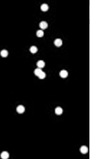

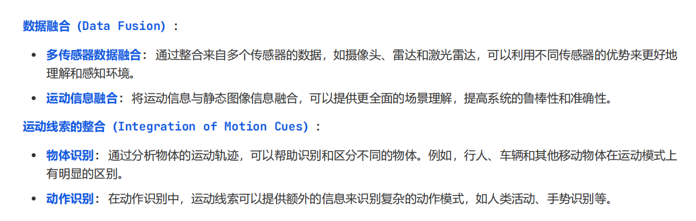

Discuss the use of texture gradients as a depth cue in
computer vision.How cantexture gradients be measured?
What prior assumptions are needed to
makecomputations about depth and shape possible?You
may find it helpful to referto the following texture
examples.

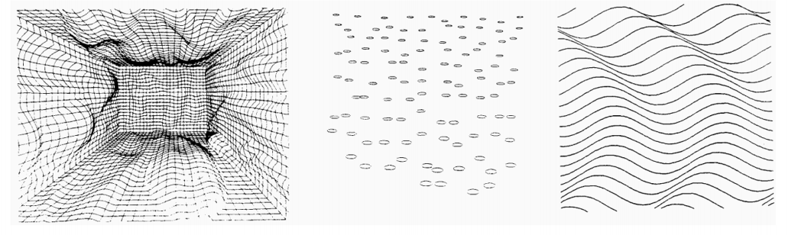

讨论纹理梯度在计算机视觉中作为深度线索的应用

1. 如何测量纹理梯度？

---

## Page 174

2. 需要哪些先验假设才能使深度和形状的计算成为可能？

纹理梯度的使用

纹理梯度是指图像中纹理密度和方向的变化。它们在计算机视觉中可以作为深度提示，因为物体表面

的纹理在三维空间中的变化会随着深度变化而发生变化。

纹理梯度的测量

纹理梯度可以通过以下几种方法测量：

1. 密度梯度：

- 通过计算图像中单位面积内纹理元素（如点、线、波纹）的数量变化来测量。

- 例如，在左侧图中，纹理元素的密度随着深度变化而变化，从而提供了深度信息。

2. 大小梯度：

- 测量纹理元素的大小变化。远处的纹理元素看起来比近处的小。

- 在中间图中，可以看到纹理元素（椭圆）的大小随着深度增加而减小。

3. 方向梯度：

- 测量纹理方向的变化。纹理方向可能会随着表面曲率的变化而改变。

- 在右侧图中，波纹的方向随着表面形状的变化而变化。

Describe two specific applications in which computer
vision/image processing techniques have been used
successfully. Specify in some detail (10 points worth) the
techniques used in each case.

描述计算机视觉/图像处理技术成功应用的两个具体案例。针对每个案例，详细说明所使用的技术

自动驾驶汽车: 使用物体检测和分割等技术来识别和分类道路上的物体，如其他车辆、行人和交通标

志。卷积神经网络（CNN）和深度学习方法对实时决策至关重要。

医学影像: 使用图像分割和分类等技术从医学扫描中识别和诊断疾病。例如，使用深度学习和机器学习

算法在MRI扫描中检测肿瘤，提高了诊断的准确性和速度。

Give two specific computer vision problems in which
active research is being pursued and describe in some
detail the principal difficulties.

列举两个当前活跃研究的计算机视觉问题并详细描述其主要难点

---

## Page 175

实时物体跟踪：挑战包括处理遮挡、光照变化和快速运动。卡尔曼滤波器和基于深度学习的跟踪器等

技术正在研究中，以提高鲁棒性。

3D场景重建：困难在于处理遮挡、视角变化和计算复杂性。运动结构（SfM）和多视角立体技术正在

开发中，以从2D图像创建精确的3D模型。

Define radiance (L) and irradiance (I).

- 辐射度 (L)：通过或从特定区域发出并落在给定立体角内的光量。单位是瓦特每平方米每球面度

（W·sr⁻¹·m⁻²）。

- 辐照度 (I)： 照射到单位面积表面的光量。单位是瓦特每平方米（W·m⁻²）。

Give two processes that produce "noise" in digital images
obtained from real detectors, and describe methods for
dealing with the effects in each case.

列举真实探测器获取的数字图像中产生"噪声"的两种物理过程，并分别描述对应的处理方法。

光子散粒噪声： 由于光子到达传感器的随机性产生。高斯平滑等方法可以帮助减少这种噪声。

热噪声： 由传感器电子设备产生。暗帧减法和冷却传感器等技术可以减轻其影响。

What is the Convolution Theorem? What are some of its
practical ramifications for image processing?

什么是卷积定理？它在图像处理中有哪些实际影响？

卷积定理： 它表明两个函数卷积的傅里叶变换是它们傅里叶变换的逐点乘积。这使得使用快速傅里叶

变换（FFT）进行卷积计算变得高效，对图像处理中的滤波操作特别有用。

What is a thinning algorithm? Where are they useful?
Describe briefly one example of a thinning algorithm.

什么是细化算法？它们的应用场景有哪些？简要描述一个细化算法的例子。

细化算法：将二值对象简化为骨架形式的过程。用于字符识别等应用。一个例子是Zhang-Suen细化算

法，它通过迭代地从边缘删除像素，同时保持连通性。

---

## Page 176

Apply the indicated filter (e.g. a sobel mask) to the image
shown below. What mathematical operation does the
filter approximate? In qualitative terms, what is the effect
of applying the filter to an image?

对下图应用指定的滤波器(如Sobel算子)。该滤波器近似什么数学运算？定性描述该滤波器对图像的效

果。

- Sobel滤波操作：近似图像强度函数的梯度。效果是突出边缘和强度的过渡，使物体的边界更加明

显。

Compare 1st and 2nd derivative methods of local edge
detection. What are the advantages and disadvantages of
each?

比较局部边缘检测的一阶和二阶导数方法。各自的优缺点是什么？

- 一阶导数方法：通过识别快速强度变化来检测边缘。对噪声不太敏感，但可能会错过更细的细节。

- 二阶导数方法： 通过在二阶导数中找到零交叉点来检测边缘。它们提供更精确的边缘定位，但对噪

声更敏感。

Give a specific application for high-pass filtering in image
processing. Give one for low-pass filtering.

列举图像处理中高通滤波和低通滤波的具体应用各一例。

- 高通滤波： 用于边缘检测以增强物体的边缘。

- 低通滤波：用于图像平滑以减少噪声和细节，例如图像模糊。

Give two methods of smoothing image data and compare
their performance.

给出两种图像平滑方法并比较它们的性能。

- 高斯平滑： 应用高斯核来减少噪声。它更好地保留了边缘，但可能会模糊细节。

- 中值滤波：用邻域内的中值替换每个像素。它有效去除椒盐噪声，但可能会扭曲边缘。

- 平均滤波： 简单快捷，但可能模糊边缘。

- 中值滤波： 在去除噪声的同时保留边缘，但计算量较大。

- 适用情况：平滑操作用于减少噪声和改善图像视觉质量。

---

## Page 177

Briefly describe the following structures in the eye and
their functional significance.

简要描述眼睛的以下结构及其功能意义。

- 晶状体： 将光聚焦在视网膜上。通过调整形状来改变眼睛的焦距。

- 角膜： 透明的外层，帮助将光聚焦在视网膜上。

- 虹膜： 控制瞳孔的大小，从而控制进入眼睛的光量。

- 视网膜： 包含光感受细胞，检测光并将信号发送到大脑。

- 中央凹： 视网膜的中心部分，具有最高密度的视锥细胞，负责清晰的视觉。

- 视杆细胞： 对低光照敏感，负责夜间视力。

- 视锥细胞： 对颜色和高光照敏感，负责颜色视觉。

- 神经节细胞： 将视觉信息从视网膜传送到大脑的神经元。

- 视神经： 将视觉信息从视网膜传送到大脑。

- 盲点： 视神经离开视网膜的区域，缺乏光感受细胞。

What is meant by the receptive field of a neuron? What is the significance of
the concept?

什么是神经元的感受野？这个概念有什么意义？

- 感受野： 神经元响应的视觉区域。它的重要性在于帮助理解视觉信息在大脑中的处理和整合。

Comment in detail on evidence/arguments for and against, the statement
"the visual cortex of the brain contains edge detectors". Is the statement
meaningful? Why or why not?

详细评论支持和反对"大脑视觉皮层包含边缘检测器"这一说法的证据/论点。这个说法有意义吗？为什

么？

- 支持： Hubel和Wiesel的实验显示大脑视觉皮层中的神经元对特定边缘方向有反应，表明存在边缘

检测器。

- 反对： 视觉皮层处理复杂信息，不仅仅是边缘，表明边缘检测是更广泛过程的一部分。该说法有意

义，因为它强调了视觉处理的一个方面。

Describe briefly what the experiments of Hubel and Weisel showed about
information processing in the cat visual cortex.

- 实验： 显示猫的视觉皮层中的特定神经元对特定方向和运动的边缘有反应，表明视觉信息以分层方

式处理。

---

## Page 178

Describe how gray level histograms can be used for image segmentation.

- 灰度直方图： 分析像素强度分布，以确定分隔图像不同区域的阈值。

Describe in detail how color histograms can be used in an attempt to
segment "same-colored" objects in real color images. What problems
arise? what are some ways of dealing with them?

- 颜色直方图： 表示图像中颜色的分布，以识别颜色相似的区域。问题包括光照变化和颜色差异。解

决方案包括归一化和聚类技术。

Describe how (pixel-wise) region-growing techniques might be used in an
attempt to segment homogeneous objects in gray-scale or color images.
What problems arise? what are some ways of dealing with them?

- 区域增长技术： 从种子点开始，通过添加具有相似属性的邻近像素来增长区域。问题包括对噪声和

初始种子选择的敏感性。解决方案包括自适应阈值和噪声减少。

Describe briefly how conditional statistics can be used for region
segmentation.

- 条件统计： 使用像素强度和纹理的统计量来分割区域。这些方法在处理复杂纹理和图案方面效果很

好。

Describe one of the following local search methods for finding boundaries.
When is the technique useful? What are its limitations?

- 边界调整： 用于细化检测到的边界。它有助于在存在噪声的情况下保持边界的准确性。限制在于它

需要一个初始的粗略边界。

---

## Page 179

COMP9517 期末复习3

Question: Which one of the following statements about
colour spaces is incorrect?

- A. The R, G, and B channels of the RGB colour space are often correlated.

- B. The H and the S channel of the HSV colour space are confounded.

- C. The Y channel of the YCbCr colour space represents the brightness.

- D. The a* channel of the L*a*b* colour space is the green-blue component.

问题: 以下关于颜色空间的陈述中哪一项是错误的？

- A. RGB 颜色空间的 R、G 和 B 通道通常是相关的。

- B. HSV 颜色空间的 H 和 S 通道是混杂的。

- C. YCbCr 颜色空间的 Y 通道表示亮度。

- D. Lab* 颜色空间的 a通道是绿蓝分量。

Question: Which one of the following statements about
intensity transformations is incorrect?

- A. Contrast stretching linearly maps intensities between two values to the full output range.

- B. Log transformation maps a narrow range of high intensities to a wider range of output values.

- C. Power transformation can map intensities similar to log and inverse log transformations.

- D. Piecewise linear transformations can achieve contrast stretching and intensity slicing.

问题: 以下关于强度变换的陈述中哪一项是错误的？

- A. 对比度拉伸将两个值之间的强度线性映射到完整的输出范围。

- B. 对数变换将高强度的窄范围映射到更广的输出值范围。

- C. 幂变换可以映射类似于对数和反对数变换的强度。

- D. 分段线性变换可以实现对比度拉伸和强度切片。

---

## Page 180

Question: What is the effect of the following 2D
convolution kernel on an image?

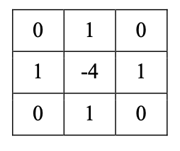

- A. It approximates the sum of first-order derivatives in 𝑥𝑥 and 𝑦𝑦.

- B. It approximates the sum of second-order derivatives in 𝑥𝑥 and 𝑦𝑦.

- C. It approximates the product of first-order derivatives in 𝑥𝑥 and 𝑦𝑦.

- D. It approximates the product of second-order derivatives in 𝑥𝑥 and 𝑦𝑦.

问题: 以下二维卷积核对图像有什么影响？

- A. 它近似于 xx 和 yy 方向的一阶导数之和。

- B. 它近似于 xx 和 yy 方向的二阶导数之和。

- C. 它近似于 xx 和 yy 方向的一阶导数之积。

- D. 它近似于 xx 和 yy 方向的二阶导数之积。

Question: Which one of the following statements on
image filtering is incorrect?

- A. Median filtering reduces noise in images.

- B. Low-pass filtering results in blurry images.

- C. High-pass filtering smooths fine details in images.

- D. Notch filtering removes specific image frequencies.

问题: 以下关于图像滤波的陈述中哪一项是错误的？

- A. 中值滤波可以减少图像中的噪声。

- B. 低通滤波会导致图像模糊。

- C. 高通滤波会平滑图像中的细节。

- D. 陷波滤波可以去除特定的图像频率。

---

## Page 181

Question: Which one of the following statements about
feature descriptors is incorrect?

- A. Haralick features are derived from gray-level co-occurrence matrices.

- B. SIFT achieves rotation invariance by computing gradient histograms at multiple scales.

- C. LBP describes local image texture and can be multiresolution and rotation-invariant.

- D. Colour moments have lower representation capability than the colour histogram.

问题: 以下关于特征描述符的陈述中哪一项是错误的？

- A. Haralick 特征是从灰度共生矩阵中提取的。

- B. SIFT 通过在多尺度上计算梯度直方图实现旋转不变性。

- C. LBP 描述局部图像纹理，可以是多分辨率和旋转不变的。

- D. 颜色矩的表征能力低于颜色直方图。

Question: Given the image below showing the result of a
segmentation of various objects and the

desired classification of these objects. The two different colours (red and green) indicate the two

different classes which the objects are to be assigned to.

A straightforward way to perform classification is by computing the value of a quantitative shape

measure for each object and then thresholding those values. Suppose we compute the

circularity

and the eccentricity. Which of these two measures can be used to produce the shown

classification?

---

## Page 182

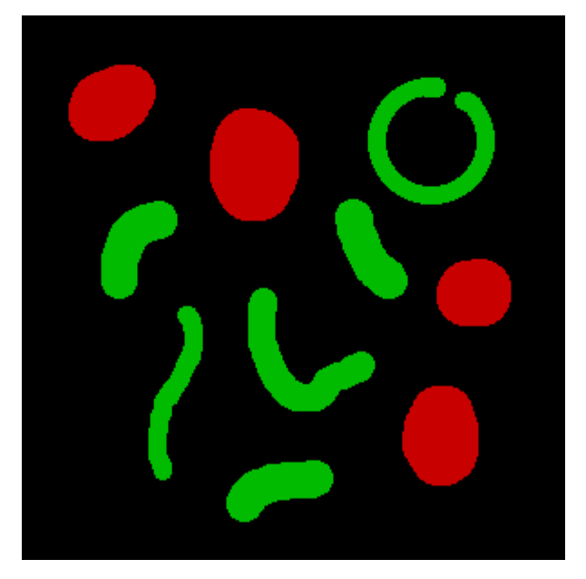

- A. Only circularity

- B. Only eccentricity

- C. Both circularity and eccentricity

- D. Neither circularity nor eccentricity

问题: 给定下图显示了多个对象的分割结果以及这些对象的期望分类。两种不同的颜色（红色和绿色）

表示对象需要被分配到的两个不同类别。

一种简单的分类方法是计算每个对象的定量形状度量值，然后对这些值进行阈值处理。假设我们计算

了圆形度和偏心率。这两种度量中哪一种可以用于实现图中所示的分类？

- A. 仅圆形度

- B. 仅偏心率

- C. 圆形度和偏心率

- D. 既不是圆形度也不是偏心率

Question: Which one of the following statements is
correct for random forest classifiers?

---

## Page 183

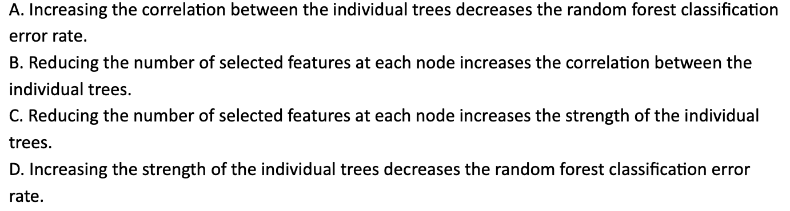

问题: 以下关于随机森林分类器的陈述中哪一项是正确的？

- A. 增加个体树之间的相关性会降低随机森林的分类错误率。

- B. 减少每个节点选择的特征数量会增加个体树之间的相关性。

- C. 减少每个节点选择的特征数量会增加个体树的强度。

- D. 增加个体树的强度会降低随机森林的分类错误率。

Question: Which one of the following statements is
correct for pattern recognition?

- A. Pattern recognition is defined as the process of model training on a training dataset and then

testing on an independent test set.

- B. The dimension of feature vectors should be smaller than the number of training samples in

order

to avoid the overfitting problem.

- C. The simple kNN classifier needs homogeneous feature types and scales so that the

classification

performance can be better.

- D. SVM is a powerful classifier that can separate classes even when the feature space exhibits

significant overlaps between classes.

问题: 以下关于模式识别的陈述中哪一项是正确的？

- A. 模式识别被定义为在训练数据集上训练模型，然后在独立的测试集上进行测试的过程。

- B. 特征向量的维度应小于训练样本的数量，以避免过拟合问题。

- C. 简单的 kNN 分类器需要同类型的特征和尺度，以提高分类性能。

- D. SVM 是一种强大的分类器，即使在特征空间中类别之间存在显著重叠时也能分离类别。

---

## Page 184

Question: Given the following binary image after
segmentation.

To automatically identify the objects (in white) in this image we can use the connected

components

labelling algorithm. How many separate objects will this algorithm find here if it uses 4-

connectivity?

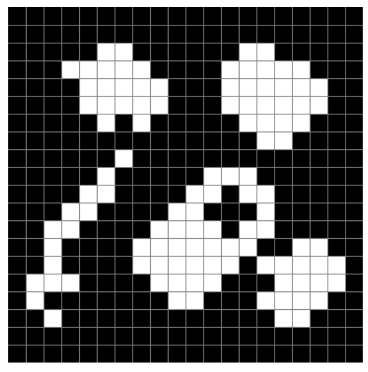

- A. 4

- B. 5

- C. 6

- D. 7

问题: 给定以下分割后的二值图像。

为了自动识别图像中的白色对象，我们可以使用连通域标记算法。如果使用 4-连通性，该算法会找到

多少个独立的对象？

Question: Given a binary input image 𝐼𝐼 to which we
apply the following algorithm:

Step 1: Create a copy 𝐶𝐶 of input image 𝐼𝐼.

Step 2: Copy the boundary pixels of 𝐶𝐶 into new image 𝐵𝐵.

Step 3: Compute the reconstruction 𝑅𝑅 of 𝐶𝐶 from 𝐵𝐵.

Step 4: Compute output 𝑂𝑂 by subtracting 𝑅𝑅 from 𝐼𝐼.What does the output image 𝑂𝑂 contain?

- A. The same objects as the input image whatever the input.

- B. The same objects as the input image but with holes filled.

---

## Page 185

- C. The same objects as the input image except the boundary objects.

- D. The same objects as the input image but with touching objects separated.

问题: 给定一个二值输入图像 I，我们对其应用以下算法：

步骤 1: 创建输入图像 I 的副本 C。

步骤 2: 将 C 的边界像素复制到新图像 B中。

步骤 3: 从 B 计算 C 的重建 R。

步骤 4: 通过从 I 中减去 R 计算输出 O。

输出图像 OO 包含什么？

- A. 无论输入是什么，输出图像与输入图像的对象相同。

- B. 输出图像与输入图像的对象相同，但孔洞被填充。

- C. 输出图像与输入图像的对象相同，但边界对象被去除。

- D. 输出图像与输入图像的对象相同，但接触的对象被分离。

Question: Which one of the following lines describes the
purpose of convolutional layers in CNNs?

- A. Reducing the size of the feature maps.

- B. Calculating the dot product of the input and kernels.

- C. Applying a nonlinear activation function.

- D. Making the network learn faster.

问题: 以下哪一项描述了 CNN 中卷积层的作用？

- A. 减小特征图的尺寸。

- B. 计算输入和核的点积。

- C. 应用非线性激活函数。

- D. 使网络学习更快。

Question: Which one of the following lines describes the
purpose of transfer learning?

- A. Training a model from scratch for each new task.

- B. Using a pretrained model and fine-tuning it for a new task.

---

## Page 186

- C. Converting image data to text data to facilitate learning.

- D. Combining multiple models into a single model for better performance.

问题: 以下哪一项描述了迁移学习的目的？

- A. 为每个新任务从头开始训练模型。

- B. 使用预训练模型并针对新任务进行微调。

- C. 将图像数据转换为文本数据以促进学习。

- D. 将多个模型组合成一个模型以提高性能。

Question: Which one of the following lines best describes
the key benefit of CNNs over traditional

ANNs for image classification?

- A. CNNs are computationally less expensive.

- B. CNNs automatically learn hierarchical features.

- C. CNNs require fewer network layers.

- D. CNNs can learn nonlinear mappings.

问题: 以下哪一项最能描述 CNN 在图像分类中优于传统 ANN 的关键优势？

- A. CNN 的计算成本更低。

- B. CNN 自动学习层次化特征。

- C. CNN 需要更少的网络层。

- D. CNN 可以学习非线性映射。

Question: Which one of the following networks is most
suited for image segmentation tasks?

- A. Multilayer perceptron (MLP)

- B. Fully convolutional network (FCN)

- C. Region proposal network (RPN)

- D. Recurrent neural network (RNN)

问题: 以下哪种网络最适合图像分割任务？

- A. 多层感知机 (MLP)

---

## Page 187

- B. 全卷积网络 (FCN)

- C. 区域提议网络 (RPN)

- D. 循环神经网络 (RNN)

Question: Which one of the following statements about
motion analysis is incorrect?

- A. Detection of moving objects by subtraction of successive images in a video works best if the

background is constant.

- B. Sparse motion estimation in a video can be done by template matching and minimising the

mutual

information measure.

- C. Dense motion estimation using optical flow assumes that each small neighbourhood remains

constant over time.

- D. Optical flow provides an equation for each pixel but requires further constraints to solve the

equation uniquely.

问题: 以下关于运动分析的陈述中哪一项是错误的？

- A. 通过视频中连续图像的减法检测运动物体在背景恒定时效果最好。

- B. 视频中的稀疏运动估计可以通过模板匹配和最小化互信息度量来实现。

- C. 使用光流进行密集运动估计时，假设每个小邻域随时间保持不变。

- D. 光流为每个像素提供一个方程，但需要额外的约束才能唯一求解。

Question: Which one of the following statements about
object tracking is incorrect?

- A. The particle filtering method assumes that the dynamics model and the measurement model

can

be parameterized.

- B. The hidden Markov model assumes that the measurements depend only on the current state

of

the objects.

---

## Page 188

- C. The prediction step of Bayesian inference assumes that the current state of the objects

depends

only on the previous state.

- D. The Kalman filtering method assumes that the dynamics and measurement noise are additive

Gaussian.

问题: 以下关于目标跟踪的陈述中哪一项是错误的？

- A. 粒子滤波方法假设动态模型和测量模型可以被参数化。

- B. 隐马尔可夫模型假设测量仅依赖于对象的当前状态。

- C. 贝叶斯推理的预测步骤假设对象的当前状态仅依赖于前一状态。

- D. 卡尔曼滤波方法假设动态和测量噪声是加性高斯噪声。

Question: In many image processing operations, the
image must be expanded a little bit to solve the

boundary problem. Which one of the following types of expansion is implicitly used by the

Fourier

transform?

- A. Padding

- B. Clamping

- C. Wrapping

- D. Mirroring

问题: 在许多图像处理操作中，图像需要稍微扩展以解决边界问题。以下哪种扩展类型被傅里叶变换隐

式使用？

- A. 填充

- B. 钳位

- C. 环绕

- D. 镜像

Question: Which one of the following equations
concerning convolution (∗) of two images (𝑓and 𝑔)

---

## Page 189

问题: 以下关于两幅图像 (ff 和 gg) 卷积 (*) 的方程中哪一个是正确的？B

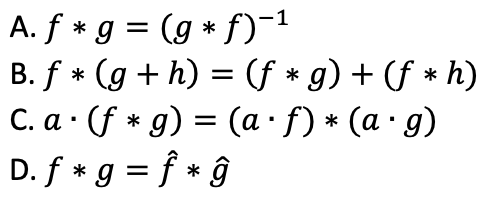

卷积运算满足分配律：f * (g + h) = (f * g) + (f * h)。这是卷积的基本数学性质，在线性系统理论中非常

重要。

Question: Suppose we have the following grayscale input image 𝐼𝐼 (shown on the left) and we

would

like to have a binary output image 𝑂𝑂 (as shown on the right) containing the edges of the

objects in

the input. Also suppose that the only image processing operations available for this are

intensitythresholding, dilation and erosion (binary and grayscale), and image subtraction.

Which one of the

following algorithms will not produce the desired output?

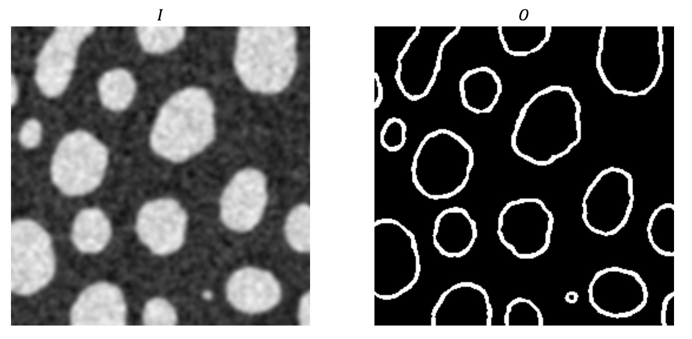

- A. Thresholding (result = 𝑇), then erosion (result = 𝐸), then subtraction (result = 𝐸 − 𝑇).

- B. Erosion (result = 𝐸), then subtraction (result = 𝐼 − 𝐸), then thresholding (result = 𝑇).

- C. Thresholding (result = 𝑇), then dilation (result = 𝐷), then subtraction (result = 𝐷 − 𝑇).

---

## Page 190

- D. Dilation (result = 𝐷), then subtraction (result = 𝐷 − 𝐼), then thresholding (result = 𝑇).

问题: 假设我们有一幅灰度输入图像 II（左侧显示），我们希望得到一幅二值输出图像 OO（右侧显

示），其中包含输入图像中对象的边缘。假设唯一可用的图像处理操作是强度阈值化、膨胀和腐蚀

（二值和灰度）以及图像减法。以下哪种算法无法产生所需的输出？

- A. 阈值化（结果为 T），然后腐蚀（结果为 E），然后减法（结果为 E − T）。

- B. 腐蚀（结果为 E），然后减法（结果为 I − E），然后阈值化（结果为 T）。

- C. 阈值化（结果为 T），然后膨胀（结果为 D），然后减法（结果为 D − T）。

- D. 膨胀（结果为 D），然后减法（结果为 D − I），然后阈值化（结果为 T）。

Question: Given the image below containing about two
dozen algae (the bright spots) which we

would like to segment using an automatic thresholding method. Which one of the following

automatic thresholding methods will give the best segmentation result here?

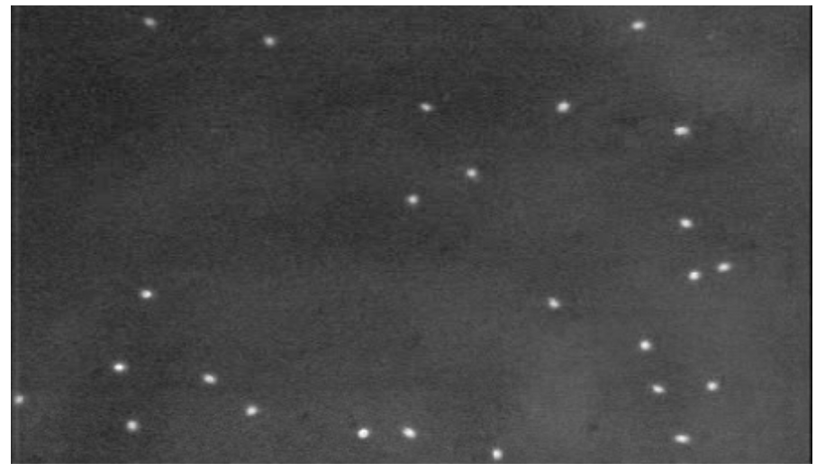

- A. Mean thresholding

- B. IsoData thresholding 灰度图双峰分布

- C. Otsu thresholding

- D. Triangle thresholding

问题: 给定下图包含约二十多个藻类（亮点），我们希望使用自动阈值化方法进行分割。以下哪种自动

阈值化方法会在此处给出最佳分割结果？

- A. 均值阈值化

---

## Page 191

- B. IsoData 阈值化

- C. 大津阈值化

- D. 三角阈值化

Question: Which one of the following statements about
data augmentation for image classification

using CNNs is correct?

- A. Augmentation increases the number of parameters in the model.

- B. Augmentation reduces the size of the dataset to speed up training.

- C. Augmentation generates new training data by transforming the existing data.

- D. Augmentation reduces the depth of the network for better performance.

问题: 以下关于使用 CNN 进行图像分类的数据增强的陈述中哪一项是正确的？

- A. 数据增强增加了模型中的参数数量。

- B. 数据增强减少了数据集的大小以加速训练。

- C. 数据增强通过对现有数据进行变换生成新的训练数据。

- D. 数据增强减少了网络的深度以提高性能。

Question: Which one of the following statements about
image segmentation methods is incorrect?

- A. Thresholding based on pixel intensity yields poor results if the regions to be segmented have

overlapping intensity distributions.

- B. Level-set segmentation uses an object boundary representation that makes it hard to deal

with

topological changes.

- C. Region splitting techniques aim to optimize some metric of intra-region similarity and inter-

region

dissimilarity.

- D. Watershed segmentation often results in over-segmentation because image regions may

contain

---

## Page 192

multiple local minima.

问题: 以下关于图像分割方法的陈述中哪一项是错误的？

- A. 如果待分割区域的强度分布重叠，基于像素强度的阈值化会得到较差的结果。

- B. 水平集分割使用一种对象边界表示，使得难以处理拓扑变化。

- C. 区域分裂技术旨在优化区域内相似性和区域间差异性的某种度量。

- D. 分水岭分割通常会导致过分割，因为图像区域可能包含多个局部最小值。

Question: Suppose we have a 2D image that is very noisy
and we want to smooth it by filtering with a

uniform kernel of size 5 × 5 voxels. Let 𝑆𝑆 be the total number of floating-point operations

required

per pixel to perform the operation when using a dimensionally separated implementation of the

filter. And let 𝑁𝑁 be the total number of floating-point operations required per pixel to perform

the

operation when using a dimensionally nonseparated implementation of the filter.

What is the ratio 𝑆/𝑁(as a percentage rounded to one decimal)?

- A. 36.7%

- B. 40.0%

- C. 58.8%

- D. 66.7%

问题: 假设我们有一幅噪声很大的二维图像，我们希望通过使用大小为 5×5 体素的均匀核进行滤波来

平滑它。设 S 为使用维度分离滤波器实现时每个像素所需的浮点操作总数，N为使用非维度分离滤波器

实现时每个像素所需的浮点操作总数。

比率 S/N（四舍五入到小数点后一位的百分比）是多少

非分离滤波 25次乘和24次加

分离式 xy方向上各自5次乘和四次加 一共18次

Question: Given the following 2D convolution kernel:

---

## Page 193

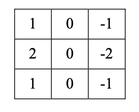

Which one of the following correctly describes the effect of this kernel when applied to an

image?

以下哪一项正确描述了该核应用于图像时的效果？

- A. 在 x 方向平滑，在 y 方向一阶微分。

- B. 在 x 方向平滑，在 y 方向二阶微分。

- C. 在 x 方向一阶微分，在 y 方向平滑。

- D. 在 x 方向二阶微分，在 y 方向平滑。

Question: Given the following input image 𝐼𝐼 (on the left)
and output image 𝑂𝑂 (on the right):

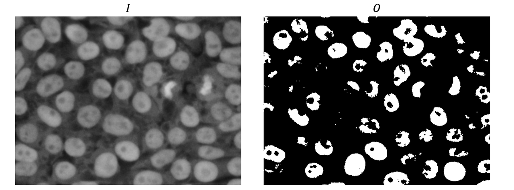

图像 OO 是通过使用点操作处理图像 II 得到的结果。以下哪种映射函数（红色曲线）被点操作用于将 II

中的强度映射到 OO 中的强度？作为参考，每个图形中显示了图像 II 的直方图（蓝色）。 B

---

## Page 194

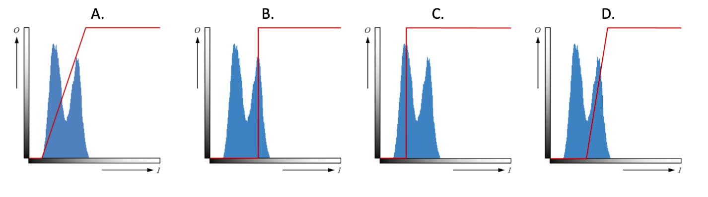
